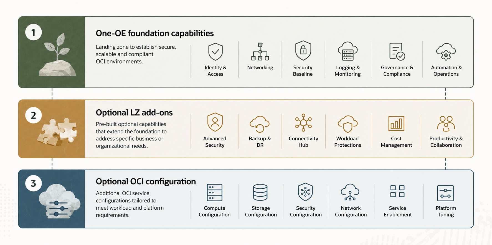

# ENS Guidance for the OCI Operating Entities Landing Zone

## 1. Overview and compliance boundary

Oracle Cloud Infrastructure (OCI) provides security and governance capabilities that can support the design of systems subject to Spain’s [Esquema Nacional de Seguridad (ENS)](https://ens.ccn.cni.es/es/).

Under [Royal Decree 311/2022](https://www.boe.es/buscar/act.php?id=BOE-A-2022-7191), ENS categorises information systems as **Basic**, **Medium**, or **High**. It also applies to private-sector systems that support public-sector functions where applicable law and contractual arrangements require it.

Compliance with ENS is assessed for the complete system, not for a blueprint or OCI tenancy. The assessment considers the system scope and category, risk analysis, applicable measures and reinforcements, OCI services and regions, workload configuration, operations, evidence, and audit results. [CCN-STIC 808](https://www.ccn-cert.cni.es/es/series-ccn-stic/800-guia-esquema-nacional-de-seguridad/518-ccn-stic-808-verificacion-del-cumplimiento-de-las-medidas-en-el-ens/file?format=html) provides verification guidance and evidence examples for applicable ENS measures; it supports audit preparation but does not by itself demonstrate ENS compliance.

[OCI Operating Entities Landing Zone](https://github.com/oci-landing-zones/oci-landing-zone-operating-entities) provides blueprints for organisations operating on OCI. This guidance covers the [One-OE blueprint](https://github.com/oci-landing-zones/oci-landing-zone-operating-entities/tree/master/blueprints/one-oe): a configurable security and governance foundation for one operating entity in a single OCI tenancy, including IAM, network segmentation, logging, monitoring, and security services.

[One-OE](https://github.com/oci-landing-zones/oci-landing-zone-operating-entities/tree/master/blueprints/one-oe) can help design an ENS High-category system, but it does not establish ENS compliance or certification for Oracle, OCI services, a tenancy, a workload, or the blueprint.

## 2. Customer responsibilities

The One-OE Landing Zone provides a security-oriented OCI foundation. The customer remains responsible for defining, securing, operating, and demonstrating the effectiveness of the complete system within ENS scope.

Customer and workload responsibilities fall into six areas:

- **Governance and risk:** define the system boundary and category; assign responsibilities; maintain the security policy, risk analysis, residual-risk acceptance, and Statement of Applicability.
- **Identity and access:** operate access lifecycle, MFA, privileged access, and periodic access reviews.
- **Workload protection:** implement and operate workload security, encryption, certificates and keys, secure development, patching, vulnerability remediation, and data protection.
- **Operations and evidence:** select, deploy, and verify One-OE and workload controls; operate logging, monitoring, incident response, exceptions, and evidence collection.
- **Continuity:** establish, test, and evidence backups, recovery, continuity, failover, capacity, and recovery objectives.
- **Suppliers and assurance:** manage supplier and outsourced-service requirements, contractual commitments, supply-chain controls, audits, certification, and applicable publication duties.

The customer must retain evidence. Basic-category systems require a documented self-assessment at least every two years and after substantial changes. Medium- and High-category systems require an audit for certification at least every two years, and an extraordinary audit after substantial changes that may affect the required security measures. [Royal Decree 311/2022, Articles 31 and 38](https://www.boe.es/buscar/act.php?id=BOE-A-2022-7191)

## 3. What the Operating Entities Landing Zone provides

[OCI Operating Entities Landing Zone](https://github.com/oci-landing-zones/oci-landing-zone-operating-entities) provides configurable OCI blueprints. This guidance focuses on [One-OE](https://github.com/oci-landing-zones/oci-landing-zone-operating-entities/tree/master/blueprints/one-oe), which can provide a technical starting point for a system in ENS scope. Extend it as needed with [OCI Landing Zone add-ons](https://github.com/oci-landing-zones/oci-landing-zone-operating-entities/tree/master/addons) and optional OCI configurations to address customer-specific requirements and remaining compliance or architectural gaps.

  

|  [One-OE foundation capabilities](https://github.com/oci-landing-zones/oci-landing-zone-operating-entities/tree/master/blueprints/one-oe) |  Optional LZ add-ons |  Optional OCI configuration |
| --- | --- | --- |
| • Tenancy and compartment structure. • IAM groups, policies, and segregation of administrative roles. • VCN topology, routing, security lists/NSGs, and private connectivity. • Cloud Guard targets and detector/responder recipes, where configured. • Security Zones for preventive guardrails in designated compartments. • Logging, Audit integration, flow logs, Connector Hub, events, notifications, and monitoring integration. • Vault and a software key for the audit-log bucket in the CIS Level 2 configuration; customer-managed-key adoption by other services requires additional configuration. • Vulnerability Scanning Service (VSS), including targets and scan recipes. • Architecture integration points for firewall, SIEM, and connectivity extensions. • Resource tagging, inventory support, and IAM permissions for budget management. | • [DNS controls](https://github.com/oci-landing-zones/oci-landing-zone-operating-entities/tree/master/addons/oci-private-dns). • [Tag-Based Access Control (TBAC)](https://github.com/oci-landing-zones/oci-landing-zone-operating-entities/tree/master/addons/oci-tbac) for scalable, role-based IAM policies assigned through OCI tags. • [Network Hub Models](https://github.com/oci-landing-zones/oci-landing-zone-operating-entities/tree/master/addons/oci-hub-models) for OCI Network Firewall and third-party firewall options. • [X-RPC](https://github.com/oci-landing-zones/oci-landing-zone-operating-entities/tree/master/addons/oci-x-rpc) for optional cross-region and cross-tenancy network connectivity. | • Bastion. • Identity federation and MFA, where selected. • WAF, DDoS protection, and other workload-edge services: OCI capabilities configured and operated outside the One-OE blueprint. The blueprint can provide network architecture integration points, but does not provision or operate those services. • Central log export to a customer SIEM. • Multi-AD/region workload resilience, backups, replication, and failover. |

> [!NOTE]
> The listed capabilities are not necessarily enabled by default; they must be selected, configured, deployed, and verified where applicable.

### 3.1 ENS High-category contribution overview

The One-OE blueprint contributes to 21 of the 73 measures in Annex II of [Royal Decree 311/2022](https://www.boe.es/buscar/act.php?id=BOE-A-2022-7191). This assessment identifies no direct One-OE contribution to the remaining 52 measures.

Contributes describes the technical contribution of the reviewed One-OE blueprint configuration; it does not show that an ENS measure or its reinforcements are complete.

**Examples of measures to which One-OE contributes:**

- `op.acc.3` — segregation of duties through administrative IAM groups and compartment-scoped policies.
- `op.exp.2` — selected secure configuration through IAM policies, network security rules, and Security Zones.
- `mp.com.1` — network perimeter foundation through VCNs, subnets, route tables, and NSGs/security lists.
- `mp.com.4` — network-flow separation foundation through VCN segmentation, route tables, and NSGs/security lists.

See the [complete One-OE contribution traceability](./traceability/README.md) for the measure-level mapping and customer evidence.

## 4. References

1. [OCI Security Guide](https://docs.oracle.com/en-us/iaas/Content/Security/Concepts/security.htm)
2. [Royal Decree 311/2022 — Esquema Nacional de Seguridad (consolidated text)](https://www.boe.es/buscar/act.php?id=BOE-A-2022-7191)
3. [CCN-STIC 808 — ENS compliance verification](https://www.ccn-cert.cni.es/es/series-ccn-stic/800-guia-esquema-nacional-de-seguridad/518-ccn-stic-808-verificacion-del-cumplimiento-de-las-medidas-en-el-ens/file?format=html)
4. [OCI Operating Entities Landing Zone repository](https://github.com/oci-landing-zones/oci-landing-zone-operating-entities)
5. [One-OE blueprint](https://github.com/oci-landing-zones/oci-landing-zone-operating-entities/tree/master/blueprints/one-oe)
6. [OCI Landing Zone add-ons](https://github.com/oci-landing-zones/oci-landing-zone-operating-entities/tree/master/addons)
7. [Oracle Cloud Infrastructure documentation](https://docs.oracle.com/en-us/iaas/Content/home.htm)

## License

Copyright (c) 2026 Oracle and/or its affiliates.

Licensed under the Universal Permissive License (UPL), Version 1.0.
