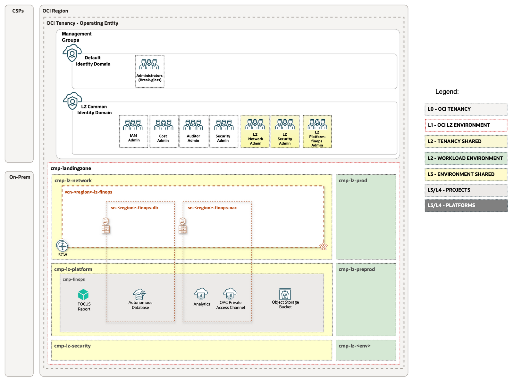

# **[OCI FinOps Solution](#)**
## **An OCI Open LZ [Addon](#) that enables cost governance, visibility, and optimization through the FinOps solution**
&nbsp;

**Table of Contents**  
[1. Overview](#1-overview) 
[2. OCI FinOps Addon Architecture](#2-oci-finops-addon-architecture) 
[3. Resources](#3-resources) 
[4. FinOps Tagging Strategy](#4-finops-tagging-strategy) 
[5. Deployment Guide](#5-deployment-guide) 
[6. Summary](#6-summary) 

&nbsp;

### 1. Overview

The **OCI FinOps Solution** is an addon to the OCI Landing Zones Framework. It enhances cost governance and financial visibility for Operating Entities by integrating **OCI FOCUS reports** directly with an **Autonomous Database and Oracle Analytics Cloud (OAC) dashboards** for insightful cost analysis.

The solution describes the end-to-end workflow by securely fetching FOCUS reports into an Autonomous Database and presenting them through **Oracle Analytics Cloud (OAC)** dashboards to view expenditure, analyze cost allocation, and support FinOps decisions.

> **What is FinOps?**  
> FinOps is an operational framework and cultural practice which maximizes the business value of cloud and technology, enables timely data-driven decision making, and creates financial accountability through collaboration between engineering, finance, and business teams.

> **Why another solution?**  
> While OCI provides native Cost Analysis, this addon supports scenarios such as **multi‑cloud cost aggregation**, **external stakeholder access**, **custom reporting**, and **long‑term cost data retention** for compliance and historical analysis.

&nbsp;

### 2. OCI FinOps Addon Architecture

### 3. Resources

| **Resource**              | **Description** |
|---------------------------|------------------|
| **IAM Groups**            | Separate database and OAC administration groups, with service permissions in the FinOps platform compartment and network dependencies in shared networking. |
| **IAM Policies**          | Includes user policies to manage the FinOps platform and **resource principal** permissions that allow ADB to fetch FOCUS reports, all in a controlled and auditable way. |
| **Autonomous Database (ADB)** | Central data store for the FinOps platform. Provisioned with a **private endpoint** inside the VCN, it directly ingests FOCUS reports and powers the visualization layer. |
| **Oracle Analytics Cloud (OAC)** | Presents dashboards and reports on top of ADB for cost visibility, allocation, and analysis. A private access channel connects OAC to the private ADB endpoint. |
| **VCN & Subnets**         | A dedicated **Virtual Cloud Network** with private subnets for ADB and OAC connectivity, integrated with the One-OE network topology. Network security groups control access to the FinOps endpoints. |
| **Tags**                  | A dedicated **`tgns-finops`** defined-tag namespace: **BusinessUnit** identifies the business owner, **CostCentre** the financial allocation code, **Owner** the responsible owner's email, **platform** the service or workload, **environment** the environment, and **Projects** the project name. |
| **Object Storage Bucket (Optional)** | Collects FOCUS reports exported from other cloud providers for ingestion into the FinOps database. Provider exports and ingestion mappings must be configured for the selected FOCUS versions. |

&nbsp;

### 4. FinOps Tagging Strategy

The FinOps tagging strategy complements the One-OE compartment hierarchy with consistent financial ownership and cost-allocation metadata. The **`tgns-finops`** namespace uses controlled lists for **BusinessUnit**, **CostCentre**, **platform**, and **environment**, with manually entered **Owner** email addresses and **Projects** names. The **environment** tag is optional where the compartment hierarchy already provides the environment context.

<!-- Add the tagging view after review. -->

&nbsp;

### 5. Deployment Guide

To get started with the OCI FinOps addon, it is recommended to start with an Oracle recommended Foundational Landing Zone such as a [CIS landing zone](https://github.com/oci-landing-zones/oci-cis-landingzone-quickstart), [OCI Core Landing Zone](https://github.com/oci-landing-zones/terraform-oci-core-landingzone) or [OCI Operating Entities Landing Zone](https://github.com/oci-landing-zones/oci-landing-zone-operating-entities/tree/master/blueprints/).  

**Follow the step-by-step instructions** in the [FinOps setup guide](finops-setup/README.md) to deploy the FinOps solution on top of **One-OE Landing Zone**.

&nbsp;

### 6. Summary

This addon enhances the [OCI One-OE Landing Zone](https://github.com/oci-landing-zones/oci-landing-zone-operating-entities/tree/master/blueprints/one-oe/runtime/one-stack) with a streamlined FinOps platform that delivers cost governance, financial visibility, and analysis capabilities. It automates the secure ingestion of FOCUS reports directly into an Autonomous Database using resource principal. **Oracle Analytics Cloud (OAC)** provides dashboards and reports to visualize and analyze the data, while a dedicated FinOps tagging strategy supports consistent ownership and cost allocation. Separate database and OAC administration roles support controlled access to the platform. The solution provides centralized cost insights without requiring dashboard users to access the OCI Console, enabling broader reporting flexibility and operational transparency across cloud environments.

&nbsp;

#### License
Copyright (c) 2026 Oracle and/or its affiliates.

Licensed under the Universal Permissive License (UPL), Version 1.0.

See [LICENSE](/LICENSE.txt) for more details.
