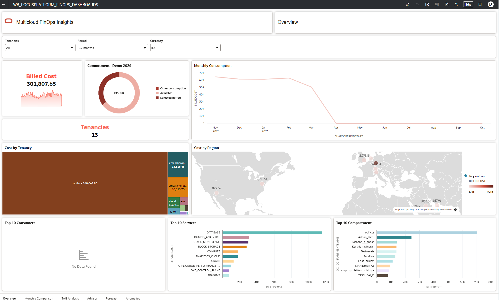
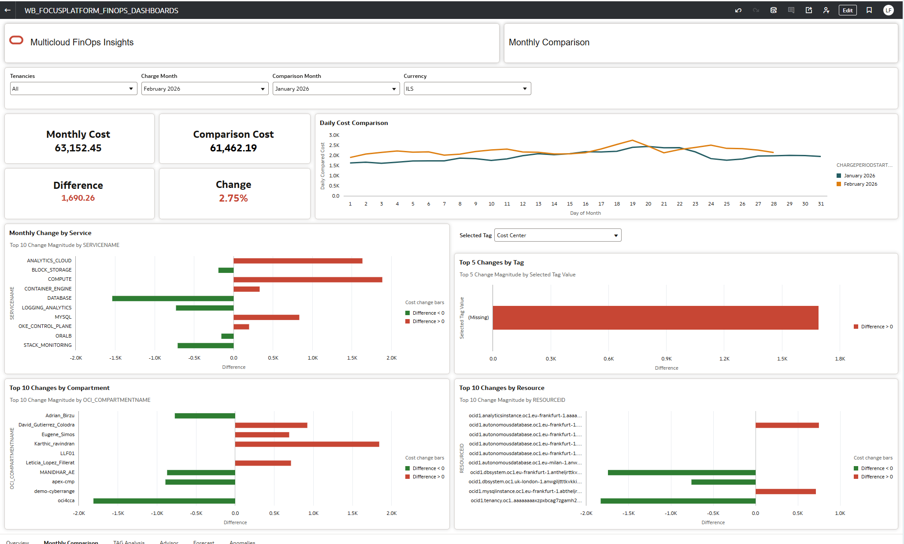
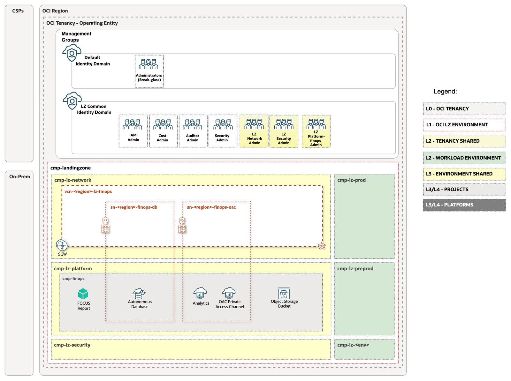

# OCI FinOps Add-on

**Contents**

- [Overview](#overview)
- [Architecture](#architecture)
  - [Workloads and Landing Zone integration](#workloads-and-landing-zone-integration)
  - [Inside the database](#inside-the-database)
- [FinOps Tagging](#finops-tagging)
- [Installation](#installation)
- [Maintenance backlog](#maintenance-backlog)
- [License](#license)

## Overview

The OCI FinOps Add-on extends the OCI Operating Entities Landing Zone. It provides cost visibility, financial allocation and optimization insights by bringing FOCUS reports into Oracle Autonomous Database (ADB) and presenting them through Oracle Analytics Cloud (OAC).

The solution runs in an OCI **parent tenancy**. The current implementation is **V2**, with OCI as the provider implemented today; the modular architecture allows additional providers to be introduced.

*Example of the OAC Overview dashboard.*

*Example of the OAC Monthly Comparison dashboard.*

**What is FinOps?** FinOps brings financial accountability to cloud usage through collaboration between engineering, finance and business teams, helping organizations make informed decisions about cost and value.

**Why this solution?** Cloud providers offer separate cost-management tools, making a consolidated view across clouds difficult. This solution uses FOCUS as a common data model and a modular architecture designed to bring cost and usage from multiple providers into one reporting environment, with consistent cost allocation and analysis. OCI is the first implemented provider.

## Architecture

### Workloads and Landing Zone integration

The FinOps workload integrates a private ADB and OAC reporting with the existing One-OE hub and shared services. Its dedicated VCN connects to the hub, with private subnets and network security groups separating database, OAC connectivity and infrastructure access.

OAC is a separate presentation service. Its private access channel connects to the private ADB endpoint; dashboard access is controlled separately through OAC endpoint configuration and application roles. The solution uses One-OE's existing identity domain and governance tags, and connects its dedicated FinOps VCN to the Landing Zone hub.

| **Resource** | **Description** |
| --- | --- |
| **FinOps compartment** | Dedicated compartment for the FinOps database and platform services. |
| **IAM Groups** | Separate database and OAC administration groups, with service permissions in the FinOps compartment and network dependencies in shared networking. |
| **IAM Policies and ADB Dynamic Group** | Provide administrator access to the platform and resource-principal permissions for ADB to read FOCUS reports, query module APIs and publish operational notifications. See the [IAM policy reference](installation-guide/infrastructure/iam-policies.md) for grants and scope. |
| **Autonomous Database (ADB)** | Central data store for the FinOps platform. Its private endpoint is inside the FinOps VCN; native database pipelines ingest FOCUS reports, while database modules prepare the reporting data. |
| **Oracle Analytics Cloud (OAC)** | Presents dashboards and reports for cost visibility, allocation and analysis. A private access channel connects OAC to the private ADB endpoint. |
| **VCN & Subnets** | A dedicated VCN with private subnets for ADB, OAC connectivity and infrastructure access. Network security groups control access to FinOps endpoints; a service gateway provides OCI service connectivity and a DRG attachment connects the VCN to the One-OE hub. |
| **Tags** | Reuses One-OE's `tagns-lz-cost-governance` namespace for financial ownership and cost-allocation metadata. See [FinOps Tagging](#finops-tagging) for the six tags and their meaning. |
| **Object Storage Bucket (Optional)** | Provides a customer-managed source for OCI FOCUS report files as an alternative to Oracle-managed report storage. The bucket is supplied separately from the current IaC configurations. |
| **Vault, encryption key and Secrets** | The Vault and key provide secure storage for database credentials. The ADMIN, FinOps schema-owner and OAC-reader password Secrets are prepared separately after infrastructure creation. |
| **Notifications** | A topic and confirmed email subscriptions deliver platform operational notifications. |
| **Bastion (Optional)** | Provides administrative access to private FinOps endpoints through a central Bastion in shared security; an existing Bastion can be reused. |

The IaC configurations provision the supporting infrastructure and ADB. Password Secrets and OAC are prepared separately. See the [infrastructure setup guide](SETUP.md#step-1-provision-finops-infrastructure-and-adb) for the configuration files, resource ownership and dependencies.

### Inside the database

The database solution combines three layers:

1. **Ingestion:** uses ADB's native pipelines, through `DBMS_CLOUD_PIPELINE`, to load FOCUS report files into landing tables. Database routines reconcile rejected files and rows.
2. **Data preparation:** makes existing tag data available for analysis, incorporates account and contract context, and provides optional budgets, recommendations, anomalies and forecasts.
3. **Reporting:** publishes database views and materialized views that OAC consumes as datasets for dashboards.

A shared Core coordinates provider processing, records execution status and sends operational notifications. Pipelines, processing routines and reporting objects run inside ADB.

The platform separates a provider-neutral shared Core, cloud-provider modules and visualization modules, allowing them to evolve independently while respecting their dependencies. OAC is the default visualization tool for V2.

See [Design](design/README.md) for the solution's internal operation: component boundaries, data models, database objects and processing flows.

## FinOps Tagging

The FinOps tagging strategy complements the One-OE compartment hierarchy with consistent financial ownership and cost-allocation metadata. The add-on reuses the `tagns-lz-cost-governance` namespace provided and managed by One-OE.

All six tags are **mandatory** and use **controlled lists of values defined in advance by the organization**. One-OE tag defaults can populate these required tags when resources are provisioned.

| Tag | Purpose |
| --- | --- |
| `tag-lz-business-unit` | Business unit responsible for the resource and its costs. |
| `tag-lz-cost-center` | Financial allocation code used to assign costs to a cost center. |
| `tag-lz-platform` | Platform or service to which the resource belongs. |
| `tag-lz-environment` | Environment associated with the resource. |
| `tag-lz-owner` | Email address of the responsible owner. |
| `tag-lz-project` | Project to which the resource and its costs are assigned. |

The namespace, tag definitions, controlled values and defaults belong to One-OE and must be prepared before deploying the add-on. FinOps consumes these existing tags for cost allocation and reporting. See the [tag catalog and reporting-profile design](design/02-oci-tags.md) for their use inside the platform.

## Installation

Follow the [complete FinOps setup guide](SETUP.md), from provisioning infrastructure and ADB with IaC, through changing the ADMIN password and preparing Secrets, to installing database modules with Python or SQL and configuring OAC.

The guide defines the sequence and links to the detailed procedures.

## Maintenance backlog

See the [maintenance backlog](BACKLOG.md) for pending code cleanup and its validation criteria.

## License

Copyright (c) 2026 Oracle and/or its affiliates.

Licensed under the Universal Permissive License (UPL), Version 1.0.

See [LICENSE](/LICENSE.txt) for more details.
