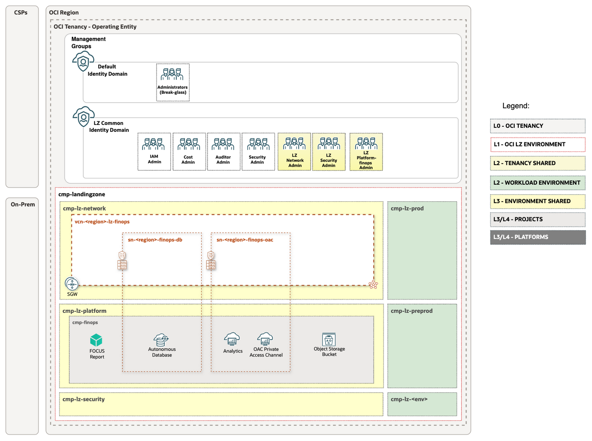

# FinOps Infrastructure Deployment Instructions

## Overview

The FinOps add-on extends an existing One-OE Landing Zone through a separate stack. It provisions the FinOps infrastructure using dependency outputs from the One-OE stack, which retains ownership of shared resources.

## Deployment diagram

The diagram shows how the FinOps infrastructure integrates with the existing One-OE Landing Zone, including its private database, dedicated VCN and shared services.

<p align="center">
  <a href="../../images/OCI_FinOps_Arch.png">
    
  </a>
</p>

OAC and the optional customer-managed report bucket are shown for context and are configured separately.

## Deployment

### Prerequisites

**One-OE deployment with required cost-governance tags:** A [One-OE Landing Zone](../../../../blueprints/one-oe/runtime/one-stack/readme.md) must already be deployed in the tenancy with `is_user_required: true` in all six cost-governance `tag_defaults` entries in `oneoe_governance.json`. Follow the [One-OE cost-governance guide](https://github.com/oci-landing-zones/oci-landing-zone-operating-entities/blob/tags-updates/blueprints/one-oe/runtime/one-stack/cost-governance.md) for the supported Orchestrator version, approved tag values and deployment instructions.

### Input configurations

The FinOps deployment uses the JSON files below. Before deployment, edit private copies of the selected files. Keep credentials out of Git and protect private inputs, saved plans and Terraform state. Retain the published resource keys unless adapting the configuration consistently. Omit `finops_bastion.json` when reusing an existing managed central Bastion.

| Configuration file | Resources | Fields to review or change |
| --- | --- | --- |
| [finops_iam.json](infrastructure-config/finops_iam.json) | FinOps compartment, administrator groups, ADB Dynamic Group and policies; see the [IAM policy reference](iam-policies.md). | Confirm `COMMON-DOMAIN`, domain/compartment names in policy strings and the FinOps CIDR condition. Follow the two-phase IAM sequence in [Deploy and verify](#deploy-and-verify). |
| [finops_network.json](infrastructure-config/finops_network.json) | FinOps VCN, private subnets, NSGs, service gateway and attachment to the existing hub DRG. | Review regional names/keys, non-overlapping VCN/subnet CIDRs, `hub_mgmt_*` source CIDRs and hub DRG/route-table references. Complete hub routing and attachment imports following the [One-OE integration reference](one-oe-integration.md). |
| [finops_database.json](infrastructure-config/finops_database.json) | Private Autonomous Database. | Replace `<ADB_ADMIN_PASSWORD>` in `admin_password` with a password meeting the [ADB requirements](https://docs.oracle.com/en-us/iaas/tools/oci-cli/latest/oci_cli_docs/cmdref/db/autonomous-database/create.html#cmdoption-admin-password). Review sizing and networking. Follow the [credential preparation steps](../database-installation/README.md#step-1-prepare-database-credentials-and-secrets) after creation. |
| [finops_security.json](infrastructure-config/finops_security.json) | Vault and encryption key in `cmp-lz-security`. | Keep the Vault/key in `CMP-LZ-SECURITY-KEY` and the `vlt-lz-finops` name expected by Python discovery. Reuse existing managed resources through their owner. |
| [finops_observability.json](infrastructure-config/finops_observability.json) | Notifications topic and email subscriptions. | Replace `email.address@example.com` in `subscriptions[].values` with the operational recipients. |
| [finops_bastion.json](infrastructure-config/finops_bastion.json) | Central Bastion in `cmp-lz-security`. | Replace `<YOUR_IP>/32` in `cidr_block_allow_list` with approved source IPs/CIDRs. Confirm the existing hub management subnet. Keep `default_compartment_id=CMP-LZ-SECURITY-KEY`; the compartment is not a deployment choice. |

**Tags — all selected files:** Replace `tobedefined` and verify every tag value, including `shared`, `finops`, `security` and `notapplicable`, belongs to the organization's controlled lists. Update both defaults and any per-resource `defined_tags` overrides.

### Deployment methods

The FinOps add-on supports two deployment methods:

- **OCI Resource Manager (ORM):** managed Terraform execution using configuration and dependency files stored in a private OCI Object Storage bucket.
- **Terraform CLI:** execution from an administration host or CI/CD runner using private configuration and dependency files.

Both methods use Orchestrator [**Release 2.4.1**](https://github.com/oci-landing-zones/terraform-oci-modules-orchestrator/releases/tag/v2.4.1) with **`rms-facade`** as the working directory. Prepare the reviewed FinOps configurations and the dependency outputs from the existing One-OE stack, then follow [Deploy and verify](#deploy-and-verify).

#### Option A: Deploy via OCI Resource Manager (ORM)

ORM is the recommended managed execution option. Keep configuration and dependency files in an organization-controlled **private OCI Object Storage bucket**.

1. **Stage the private files.** Upload the reviewed FinOps JSON copies and One-OE dependency files to the private bucket. Include `finops_bastion.json` only when creating the central Bastion. Ensure the execution identity can read the selected objects and provision the resources described by the configurations.

2. **Create the FinOps stack.** Use the [Orchestrator v2.4.1 source archive](https://github.com/oci-landing-zones/terraform-oci-modules-orchestrator/archive/refs/tags/v2.4.1.zip), set the working directory to `rms-facade`, and select the target tenancy and region. Keep automatic apply disabled until the plan has been reviewed.

3. **Configure the private sources.** Set `configuration_source` to `ocibucket` and `oci_configuration_bucket` to the private bucket name. In `oci_configuration_objects`, list the selected FinOps JSON objects; in `oci_dependency_objects`, list the One-OE dependency objects from the same bucket.

4. **Run the deployment sequence.** Follow [Deploy and verify](#deploy-and-verify) to complete both phases and the final checks in this ORM stack.

An approved private GitHub source is an alternative when the organization manages its deployment inputs there. Configure the corresponding repository, revision, configuration files and dependency files in the pinned Orchestrator; do not substitute public raw URLs for private deployment copies.

#### Option B: Deploy via Terraform CLI

Use this alternative for local Terraform or organization-controlled CI/CD, with OCI authentication configured for the target tenancy.

1. **Clone the Orchestrator repository.**

   ```bash
   git clone --branch v2.4.1 https://github.com/oci-landing-zones/terraform-oci-modules-orchestrator.git finops-orchestrator
   cd finops-orchestrator/rms-facade
   ```

2. **Prepare the configuration files.** Keep the reviewed FinOps JSONs and One-OE dependency outputs in a private workspace. In `rms-facade`, create a private `finops.auto.tfvars.json` with `tenancy_ocid`, `region`, `configuration_source: "file"`, `local_config_file_paths` and `local_dependency_file_paths`. Point the path lists to your private files. See the [Terraform guidance](../../../../commons/content/terraform.md) for environment setup.

3. **Initialize and deploy.**

   ```bash
   terraform init
   terraform plan -out=finops.tfplan
   ```

   Review the plan, then apply it:

   ```bash
   terraform apply finops.tfplan
   ```

Follow [Deploy and verify](#deploy-and-verify) for the deployment sequence and final checks.

### Deploy and verify

1. **Prepare the One-OE dependency files.** Obtain the dependency outputs from the existing One-OE stack and make them available through the selected deployment method.
2. **Deploy the initial FinOps configuration.** In the private `finops_iam.json` copy, temporarily omit `identity_domain_dynamic_groups_configuration` and only `PCY-LZ-FINOPS-ADB-RESOURCE-PRINCIPAL` from `supplied_policies`. Keep the other IAM entries and all other selected configuration files, including ADB. Validate, review the plan and apply using the selected deployment method.
3. **Complete ADB Resource Principal IAM.** Restore those entries and replace `<FINOPS_COMPARTMENT_OCID>` and `<FINOPS_ADB_OCID>` with the created OCIDs; these placeholders are not substituted automatically. Review and apply a new plan to the **same FinOps stack/state**.
4. **Verify readiness.** Confirm ADB and Vault availability, hub connectivity, Bastion access when used, and the intended IAM permissions. Check that Notifications subscriptions are `ACTIVE` and retain the topic OCID for the Core configuration.

## Next steps

Continue with the [FinOps configuration guide](../database-installation/README.md).

## License

Copyright (c) 2026 Oracle and/or its affiliates.

Licensed under the Universal Permissive License (UPL), Version 1.0.

See [LICENSE](/LICENSE.txt) for more details.
