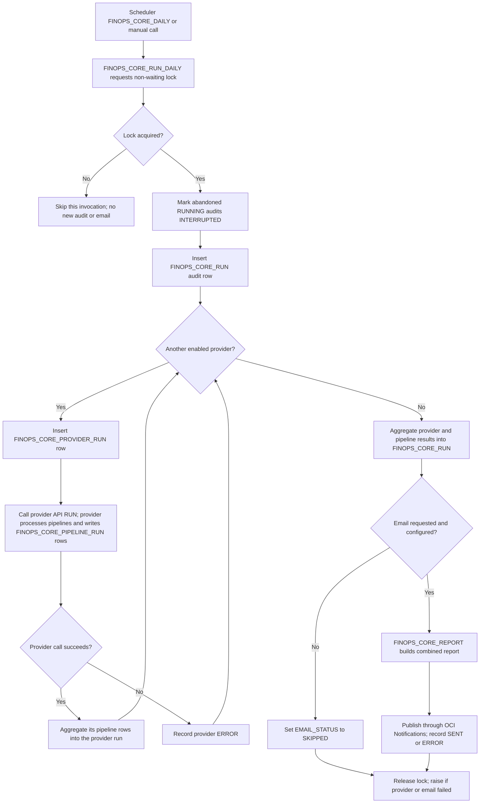
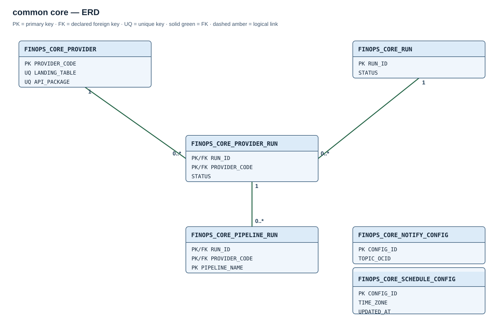

# Module 01 — Provider-neutral coordinator

## Purpose

Coordinate provider-specific daily reconciliation without encoding any provider's CSV layout, source URI, failed-file rules, or row conversion in the shared layer. A provider is explicitly registered once its package and landing table exist. The coordinator invokes enabled provider packages, stores a hierarchy of run results, and can send one combined report after the run.

## Execution flow

[Open the same execution flow on its own page](diagrams/01-common-core-flow.mmd).

The Scheduler calls the procedure with its default `P_SEND_EMAIL='Y'`; a manual caller can pass `N`. Both entry points use the same lock. If it is busy, the new invocation returns immediately without a run row or email. A scheduled occurrence is skipped; the next one remains on the normal daily schedule. An invalid email argument fails before an audit is created. Lock-request failures other than contention, and lock-release failures, raise errors rather than following the skip branch.

After acquiring the lock, the coordinator closes stale audit rows left `RUNNING` by an interrupted session and creates a new run. This changes the audit only; each provider's `RUN` implementation decides how to recover unfinished files. Providers run sequentially in provider-code order. Each provider writes its own per-pipeline rows; the core totals those rows and records the provider result. A provider exception is recorded as `ERROR` and does not prevent later providers from running. The final core status reflects provider errors.

With `P_SEND_EMAIL='Y'` and notifications enabled, the coordinator calls `FINOPS_CORE_REPORT`, publishes the combined report, and records the delivery result. If the configuration is consistently disabled (`ENABLED='N'` and `TOPIC_OCID IS NULL`), or a manual caller passes `N`, it records `EMAIL_STATUS='SKIPPED'` but still processes enabled providers. A publish failure sets `EMAIL_STATUS='ERROR'` and the core run to `ERROR`. An inconsistent configuration or invalid topic also records an email error without sending the report. The procedure releases the lock and raises an error if any provider or attempted email failed. `FINOPS_CORE_REPORT` can also be called independently for a read-only report; that call does not start reconciliation or send email.

## Entity relationships

The diagram shows the declared foreign keys. Its [full-size SVG](diagrams/01-common-core.svg) remains readable when embedded images are scaled. Complete column definitions follow.

| Parent table and key | Child table and foreign key | Cardinality |
| --- | --- | --- |
| `FINOPS_CORE_PROVIDER(PROVIDER_CODE)` | `FINOPS_CORE_PROVIDER_RUN(PROVIDER_CODE)` | One provider to zero or more provider runs. |
| `FINOPS_CORE_RUN(RUN_ID)` | `FINOPS_CORE_PROVIDER_RUN(RUN_ID)` | One coordinator run to zero or more provider runs. |
| `FINOPS_CORE_PROVIDER_RUN(RUN_ID, PROVIDER_CODE)` | `FINOPS_CORE_PIPELINE_RUN(RUN_ID, PROVIDER_CODE)` | One provider run to zero or more pipeline results. |

## Created objects

| Object | Type | Description |
| --- | --- | --- |
| [FINOPS_CORE_PROVIDER](#finops_core_provider--provider-registry) | Table | Registry of installed provider adapters and landing targets. |
| [FINOPS_CORE_RUN](#finops_core_run--one-coordinator-execution) | Table | Audit of each coordinator invocation and notification result. |
| [FINOPS_CORE_PROVIDER_RUN](#finops_core_provider_run--provider-result-within-a-run) | Table | Provider outcome within a coordinator run. |
| [FINOPS_CORE_PIPELINE_RUN](#finops_core_pipeline_run--pipeline-result-within-a-provider-run) | Table | Pipeline outcome within a provider run. |
| [FINOPS_CORE_NOTIFY_CONFIG](#finops_core_notify_config--combined-report-destination) | Table | Singleton Notifications topic and delivery switch; optional at install and adjustable later. |
| [FINOPS_CORE_SCHEDULE_CONFIG](#finops_core_schedule_config--shared-scheduler-time-zone) | Table | Singleton IANA time-zone setting shared by recurring module jobs. |
| [FINOPS_CORE_PROVIDER_RUN_PK](#finops_core_provider_run--provider-result-within-a-run), [FINOPS_CORE_PIPELINE_RUN_PK](#finops_core_pipeline_run--pipeline-result-within-a-provider-run) | Named indexes | Primary-key indexes; their columns and table ownership are defined below. |
| [FINOPS_CORE_REPORT](#finops_core_report) | Function | Builds the current or selected run report on demand without sending email. |
| [FINOPS_CORE_RUN_DAILY](#finops_core_run_daily) | Procedure | Invokes enabled provider APIs, records results, and sends the combined report when requested. |
| [FINOPS_CORE_SCHEDULE_API](#finops_core_schedule_api) | Package and body | Reads the central time-zone setting and supplies Scheduler start timestamps to modules. |
| [FINOPS_CORE_DAILY](#finops_core_daily) | Scheduler job | Runs the shared coordinator daily at 04:00 in the deployment-selected time zone; providers do not create a second core job. |

## Table columns and Oracle types

### `FINOPS_CORE_PROVIDER` — provider registry

One row identifies a provider, its landing target and its API package. `LANDING_TABLE` and `API_PACKAGE` are stored metadata names, not foreign keys to database objects.

| Column | Type / rule | Meaning |
| --- | --- | --- |
| `PROVIDER_CODE` | `VARCHAR2(3)`, required | Provider identifier. |
| `LANDING_TABLE` | `VARCHAR2(128)`, required | Name of that provider's landing table. |
| `API_PACKAGE` | `VARCHAR2(128)`, required | Package exposing `RUN` and `REPORT`. |
| `ENABLED` | `CHAR(1)`, required, `Y` or `N`, default `N` | Whether daily coordination invokes the provider. |
| `MAX_FILES_PER_PIPELINE` | `NUMBER(4)`, required, 1–2000, default 2000 | Daily remediation cap applied to each pipeline by its provider. |
| `CREATED_AT` | `TIMESTAMP WITH TIME ZONE`, required, default `SYSTIMESTAMP` | Registration timestamp. |
| `UPDATED_AT` | `TIMESTAMP WITH TIME ZONE`, required, default `SYSTIMESTAMP` | Last registry update timestamp; application code must maintain it on updates. |

**Keys and indexes:** primary key on `PROVIDER_CODE`; separate unique constraints on `LANDING_TABLE` and `API_PACKAGE`. Oracle generates the supporting index names.

### `FINOPS_CORE_RUN` — one coordinator execution

A row records one coordinator execution. Counters summarize its provider and pipeline children as stored audit values rather than virtual aggregates.

| Column | Type / rule | Meaning |
| --- | --- | --- |
| `RUN_ID` | `NUMBER`, required, identity | Run identifier. |
| `STARTED_AT` | `TIMESTAMP WITH TIME ZONE`, required, default `SYSTIMESTAMP` | Run start. |
| `FINISHED_AT` | `TIMESTAMP WITH TIME ZONE`, nullable | Run finish. |
| `STATUS` | `VARCHAR2(20)`, required, default `RUNNING`; `RUNNING`, `COMPLETE`, `ERROR`, `INTERRUPTED` | Coordinator outcome. |
| `PROVIDERS_FOUND` | `NUMBER`, required, default 0 | Providers included in this run. |
| `PROVIDERS_ERROR` | `NUMBER`, required, default 0 | Providers that failed. |
| `PIPELINES_FOUND` | `NUMBER`, required, default 0 | Pipeline results recorded by providers. |
| `PIPELINES_ERROR` | `NUMBER`, required, default 0 | Pipeline processes that failed. |
| `FILES_FULL` | `NUMBER`, required, default 0 | Files fully remediated in this run. |
| `FILES_PARTIAL` | `NUMBER`, required, default 0 | Files fully processed with one or more rows sent to manual review. |
| `FILES_ERROR` | `NUMBER`, required, default 0 | Files whose automated processing ended in an error. |
| `PIPELINES_AT_LIMIT` | `NUMBER`, required, default 0 | Pipelines that reached their configured per-pipeline cap. |
| `EMAIL_STATUS` | `VARCHAR2(20)`, required, default `PENDING`; `PENDING`, `SENT`, `SKIPPED`, `ERROR` | Combined report delivery outcome. |
| `EMAIL_ERROR` | `VARCHAR2(4000)`, nullable | Notification delivery failure detail. |
| `ERROR_MESSAGE` | `VARCHAR2(4000)`, nullable | Coordinator failure detail. |

**Keys and indexes:** identity primary key on `RUN_ID`, with an Oracle-generated supporting index name. Summary counters have no nonnegative `CHECK` constraint.

### `FINOPS_CORE_PROVIDER_RUN` — provider result within a run

One row records a provider's outcome within a coordinator run. `LANDING_TABLE` captures the target used at execution time, even if the registry later changes.

| Column | Type / rule | Meaning |
| --- | --- | --- |
| `RUN_ID` | `NUMBER`, required | Parent coordinator run. |
| `PROVIDER_CODE` | `VARCHAR2(3)`, required | Registered provider. |
| `LANDING_TABLE` | `VARCHAR2(128)`, required | Target table name at execution time. |
| `STARTED_AT` | `TIMESTAMP WITH TIME ZONE`, required, default `SYSTIMESTAMP` | Provider start. |
| `FINISHED_AT` | `TIMESTAMP WITH TIME ZONE`, nullable | Provider finish. |
| `STATUS` | `VARCHAR2(20)`, required, default `RUNNING`; `RUNNING`, `COMPLETE`, `ERROR`, `INTERRUPTED` | Provider outcome. |
| `PIPELINES_FOUND` | `NUMBER`, required, default 0 | Pipeline results for this provider. |
| `PIPELINES_ERROR` | `NUMBER`, required, default 0 | Failed pipeline processes for this provider. |
| `FILES_FULL` | `NUMBER`, required, default 0 | Fully remediated files for this provider. |
| `FILES_PARTIAL` | `NUMBER`, required, default 0 | Fully processed files with manual rows for this provider. |
| `FILES_ERROR` | `NUMBER`, required, default 0 | File processing errors for this provider. |
| `PIPELINES_AT_LIMIT` | `NUMBER`, required, default 0 | Pipeline caps reached for this provider. |
| `ERROR_MESSAGE` | `VARCHAR2(4000)`, nullable | Provider failure detail. |

**Keys and indexes:** `FINOPS_CORE_PROVIDER_RUN_PK` is the primary-key constraint and supporting index on `(RUN_ID, PROVIDER_CODE)`. `RUN_ID` references `FINOPS_CORE_RUN(RUN_ID)`; `PROVIDER_CODE` references `FINOPS_CORE_PROVIDER(PROVIDER_CODE)`. Summary counters have no nonnegative `CHECK` constraint.

### `FINOPS_CORE_PIPELINE_RUN` — pipeline result within a provider run

One row records a provider's daily result for a handled pipeline. This audit does not replace Oracle's own pipeline status tables.

| Column | Type / rule | Meaning |
| --- | --- | --- |
| `RUN_ID` | `NUMBER`, required | Parent coordinator run. |
| `PROVIDER_CODE` | `VARCHAR2(3)`, required | Parent provider. |
| `PIPELINE_NAME` | `VARCHAR2(128)`, required | Pipeline handled in that run. |
| `LANDING_TABLE` | `VARCHAR2(128)`, required | Pipeline target name at execution time. |
| `PIPELINE_STATUS` | `VARCHAR2(30)`, nullable | Observed Oracle source pipeline status. |
| `PROCESS_STATUS` | `VARCHAR2(20)`, required; `COMPLETE`, `ERROR`, `SKIPPED` | Provider reconciliation outcome for this pipeline. |
| `FILES_FULL` | `NUMBER`, required, nonnegative, default 0 | Files fully remediated for this pipeline. |
| `FILES_PARTIAL` | `NUMBER`, required, nonnegative, default 0 | Fully processed files with manual rows for this pipeline. |
| `FILES_ERROR` | `NUMBER`, required, nonnegative, default 0 | File processing errors for this pipeline. |
| `QUEUED_AFTER` | `NUMBER`, required, nonnegative, default 0 | File queue remaining after this pipeline's turn. |
| `OPEN_FILE_ERRORS` | `NUMBER`, required, nonnegative, default 0 | Known file errors still open for review. |
| `MANUAL_PENDING_ROWS` | `NUMBER`, required, nonnegative, default 0 | Rows awaiting manual remediation. |
| `LIMIT_REACHED` | `CHAR(1)`, required, `Y` or `N`, default `N` | Whether the per-pipeline cap was reached. |
| `ERROR_MESSAGE` | `VARCHAR2(4000)`, nullable | Failure detail. |

**Keys and indexes:** `FINOPS_CORE_PIPELINE_RUN_PK` is the primary-key constraint and supporting index on `(RUN_ID, PROVIDER_CODE, PIPELINE_NAME)`. The composite foreign key `FINOPS_CORE_PIPELINE_RUN_FK` maps `(RUN_ID, PROVIDER_CODE)` to `FINOPS_CORE_PROVIDER_RUN(RUN_ID, PROVIDER_CODE)`.

### `FINOPS_CORE_NOTIFY_CONFIG` — combined report destination

`FINOPS_CORE_NOTIFY_CONFIG` has one row, `CONFIG_ID=1`. A configured topic with `ENABLED='Y'` permits email delivery; a null topic with `ENABLED='N'` disables delivery while leaving the coordinator job enabled.

Email delivery requires an OCI Notifications topic, a confirmed email subscription and IAM permission for the ADB Resource Principal to publish. `EMAIL_STATUS='SENT'` records a successful package call; mailbox receipt is a separate delivery outcome.

| Column | Type / rule | Meaning |
| --- | --- | --- |
| `CONFIG_ID` | `NUMBER`, required | Singleton key. |
| `TOPIC_OCID` | `VARCHAR2(255)`, nullable | OCI Notifications topic for the combined report; null when notifications are omitted. |
| `ENABLED` | `CHAR(1)`, required, default `N`, `Y` or `N` | Delivery switch; `N` when no topic was supplied. |
| `UPDATED_AT` | `TIMESTAMP WITH TIME ZONE`, required, default `SYSTIMESTAMP` | Configuration creation timestamp; update statements must maintain it. |

**Keys and indexes:** primary key on `CONFIG_ID` and singleton `CHECK (CONFIG_ID = 1)`. Oracle generates the supporting index name. This configuration has no foreign key to an audit run.

### `FINOPS_CORE_SCHEDULE_CONFIG` — shared Scheduler time zone

One configuration row stores the selected IANA time-zone region. Recurring jobs use region-aware start timestamps so their local hour follows daylight-saving rules.

| Column | Type / rule | Meaning |
| --- | --- | --- |
| `CONFIG_ID` | `NUMBER`, required | Singleton configuration key. |
| `TIME_ZONE` | `VARCHAR2(64)`, required | Selected IANA time-zone region. |
| `UPDATED_AT` | `TIMESTAMP WITH TIME ZONE`, required, default `SYSTIMESTAMP` | Last configuration update. |

**Keys and indexes:** primary key on `CONFIG_ID` and singleton `CHECK (CONFIG_ID = 1)`. Oracle generates the supporting index name.

## Routines and job

### `FINOPS_CORE_RUN_DAILY`

`FINOPS_CORE_RUN_DAILY(P_SEND_EMAIL CHAR DEFAULT 'Y')` is the provider-neutral coordinator. It validates registered API package names, invokes enabled providers and records the coordinator/provider/pipeline audit hierarchy. `P_SEND_EMAIL` accepts only `Y` or `N`; `N` suppresses email without suppressing provider processing. Locking, notification decisions and error handling follow the execution flow above.

The provider API requires `RUN(P_CORE_RUN_ID NUMBER, P_MAX_FILES_PER_PIPELINE NUMBER)` and `REPORT RETURN CLOB`. Each handled pipeline contributes a `FINOPS_CORE_PIPELINE_RUN` row. Registry entries identify a provider code, landing table and valid API package. An empty registry is valid: the coordinator can run with zero providers and report that none are registered.

### `FINOPS_CORE_REPORT`

`FINOPS_CORE_REPORT(P_RUN_ID NUMBER DEFAULT NULL) RETURN CLOB` builds a read-only report for a selected coordinator run, or the latest run when no ID is supplied. It combines the stored run/pipeline totals with current status from enabled providers' `REPORT` functions. It does not start reconciliation or send email.

### `FINOPS_CORE_SCHEDULE_API`

The package and its body provide `LOCAL_START_DATE RETURN TIMESTAMP WITH TIME ZONE`. It reads `TIME_ZONE` from the singleton `FINOPS_CORE_SCHEDULE_CONFIG` row and returns the current timestamp expressed in that IANA region. Recurring modules use this timestamp as their Scheduler start date so configured local hours follow daylight-saving rules.

### `FINOPS_CORE_DAILY`

An enabled `DBMS_SCHEDULER` stored-procedure job invokes `FINOPS_CORE_RUN_DAILY` with its default arguments. Its `JOB_ACTION` is `FINOPS_CORE_RUN_DAILY`, its `START_DATE` uses the shared IANA region and its `REPEAT_INTERVAL` is `FREQ=DAILY;BYHOUR=04;BYMINUTE=00;BYSECOND=00`. A single coordinator job handles all registered providers.

## Dependencies

The coordinator requires the Module 00 direct grants on `DBMS_LOCK` and `DBMS_CLOUD_NOTIFICATION`. Notifications additionally require the ADB Resource Principal and delivery prerequisites defined above. Provider packages own source-specific processing; they do not modify the common coordinator or notification configuration.

Setup commands are in the [installation guide](../deployment/install/python-installation.md#configure-validate-and-install); report queries are in [coordinator diagnostics](../deployment/install/maintenance-and-diagnostics.md#coordinator-and-notification-diagnostics).
