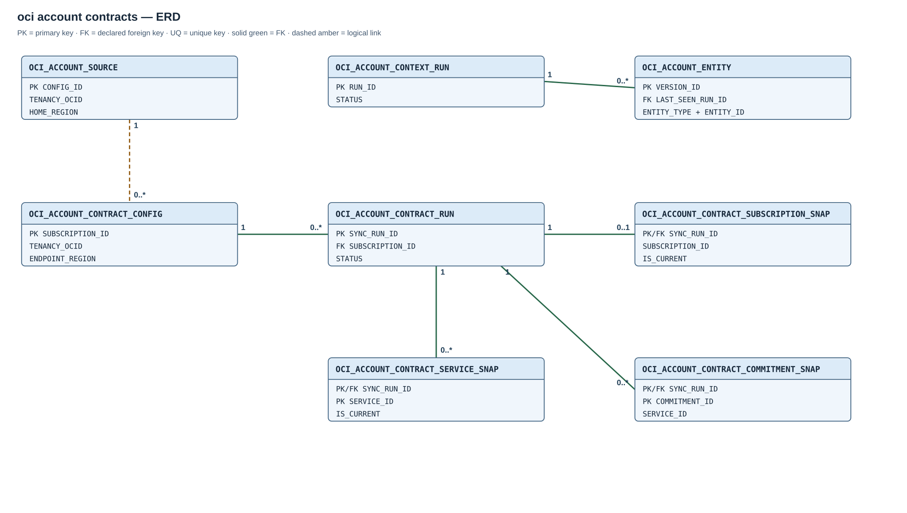

# Module 02 / OCI / 02 — account context and commercial contracts

## Purpose

This module maintains independent daily account-context and monthly commercial-contract synchronizations. It does not depend on tag-value extraction or alter the FOCUS landing.

## Scope and source distinction

The context source is OCI Identity. It reads the tenancy, all accessible compartments in its tree, and subscribed **regions**. The commercial source is OneSubscription. It discovers subscription IDs automatically and reads each subscription, its subscribed services, and their commitments. A region subscription is not a commercial subscription.

Tag namespaces, tag defaults, free-form tags, budgets, FOCUS charges and OAC objects are outside this module. Only selected typed fields are stored; the Identity response body and its tag fields are not persisted. Commercial API responses can contain contacts and addresses, but those fields are not copied into the contract tables.

Source identity consists of the tenancy OCID from `V$PDBS.CLOUD_IDENTITY`, its home region discovered through Identity region subscriptions, and the existing `OCI$RESOURCE_PRINCIPAL`. IAM must permit tenancy/compartment inspection and reads of organization subscriptions, subscriptions, subscribed services and commitments. API failures are recorded in run audits and Scheduler history.

## Entity relationships

[Open the full-size ERD](diagrams/02-oci-account-contracts.svg). Solid lines are declared foreign keys. The dashed source-to-contract-configuration link is the shared tenancy identity, not a database foreign key. Service IDs link commitments to services logically across version rows; the snapshot tables have declared foreign keys to their run, but no service-to-commitment FK.

| Parent key | Child key | Relationship |
| --- | --- | --- |
| `OCI_ACCOUNT_CONTEXT_RUN(RUN_ID)` | `OCI_ACCOUNT_ENTITY(LAST_SEEN_RUN_ID)` | Declared FK; one run may be the last observation for many current or historical entity versions. |
| `OCI_ACCOUNT_CONTRACT_CONFIG(SUBSCRIPTION_ID)` | `OCI_ACCOUNT_CONTRACT_RUN(SUBSCRIPTION_ID)` | Declared FK; one discovered subscription has many attempts. |
| `OCI_ACCOUNT_CONTRACT_RUN(SYNC_RUN_ID)` | `OCI_ACCOUNT_CONTRACT_SUBSCRIPTION_SNAP(SYNC_RUN_ID)` | Declared FK; at most one subscription version per run. |
| `OCI_ACCOUNT_CONTRACT_RUN(SYNC_RUN_ID)` | `OCI_ACCOUNT_CONTRACT_SERVICE_SNAP(SYNC_RUN_ID)` | Declared FK; zero or more subscribed-service versions per run. |
| `OCI_ACCOUNT_CONTRACT_RUN(SYNC_RUN_ID)` | `OCI_ACCOUNT_CONTRACT_COMMITMENT_SNAP(SYNC_RUN_ID)` | Declared FK; zero or more commitment versions per run. |

## Created objects

| Object | Type | Description |
| --- | --- | --- |
| [OCI_ACCOUNT_SOURCE](#oci_account_source) | Table | Tenancy source identity and independent context/contract switches. |
| [OCI_ACCOUNT_CONTEXT_RUN](#oci_account_context_run) | Table | Audit for Identity context scans. |
| [OCI_ACCOUNT_ENTITY](#oci_account_entity) | Table | Versioned tenancy, compartment, and region entities. |
| [OCI_ACCOUNT_CONTRACT_CONFIG](#oci_account_contract_config) | Table | Discovered commercial subscriptions and their synchronization switches. |
| [OCI_ACCOUNT_CONTRACT_RUN](#oci_account_contract_run) | Table | Audit for one commercial subscription snapshot attempt. |
| [OCI_ACCOUNT_CONTRACT_SUBSCRIPTION_SNAP](#oci_account_contract_subscription_snap) | Table | Versioned subscription terms. |
| [OCI_ACCOUNT_CONTRACT_SERVICE_SNAP](#oci_account_contract_service_snap) | Table | Versioned subscribed services. |
| [OCI_ACCOUNT_CONTRACT_COMMITMENT_SNAP](#oci_account_contract_commitment_snap) | Table | Versioned commitments. |
| [OCI_ACCOUNT_CURRENT_V](#oci_account_current_v), [OCI_ACCOUNT_COMPARTMENT_V](#oci_account_compartment_v), [OCI_ACCOUNT_REGION_V](#oci_account_region_v) | Views | Current Identity entities and focused compartment/region projections. |
| [OCI_ACCOUNT_CONTEXT_HEALTH_V](#oci_account_context_health_v) | View | Latest context attempt and last success. |
| [OCI_ACCOUNT_CONTRACT_CURRENT_RUN_V](#oci_account_contract_current_run_v) | View | Latest completed commercial attempt by subscription. |
| [OCI_ACCOUNT_CONTRACT_SUBSCRIPTION_V](#oci_account_contract_subscription_v-oci_account_contract_service_v-oci_account_contract_commitment_v), [OCI_ACCOUNT_CONTRACT_SERVICE_V](#oci_account_contract_subscription_v-oci_account_contract_service_v-oci_account_contract_commitment_v), [OCI_ACCOUNT_CONTRACT_COMMITMENT_V](#oci_account_contract_subscription_v-oci_account_contract_service_v-oci_account_contract_commitment_v) | Views | Current commercial versions for reporting. |
| [OCI_ACCOUNT_CONTRACT_HEALTH_V](#oci_account_contract_health_v) | View | Latest commercial attempt and last success by subscription. |
| [OCI_ACCOUNT_ENTITY_CURRENT_UX](#oci_account_entity), [OCI_ACCOUNT_ENTITY_PARENT_IX](#oci_account_entity) | Indexes | Enforce one current entity version and support hierarchy lookups. |
| [OCI_ACCOUNT_CONTRACT_RUN_IX](#oci_account_contract_run) | Index | Supports subscription/status run history. |
| [OCI_ACCOUNT_CONTRACT_SUB_CURRENT_UQ](#oci_account_contract_subscription_snap), [OCI_ACCOUNT_CONTRACT_SVC_CURRENT_UQ](#oci_account_contract_service_snap), [OCI_ACCOUNT_CONTRACT_COM_CURRENT_UQ](#oci_account_contract_commitment_snap) | Unique indexes | Enforce one current subscription, service, or commitment version per source identity. |
| [OCI_SYNC_ACCOUNT_CONTEXT](#oci_sync_account_context) | Procedure | Reads Identity and publishes changed context versions. |
| [OCI_SYNC_CONTRACT](#oci_sync_contract), [OCI_SYNC_ALL_CONTRACTS](#oci_sync_all_contracts) | Procedures | Synchronize one subscription or discover and synchronize all visible subscriptions. |
| [OCI_ACCOUNT_CONTEXT_DAILY](#oci_account_context_daily), [OCI_ACCOUNT_CONTRACT_MONTHLY](#oci_account_contract_monthly) | Scheduler jobs | Run the independent daily context and monthly contract workflows. |

Primary-key constraints provide additional indexes; their keys are described with the tables below.

## Table columns and Oracle types

### `OCI_ACCOUNT_SOURCE`

Singleton source identity with primary key `CONFIG_ID=1`. Independent context and contract enablement switches control scheduled work.

| Column | Type |
| --- | --- |
| `CONFIG_ID` | `NUMBER(1)` |
| `TENANCY_OCID` | `VARCHAR2(512)` |
| `HOME_REGION` | `VARCHAR2(64)` |
| `IDENTITY_DOMAIN` | `VARCHAR2(128)` |
| `CREDENTIAL_NAME` | `VARCHAR2(128)` |
| `CONTEXT_ENABLED` | `CHAR(1)` |
| `CONTRACT_ENABLED` | `CHAR(1)` |

### `OCI_ACCOUNT_CONTEXT_RUN`

One Identity scan attempt with identity PK `RUN_ID`. States are `RUNNING`, `COMPLETE`, `ERROR` and `SKIPPED`.

| Column | Type |
| --- | --- |
| `RUN_ID` | `NUMBER` |
| `STARTED_AT` | `TIMESTAMP WITH TIME ZONE` |
| `FINISHED_AT` | `TIMESTAMP WITH TIME ZONE` |
| `STATUS` | `VARCHAR2(12)` |
| `TENANCY_READ` | `NUMBER` |
| `COMPARTMENTS_READ` | `NUMBER` |
| `REGIONS_READ` | `NUMBER` |
| `CHANGES_RECORDED` | `NUMBER` |
| `UNRESOLVED_COMPARTMENTS` | `NUMBER` |
| `ERROR_MESSAGE` | `VARCHAR2(4000)` |

### `OCI_ACCOUNT_ENTITY`

`OCI_ACCOUNT_ENTITY_CURRENT_UX` enforces at most one current row for each `(ENTITY_TYPE, ENTITY_ID)` while preserving earlier versions. `OCI_ACCOUNT_ENTITY_PARENT_IX` supports current hierarchy lookups. Primary keys and the `LAST_SEEN_RUN_ID` foreign key provide the other context indexes. `UNRESOLVED_COMPARTMENTS` counts current compartments whose reported parent is absent from the current tenancy/compartment set; the sync records them rather than inventing a parent.

One entity version with identity PK `VERSION_ID` and a `LAST_SEEN_RUN_ID` foreign key. Entity types are `TENANCY`, `COMPARTMENT` and `REGION`. Changed source fields create a new version; absence after a complete scan closes the previous current version.

| Column | Type |
| --- | --- |
| `VERSION_ID` | `NUMBER` |
| `ENTITY_TYPE` | `VARCHAR2(12)` |
| `ENTITY_ID` | `VARCHAR2(512)` |
| `PARENT_ID` | `VARCHAR2(512)` |
| `ENTITY_NAME` | `VARCHAR2(1000)` |
| `LIFECYCLE_STATE` | `VARCHAR2(64)` |
| `SOURCE_CREATED_AT` | `TIMESTAMP WITH TIME ZONE` |
| `HOME_REGION_KEY` | `VARCHAR2(64)` |
| `REGION_KEY` | `VARCHAR2(64)` |
| `IS_HOME_REGION` | `CHAR(1)` |
| `FIRST_SEEN_AT` | `TIMESTAMP WITH TIME ZONE` |
| `LAST_SEEN_RUN_ID` | `NUMBER` |
| `IS_CURRENT` | `CHAR(1)` |
| `CLOSED_AT` | `TIMESTAMP WITH TIME ZONE` |

### `OCI_ACCOUNT_CONTRACT_CONFIG`

One discovered subscription per `SUBSCRIPTION_ID` primary key. IDs absent from a later complete discovery become no longer observed, without implying source deletion. Disabled subscriptions retain their history.

| Column | Type |
| --- | --- |
| `SUBSCRIPTION_ID` | `VARCHAR2(256)` |
| `TENANCY_OCID` | `VARCHAR2(512)` |
| `ENDPOINT_REGION` | `VARCHAR2(64)` |
| `CREDENTIAL_NAME` | `VARCHAR2(128)` |
| `IS_SYNC_ENABLED` | `CHAR(1)` |
| `IS_DISCOVERED` | `CHAR(1)` |
| `LAST_DISCOVERED_AT` | `TIMESTAMP WITH TIME ZONE` |

### `OCI_ACCOUNT_CONTRACT_RUN`

One subscription snapshot attempt with identity PK `SYNC_RUN_ID` and a subscription foreign key. States are `RUNNING`, `COMPLETED`, `FAILED` and `SKIPPED`. `OCI_ACCOUNT_CONTRACT_RUN_IX` supports subscription/status history.

| Column | Type |
| --- | --- |
| `SYNC_RUN_ID` | `NUMBER` |
| `SUBSCRIPTION_ID` | `VARCHAR2(256)` |
| `STARTED_AT` | `TIMESTAMP WITH TIME ZONE` |
| `COMPLETED_AT` | `TIMESTAMP WITH TIME ZONE` |
| `STATUS` | `VARCHAR2(16)` |
| `SERVICES_READ` | `NUMBER` |
| `COMMITMENTS_READ` | `NUMBER` |
| `ERROR_CODE` | `NUMBER` |
| `ERROR_MESSAGE` | `VARCHAR2(4000)` |

### `OCI_ACCOUNT_CONTRACT_SUBSCRIPTION_SNAP`

**Index:** `OCI_ACCOUNT_CONTRACT_SUB_CURRENT_UQ` on `(case when is_current='Y' then subscription_id end)`.

Earlier versions remain for change history. Amounts remain source strings because the OCI API models them as text; arithmetic requires a separate currency and numeric-format decision. No daily or monthly duplicate versions are inserted for unchanged fields. A run audit row and `LAST_SEEN_RUN_ID` still record that the source was checked. `IS_DISCOVERED='N'` warns that a configured subscription was absent from the latest complete organization-subscription listing; existing contract versions are retained for review.

One subscription version per `SYNC_RUN_ID` primary key and run foreign key. A new version is stored only when a persisted source field changes.

| Column | Type |
| --- | --- |
| `SYNC_RUN_ID` | `NUMBER` |
| `SUBSCRIPTION_ID` | `VARCHAR2(256)` |
| `STATUS` | `VARCHAR2(64)` |
| `SERVICE_NAME` | `VARCHAR2(512)` |
| `TIME_START` | `TIMESTAMP WITH TIME ZONE` |
| `TIME_END` | `TIMESTAMP WITH TIME ZONE` |
| `CURRENCY_ISO_CODE` | `VARCHAR2(16)` |
| `OBSERVED_AT` | `TIMESTAMP WITH TIME ZONE` |
| `IS_CURRENT` | `CHAR(1)` |
| `LAST_SEEN_RUN_ID` | `NUMBER` |

### `OCI_ACCOUNT_CONTRACT_SERVICE_SNAP`

**Index:** `OCI_ACCOUNT_CONTRACT_SVC_CURRENT_UQ` on `(case when is_current='Y' then subscription_id end, case when is_current='Y' then service_id end)`.

One service version per primary key `(SYNC_RUN_ID, SERVICE_ID)`, with a run foreign key.

| Column | Type |
| --- | --- |
| `SYNC_RUN_ID` | `NUMBER` |
| `SERVICE_ID` | `VARCHAR2(256)` |
| `SUBSCRIPTION_ID` | `VARCHAR2(256)` |
| `SERVICE_TYPE` | `VARCHAR2(128)` |
| `STATUS` | `VARCHAR2(64)` |
| `PRODUCT_NAME` | `VARCHAR2(512)` |
| `PRODUCT_PART_NUMBER` | `VARCHAR2(128)` |
| `TIME_START` | `TIMESTAMP WITH TIME ZONE` |
| `TIME_END` | `TIMESTAMP WITH TIME ZONE` |
| `QUANTITY_TEXT` | `VARCHAR2(128)` |
| `USED_AMOUNT_TEXT` | `VARCHAR2(128)` |
| `AVAILABLE_AMOUNT_TEXT` | `VARCHAR2(128)` |
| `FUNDED_ALLOCATION_TEXT` | `VARCHAR2(128)` |
| `AGREEMENT_ID` | `NUMBER` |
| `AGREEMENT_NAME` | `VARCHAR2(512)` |
| `BILLING_FREQUENCY` | `VARCHAR2(64)` |
| `OBSERVED_AT` | `TIMESTAMP WITH TIME ZONE` |
| `IS_CURRENT` | `CHAR(1)` |
| `LAST_SEEN_RUN_ID` | `NUMBER` |

### `OCI_ACCOUNT_CONTRACT_COMMITMENT_SNAP`

**Index:** `OCI_ACCOUNT_CONTRACT_COM_CURRENT_UQ` on `(case when is_current='Y' then service_id end, case when is_current='Y' then commitment_id end)`.

One commitment version per primary key `(SYNC_RUN_ID, COMMITMENT_ID)`, with a run foreign key.

| Column | Type |
| --- | --- |
| `SYNC_RUN_ID` | `NUMBER` |
| `COMMITMENT_ID` | `VARCHAR2(256)` |
| `SERVICE_ID` | `VARCHAR2(256)` |
| `TIME_START` | `TIMESTAMP WITH TIME ZONE` |
| `TIME_END` | `TIMESTAMP WITH TIME ZONE` |
| `QUANTITY_TEXT` | `VARCHAR2(128)` |
| `USED_AMOUNT_TEXT` | `VARCHAR2(128)` |
| `AVAILABLE_AMOUNT_TEXT` | `VARCHAR2(128)` |
| `FUNDED_ALLOCATION_TEXT` | `VARCHAR2(128)` |
| `OBSERVED_AT` | `TIMESTAMP WITH TIME ZONE` |
| `IS_CURRENT` | `CHAR(1)` |
| `LAST_SEEN_RUN_ID` | `NUMBER` |

## Reporting views

### `OCI_ACCOUNT_CURRENT_V`

Current entity versions only.

### `OCI_ACCOUNT_COMPARTMENT_V`

Current compartment ID, parent ID, name, state, creation time and observation metadata. The parent ID is a source relationship, not a declared self-referential FK; inaccessible parents remain visible as unresolved.

### `OCI_ACCOUNT_REGION_V`

Current subscribed region name, key, subscription status and home-region flag.

### `OCI_ACCOUNT_CONTEXT_HEALTH_V`

Configuration and latest attempt, with the last successful completion time.

### `OCI_ACCOUNT_CONTRACT_CURRENT_RUN_V`

Latest completed attempt for each subscription.

### `OCI_ACCOUNT_CONTRACT_SUBSCRIPTION_V`, `OCI_ACCOUNT_CONTRACT_SERVICE_V`, `OCI_ACCOUNT_CONTRACT_COMMITMENT_V`

Current versions only. `IS_CURRENT='Y'` means the latest observed version; consumers must also check the contract period to find a currently active commitment.

### `OCI_ACCOUNT_CONTRACT_HEALTH_V`

Latest attempt and last successful completion per subscription.

## Procedures, jobs and recovery

### `OCI_SYNC_ACCOUNT_CONTEXT`

Reads the tenancy, paginated recursive compartments and region subscriptions. It locks `OCI_ACCOUNT_SOURCE` without waiting, starts an audit, changes only altered entity versions, closes missing entities only after a complete read, and commits the new current set atomically. A failed read rolls back entity changes and records `ERROR`; the previous current set remains.

### `OCI_SYNC_CONTRACT`

`OCI_SYNC_CONTRACT(subscription_id, force_run, page_size)`

Reads a discovered subscription, its services and commitments through OCI SDK calls. It serializes one subscription with `FOR UPDATE NOWAIT`. Unchanged versions only update `LAST_SEEN_RUN_ID`. Changed versions and missing service/commitment closures commit together per subscription. A failed traversal rolls back that subscription and records `FAILED`.

### `OCI_SYNC_ALL_CONTRACTS`

Rediscovers all commercial subscription IDs on every call. It inserts new configuration rows, invokes each enabled subscription in turn, records per-subscription failures and continues with the others. If any fail, it raises after processing all IDs so Scheduler records the overall attempt as failed; successful subscriptions remain committed.

### `OCI_ACCOUNT_CONTEXT_DAILY`

Enabled Scheduler job at 01:00 daily in the installation-selected time zone. Calls `OCI_SYNC_ACCOUNT_CONTEXT`.

### `OCI_ACCOUNT_CONTRACT_MONTHLY`

Enabled Scheduler job on day 1 of each month at 04:45 in the installation-selected time zone. Calls `OCI_SYNC_ALL_CONTRACTS`.

Context and commercial results have independent audit histories in `OCI_ACCOUNT_CONTEXT_RUN` and `OCI_ACCOUNT_CONTRACT_RUN`. A completed synchronization, rather than the presence of tables or jobs, establishes that an observation was published.

The context and commercial jobs have separate transactions, locks and failure audits. An interrupted context run is marked `ERROR` by the next context invocation before it retries; its uncommitted entity changes roll back. An interrupted subscription run is marked `FAILED` by the next invocation for that subscription; previous committed versions remain. A failed commercial API call never resets an ingestion pipeline or changes remediation state. Context/current contract data are not joined to historical FOCUS charges automatically.
