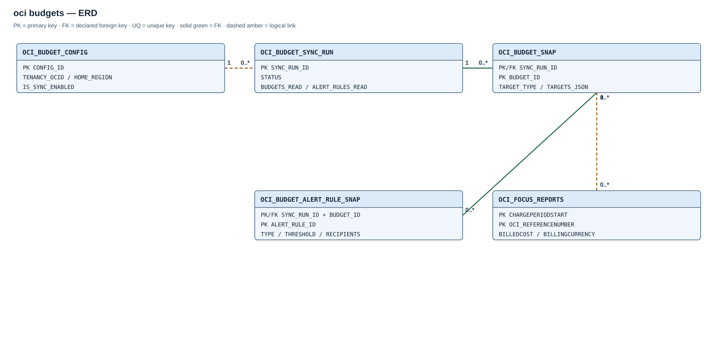

# Module 02 / OCI / 03 — Budgets

## Purpose

This optional, read-only collector stores OCI Budgets and alert-rule metadata in immutable run snapshots and shows Budget API spend separately from any FOCUS calculation:

- `ACTUAL_SPEND` reported by the OCI Budgets API for the current budget cycle.
- `FOCUS_BILLED_COST` would require matching target, cycle, and billing currency; the current view deliberately leaves it null until those can be proven.

The comparison must keep those measures separate. The Budgets API controls its own computation time (`timeSpendComputed`); FOCUS files arrive on their own schedule. A difference is therefore a reconciliation signal, not automatically a data error. Do not add the two values together.

## Source scope and comparison rules

The collector reads all budget target types and each budget's alert rules from the Budgets API in the tenancy home region. It requests budget and rule details, stores full JSON responses, and publishes one complete snapshot per run. A failed read rolls back its partial snapshot and retains the prior completed one. Run history and snapshots are retained; the module does not purge history.

FOCUS comparison is not yet calculated because the API and target/cycle semantics do not currently provide enough verified information:

- The Budget API amounts use the customer's rate-card currency but do not identify the currency on the Budget resource. Compartment targets therefore report `NOT_COMPARABLE_CURRENCY_NOT_EXPOSED_BY_BUDGET_API`.
- Tag targets report `NOT_COMPARABLE_TAG_TARGET_RESOLUTION_REQUIRED`; merely installing OCI 01b does not prove exact equivalence.
- Cycle boundaries, including custom offsets, are not yet computed. The view does not imply a numeric reconciliation.

Budget alert rules and recipient addresses are copied as source metadata for reporting. OCI remains responsible for evaluating thresholds and sending budget alerts; this module does not send those emails.

## Entity relationships

The diagram shows run-to-snapshot foreign keys and the logical budget-target association used by reporting.

Run-to-budget and run/budget-to-alert-rule links are physical foreign keys. Budget-to-FOCUS is logical; the module neither adds landing-table foreign keys nor claims numeric reconciliation.

## Created objects

| Object | Type | Description |
| --- | --- | --- |
| [OCI_BUDGET_CONFIG](#oci_budget_config) | Table | Single tenancy/home-region endpoint, credential and synchronization switch. |
| [OCI_BUDGET_SYNC_RUN](#oci_budget_sync_run) | Table | Durable audit for completed, failed or skipped runs. |
| [OCI_BUDGET_SNAP](#oci_budget_snap) | Table | Full typed budget details and JSON payload, keyed by run and budget. |
| [OCI_BUDGET_ALERT_RULE_SNAP](#oci_budget_alert_rule_snap) | Table | Full typed alert-rule details and JSON payload, keyed by run and rule. |
| [OCI_BUDGET_CURRENT_V](#oci_budget_current_v) | View | Current budget observations. |
| [OCI_BUDGET_ALERT_RULES_V](#oci_budget_alert_rules_v) | View | Reporting projection of budget alert rules. |
| [OCI_BUDGET_FOCUS_COMPARISON_V](#oci_budget_focus_comparison_v) | View | API spend and FOCUS comparability status. |
| [OCI_BUDGET_HEALTH_V](#oci_budget_health_v) | View | Synchronization freshness and operating state. |
| [OCI_BUDGET_SYNC_RUN_STATUS_IX](#oci_budget_sync_run), [OCI_BUDGET_SNAP_PK](#oci_budget_snap), [OCI_BUDGET_SNAP_ID_IX](#oci_budget_snap), [OCI_BUDGET_ALERT_RULE_SNAP_PK](#oci_budget_alert_rule_snap), [OCI_BUDGET_ALERT_ID_IX](#oci_budget_alert_rule_snap) | Indexes | Support run ordering, snapshot identity and history lookup. |
| [OCI_SYNC_BUDGETS](#oci_sync_budgets) | Procedure | Collects and publishes budget and alert-rule snapshots. |
| [OCI_BUDGET_DAILY](#oci_budget_daily) | Scheduler job | Daily budget synchronization. |

## Table columns and Oracle types

### `OCI_BUDGET_CONFIG`

| Column | Oracle definition |
| --- | --- |
| `CONFIG_ID` | `NUMBER DEFAULT 1 PRIMARY KEY CHECK(config_id=1)` |
| `TENANCY_OCID` | `VARCHAR2(512) NOT NULL` |
| `HOME_REGION` | `VARCHAR2(64) NOT NULL` |
| `CREDENTIAL_NAME` | `VARCHAR2(128) DEFAULT 'OCI$RESOURCE_PRINCIPAL' NOT NULL` |
| `IS_SYNC_ENABLED` | `CHAR(1) DEFAULT 'N' NOT NULL CHECK(is_sync_enabled IN ('Y','N'))` |
| `CREATED_AT` | `TIMESTAMP WITH TIME ZONE DEFAULT SYSTIMESTAMP NOT NULL` |
| `UPDATED_AT` | `TIMESTAMP WITH TIME ZONE DEFAULT SYSTIMESTAMP NOT NULL` |

### `OCI_BUDGET_SYNC_RUN`

**Index:** `OCI_BUDGET_SYNC_RUN_STATUS_IX` on `(status,sync_run_id)`.

| Column | Oracle definition |
| --- | --- |
| `SYNC_RUN_ID` | `NUMBER GENERATED ALWAYS AS IDENTITY PRIMARY KEY` |
| `STARTED_AT` | `TIMESTAMP WITH TIME ZONE DEFAULT SYSTIMESTAMP NOT NULL` |
| `COMPLETED_AT` | `TIMESTAMP WITH TIME ZONE` |
| `STATUS` | `VARCHAR2(16) NOT NULL CHECK(status IN ('RUNNING','COMPLETED','FAILED','SKIPPED'))` |
| `TENANCY_OCID` | `VARCHAR2(512) NOT NULL` |
| `HOME_REGION` | `VARCHAR2(64) NOT NULL` |
| `BUDGETS_READ` | `NUMBER DEFAULT 0 NOT NULL` |
| `ALERT_RULES_READ` | `NUMBER DEFAULT 0 NOT NULL` |
| `ERROR_CODE` | `NUMBER` |
| `ERROR_MESSAGE` | `VARCHAR2(4000)` |

### `OCI_BUDGET_SNAP`

**Index:** `OCI_BUDGET_SNAP_ID_IX` on `(budget_id,sync_run_id)`.

**Primary key:** `OCI_BUDGET_SNAP_PK` on `(SYNC_RUN_ID, BUDGET_ID)`.

| Column | Oracle definition |
| --- | --- |
| `SYNC_RUN_ID` | `NUMBER NOT NULL REFERENCES oci_budget_sync_run(sync_run_id)` |
| `BUDGET_ID` | `VARCHAR2(512) NOT NULL` |
| `COMPARTMENT_ID` | `VARCHAR2(512) NOT NULL` |
| `TARGET_COMPARTMENT_ID` | `VARCHAR2(512)` |
| `DISPLAY_NAME` | `VARCHAR2(1000)` |
| `DESCRIPTION` | `VARCHAR2(4000)` |
| `LIFECYCLE_STATE` | `VARCHAR2(64)` |
| `AMOUNT` | `NUMBER` |
| `ACTUAL_SPEND` | `NUMBER` |
| `FORECASTED_SPEND` | `NUMBER` |
| `ALERT_RULE_COUNT` | `NUMBER` |
| `RESET_PERIOD` | `VARCHAR2(64)` |
| `PROCESSING_PERIOD_TYPE` | `VARCHAR2(64)` |
| `PROCESSING_PERIOD_START_OFFSET` | `NUMBER` |
| `TARGET_TYPE` | `VARCHAR2(64)` |
| `TARGETS_JSON` | `CLOB CHECK(targets_json IS JSON)` |
| `START_DATE` | `TIMESTAMP WITH TIME ZONE` |
| `END_DATE` | `TIMESTAMP WITH TIME ZONE` |
| `TIME_SPEND_COMPUTED` | `TIMESTAMP WITH TIME ZONE` |
| `SOURCE_CREATED_AT` | `TIMESTAMP WITH TIME ZONE` |
| `SOURCE_UPDATED_AT` | `TIMESTAMP WITH TIME ZONE` |
| `OBSERVED_AT` | `TIMESTAMP WITH TIME ZONE DEFAULT SYSTIMESTAMP NOT NULL` |
| `SOURCE_PAYLOAD` | `CLOB NOT NULL CHECK(source_payload IS JSON)` |

### `OCI_BUDGET_ALERT_RULE_SNAP`

**Index:** `OCI_BUDGET_ALERT_ID_IX` on `(alert_rule_id,sync_run_id)`.

**Keys:** `OCI_BUDGET_ALERT_RULE_SNAP_PK` is the primary key on `(SYNC_RUN_ID, ALERT_RULE_ID)`. `OCI_BUDGET_ALERT_RULE_RUN_FK` references `OCI_BUDGET_SNAP(SYNC_RUN_ID, BUDGET_ID)` through `(SYNC_RUN_ID, BUDGET_ID)`.

| Column | Oracle definition |
| --- | --- |
| `SYNC_RUN_ID` | `NUMBER NOT NULL` |
| `BUDGET_ID` | `VARCHAR2(512) NOT NULL` |
| `ALERT_RULE_ID` | `VARCHAR2(512) NOT NULL` |
| `DISPLAY_NAME` | `VARCHAR2(1000)` |
| `LIFECYCLE_STATE` | `VARCHAR2(64)` |
| `RULE_TYPE` | `VARCHAR2(64)` |
| `THRESHOLD_TYPE` | `VARCHAR2(64)` |
| `THRESHOLD` | `NUMBER` |
| `RECIPIENTS_JSON` | `CLOB CHECK(recipients_json IS JSON)` |
| `MESSAGE` | `VARCHAR2(4000)` |
| `SOURCE_CREATED_AT` | `TIMESTAMP WITH TIME ZONE` |
| `SOURCE_UPDATED_AT` | `TIMESTAMP WITH TIME ZONE` |
| `OBSERVED_AT` | `TIMESTAMP WITH TIME ZONE DEFAULT SYSTIMESTAMP NOT NULL` |
| `SOURCE_PAYLOAD` | `CLOB NOT NULL CHECK(source_payload IS JSON)` |

The JSON CLOB columns carry `IS JSON` constraints. Configuration has a single-row check; synchronization is limited to one active worker by a non-waiting `DBMS_LOCK` lock. A failed API call or incomplete page traversal marks the run `FAILED` and rolls back all budget/rule rows for that run. The views select only the latest `COMPLETED` run, so an incomplete attempt cannot replace published data.

Primary-key constraints create their backing indexes using Oracle-generated names. The object inventory lists the explicitly named secondary indexes.

## Reporting views

### `OCI_BUDGET_CURRENT_V`

Budgets from the latest complete sync.

### `OCI_BUDGET_ALERT_RULES_V`

Alert rules from the latest complete sync.

### `OCI_BUDGET_FOCUS_COMPARISON_V`

Keeps API spend distinct and explains why a FOCUS comparison is unavailable.

### `OCI_BUDGET_HEALTH_V`

Latest run, source counts, freshness, and scheduler state.

## Routines and schedule

### `OCI_SYNC_BUDGETS`

Reads every page and entity detail, serializes runs, and atomically publishes or rolls back a snapshot.

### `OCI_BUDGET_DAILY`

Enabled daily read-only synchronization at 08:15 in the installation-selected time zone.

## Dependencies

The module requires the shared schema/core, an authorized ADB Resource Principal and IAM permission `read usage-budgets in tenancy`. The collector derives tenancy identity from ADB and discovers the home region directly. It does not consume ingestion, account-context or tag-value objects. Budget and alert-rule observations come from the OCI Budgets API; the collector does not create or change budgets, alert rules or email subscriptions.

## OCI API references

- [Budgets API functions and endpoint](https://docs.oracle.com/en-us/iaas/Content/pl-sql-sdk/doc/dbms_cloud_oci_bd_budget.html)
- [Budgets API Reference](https://docs.oracle.com/en-us/iaas/api/#/en/budgets/20190111/)
- [Budget resource](https://docs.oracle.com/en-us/iaas/api/#/en/budgets/20190111/Budget/)
- [AlertRule resource](https://docs.oracle.com/en-us/iaas/api/#/en/budgets/20190111/AlertRule/)
