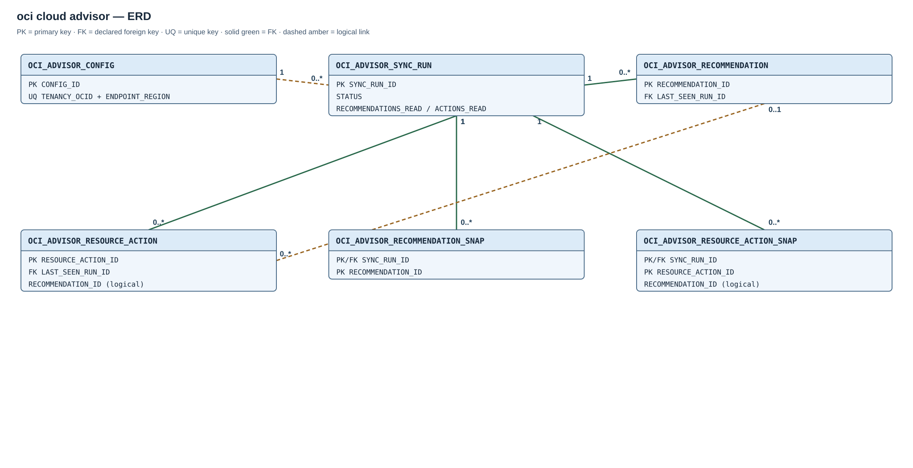

# Module 02 / OCI / 04 — Cloud Advisor

## Purpose

Cloud Advisor is an independent OCI provider extension. It requires the shared schema/core and its OCI API permissions; it does not depend on the other optional collectors.

## Entity relationships

The Optimizer API supplies recommendations and resource actions. The [Advisor ERD](diagrams/02-oci-cloud-advisor.svg) shows each table once. Solid green links are declared foreign keys; dashed amber links are logical source identities. `RECOMMENDATION_ID` on a resource action has no FK because its recommendation need not be present in the same visible API result.

## Created objects

| Object | Type | Description |
| --- | --- | --- |
| [OCI_ADVISOR_CONFIG](#oci_advisor_config) | Table | Source and enablement configuration. |
| [OCI_ADVISOR_SYNC_RUN](#oci_advisor_sync_run) | Table | Audit of each Advisor API read. |
| [OCI_ADVISOR_RECOMMENDATION](#oci_advisor_recommendation), [OCI_ADVISOR_RESOURCE_ACTION](#oci_advisor_resource_action) | Tables | Last known recommendation and resource-action identities. |
| [OCI_ADVISOR_RECOMMENDATION_SNAP](#oci_advisor_recommendation_snap), [OCI_ADVISOR_RESOURCE_ACTION_SNAP](#oci_advisor_resource_action_snap) | Tables | Successful per-run observations for history and change analysis. |
| [OCI_ADVISOR_RECOMMENDATIONS_V](#reporting-views), [OCI_ADVISOR_ACTIONS_V](#reporting-views), [OCI_ADVISOR_RECOMMENDATION_CURRENT](#reporting-views) | Views | Current recommendation/action projections and compatibility access. |
| [OCI_ADVISOR_OPEN_ACTIONS_V](#reporting-views) | View | Pending resource actions enriched with recommendation data. |
| [OCI_ADVISOR_OBSERVATIONS_V](#reporting-views), [OCI_ADVISOR_CHANGES_V](#reporting-views) | Views | Historical observations and differences between complete runs. |
| [OCI_ADVISOR_HEALTH_V](#reporting-views) | View | Source freshness, counts, and job status. |
| [OCI_ADVISOR_CONFIG_UQ](#oci_advisor_config), [OCI_ADVISOR_CONFIG_SINGLE_UQ](#oci_advisor_config) | Unique indexes | Enforce source identity and one configuration. |
| [OCI_ADVISOR_RA_RESOURCE_IX](#oci_advisor_resource_action), [OCI_ADVISOR_RA_RECOMMENDATION_IX](#oci_advisor_resource_action) | Indexes | Locate actions by resource/status and recommendation. |
| [OCI_SYNC_ADVISOR](#oci_sync_advisor) | Procedure | Reads and publishes a complete Advisor observation. |
| [OCI_ADVISOR_DAILY](#oci_advisor_daily) | Scheduler job | Requests daily synchronization. |

PK constraints create the recommendation, action, and snapshot key indexes.

## Table columns and Oracle types

### `OCI_ADVISOR_CONFIG`

**Named constraint:** `OCI_ADVISOR_CONFIG_UQ` (UNIQUE).

One source configuration with identity PK `CONFIG_ID`. `TENANCY_OCID` and `ENDPOINT_REGION` are unique together; `OCI_ADVISOR_CONFIG_SINGLE_UQ` enforces a single configuration row.

| Column | Type |
| --- | --- |
| `CONFIG_ID` | `NUMBER` |
| `TENANCY_OCID` | `VARCHAR2(512)` |
| `ENDPOINT_REGION` | `VARCHAR2(64)` |
| `CREDENTIAL_NAME` | `VARCHAR2(128)` |
| `IS_SYNC_ENABLED` | `CHAR(1)` |
| `CREATED_AT` | `TIMESTAMP(6) WITH TIME ZONE` |
| `UPDATED_AT` | `TIMESTAMP(6) WITH TIME ZONE` |

### `OCI_ADVISOR_SYNC_RUN`

One API observation attempt with identity PK `SYNC_RUN_ID`. States are `RUNNING`, `COMPLETED`, `FAILED` and `SKIPPED`.

| Column | Type |
| --- | --- |
| `SYNC_RUN_ID` | `NUMBER` |
| `STARTED_AT` | `TIMESTAMP(6) WITH TIME ZONE` |
| `COMPLETED_AT` | `TIMESTAMP(6) WITH TIME ZONE` |
| `STATUS` | `VARCHAR2(30)` |
| `ENDPOINT_REGION` | `VARCHAR2(64)` |
| `RECOMMENDATIONS_READ` | `NUMBER` |
| `RESOURCE_ACTIONS_READ` | `NUMBER` |
| `ERROR_CODE` | `NUMBER` |
| `ERROR_MESSAGE` | `VARCHAR2(4000)` |

### `OCI_ADVISOR_RECOMMENDATION`

One last-known recommendation per `RECOMMENDATION_ID` primary key. `LAST_SEEN_RUN_ID` references its observation run.

| Column | Type |
| --- | --- |
| `RECOMMENDATION_ID` | `VARCHAR2(512)` |
| `COMPARTMENT_ID` | `VARCHAR2(512)` |
| `CATEGORY_ID` | `VARCHAR2(512)` |
| `RECOMMENDATION_NAME` | `VARCHAR2(512)` |
| `DESCRIPTION_CODE` | `VARCHAR2(1000)` |
| `IMPORTANCE` | `VARCHAR2(30)` |
| `LIFECYCLE_STATE` | `VARCHAR2(30)` |
| `RECOMMENDATION_STATUS` | `VARCHAR2(30)` |
| `ESTIMATED_COST_SAVING` | `NUMBER` |
| `CURRENCY_CODE` | `VARCHAR2(30)` |
| `TIME_STATUS_BEGIN` | `TIMESTAMP(6) WITH TIME ZONE` |
| `TIME_STATUS_END` | `TIMESTAMP(6) WITH TIME ZONE` |
| `SOURCE_CREATED_AT` | `TIMESTAMP(6) WITH TIME ZONE` |
| `SOURCE_UPDATED_AT` | `TIMESTAMP(6) WITH TIME ZONE` |
| `FIRST_SEEN_AT` | `TIMESTAMP(6) WITH TIME ZONE` |
| `LAST_SEEN_AT` | `TIMESTAMP(6) WITH TIME ZONE` |
| `LAST_SEEN_RUN_ID` | `NUMBER` |
| `SOURCE_PAYLOAD` | `JSON` |

### `OCI_ADVISOR_RESOURCE_ACTION`

The named action indexes are `OCI_ADVISOR_RA_RESOURCE_IX` on `(RESOURCE_OCID, ACTION_STATUS)` and `OCI_ADVISOR_RA_RECOMMENDATION_IX` on `RECOMMENDATION_ID`. PK and unique constraints provide the other Advisor indexes.

One last-known action per `RESOURCE_ACTION_ID` primary key. `LAST_SEEN_RUN_ID` references its observation run; the recommendation identity is a logical source link.

| Column | Type |
| --- | --- |
| `RESOURCE_ACTION_ID` | `VARCHAR2(512)` |
| `RECOMMENDATION_ID` | `VARCHAR2(512)` |
| `CATEGORY_ID` | `VARCHAR2(512)` |
| `RESOURCE_OCID` | `VARCHAR2(512)` |
| `RESOURCE_NAME` | `VARCHAR2(1000)` |
| `RESOURCE_TYPE` | `VARCHAR2(256)` |
| `COMPARTMENT_ID` | `VARCHAR2(512)` |
| `COMPARTMENT_NAME` | `VARCHAR2(1000)` |
| `RESOURCE_REGION` | `VARCHAR2(64)` |
| `ACTION_TYPE` | `VARCHAR2(100)` |
| `ACTION_DESCRIPTION` | `VARCHAR2(4000)` |
| `ACTION_URL` | `VARCHAR2(4000)` |
| `LIFECYCLE_STATE` | `VARCHAR2(30)` |
| `ACTION_STATUS` | `VARCHAR2(30)` |
| `ESTIMATED_COST_SAVING` | `NUMBER` |
| `CURRENCY_CODE` | `VARCHAR2(30)` |
| `TIME_STATUS_BEGIN` | `TIMESTAMP(6) WITH TIME ZONE` |
| `TIME_STATUS_END` | `TIMESTAMP(6) WITH TIME ZONE` |
| `SOURCE_CREATED_AT` | `TIMESTAMP(6) WITH TIME ZONE` |
| `SOURCE_UPDATED_AT` | `TIMESTAMP(6) WITH TIME ZONE` |
| `FIRST_SEEN_AT` | `TIMESTAMP(6) WITH TIME ZONE` |
| `LAST_SEEN_AT` | `TIMESTAMP(6) WITH TIME ZONE` |
| `LAST_SEEN_RUN_ID` | `NUMBER` |
| `SOURCE_PAYLOAD` | `JSON` |

### `OCI_ADVISOR_RECOMMENDATION_SNAP`

One recommendation per run, with primary key `(SYNC_RUN_ID, RECOMMENDATION_ID)` and a run foreign key.

| Column | Type |
| --- | --- |
| `SYNC_RUN_ID` | `NUMBER` |
| `RECOMMENDATION_ID` | `VARCHAR2(512)` |
| `COMPARTMENT_ID` | `VARCHAR2(512)` |
| `CATEGORY_ID` | `VARCHAR2(512)` |
| `RECOMMENDATION_NAME` | `VARCHAR2(512)` |
| `IMPORTANCE` | `VARCHAR2(30)` |
| `LIFECYCLE_STATE` | `VARCHAR2(30)` |
| `RECOMMENDATION_STATUS` | `VARCHAR2(30)` |
| `ESTIMATED_COST_SAVING` | `NUMBER` |
| `CURRENCY_CODE` | `VARCHAR2(30)` |
| `SOURCE_UPDATED_AT` | `TIMESTAMP(6) WITH TIME ZONE` |
| `SOURCE_PAYLOAD` | `JSON` |

### `OCI_ADVISOR_RESOURCE_ACTION_SNAP`

One action per run, with primary key `(SYNC_RUN_ID, RESOURCE_ACTION_ID)` and a run foreign key.

| Column | Type |
| --- | --- |
| `SYNC_RUN_ID` | `NUMBER` |
| `RESOURCE_ACTION_ID` | `VARCHAR2(512)` |
| `RECOMMENDATION_ID` | `VARCHAR2(512)` |
| `RESOURCE_OCID` | `VARCHAR2(512)` |
| `RESOURCE_TYPE` | `VARCHAR2(256)` |
| `RESOURCE_REGION` | `VARCHAR2(64)` |
| `LIFECYCLE_STATE` | `VARCHAR2(30)` |
| `ACTION_STATUS` | `VARCHAR2(30)` |
| `ESTIMATED_COST_SAVING` | `NUMBER` |
| `CURRENCY_CODE` | `VARCHAR2(30)` |
| `SOURCE_UPDATED_AT` | `TIMESTAMP(6) WITH TIME ZONE` |
| `SOURCE_PAYLOAD` | `JSON` |

## Reporting views

`OCI_ADVISOR_RECOMMENDATIONS_V` and `OCI_ADVISOR_ACTIONS_V` select rows last seen in the latest completed run. `OCI_ADVISOR_RECOMMENDATION_CURRENT` is a compatibility view with the same current semantics. `OCI_ADVISOR_OPEN_ACTIONS_V` selects active pending actions and their recommendation detail. `OCI_ADVISOR_OBSERVATIONS_V` combines successful per-run snapshots; `OCI_ADVISOR_CHANGES_V` compares consecutive completed runs and labels `NEW`, `CHANGED`, `NO_LONGER_OBSERVED`, or `REAPPEARED`. `OCI_ADVISOR_HEALTH_V` exposes source enablement, current counts, latest success, running count, freshness, and job enablement. Absence is not proof that an action was implemented.

A recommendation's saving is an OCI estimate; joining its resource to a FOCUS charge requires a separately validated identity, period, and currency mapping.

## Routines and schedule

### `OCI_SYNC_ADVISOR`

`OCI_SYNC_ADVISOR` paginates source GET requests, writes an audit, and publishes only a complete observation.

### `OCI_ADVISOR_DAILY`

`OCI_ADVISOR_DAILY` calls `OCI_SYNC_ADVISOR` at **05:15 in the installation-selected time zone**.
