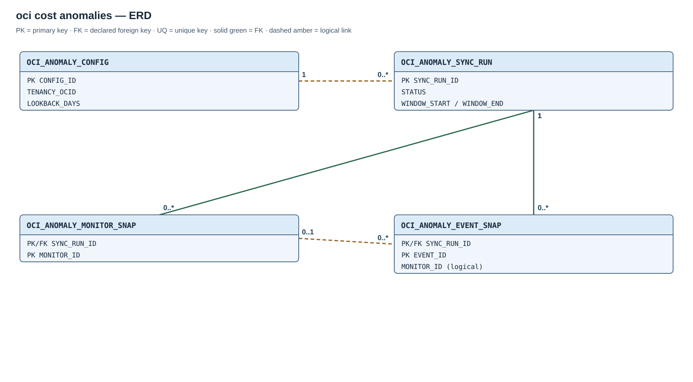

# Module 02 / OCI / 05 — Cost Anomalies

## Purpose

Cost Anomalies is an independent OCI provider extension. It requires the shared schema/core and its OCI API permissions; it does not depend on the other optional collectors.

## Entity relationships

OCI performs detection. This module preserves monitors and events. The [Cost Anomaly ERD](diagrams/02-oci-cost-anomalies.svg) shows two declared run-to-snapshot FKs. The event-to-monitor ID is a logical source link.

## Created objects

| Object | Type | Description |
| --- | --- | --- |
| [OCI_ANOMALY_CONFIG](#oci_anomaly_config) | Table | Tenancy, endpoint, lookback, and enablement configuration. |
| [OCI_ANOMALY_SYNC_RUN](#oci_anomaly_sync_run) | Table | Audit and source counts for a bounded retrieval. |
| [OCI_ANOMALY_MONITOR_SNAP](#oci_anomaly_monitor_snap), [OCI_ANOMALY_EVENT_SNAP](#oci_anomaly_event_snap) | Tables | Successful per-run monitor and event observations. |
| [OCI_ANOMALY_MONITORS_V](#reporting-views) | View | Monitors from the latest complete run. |
| [OCI_ANOMALY_HISTORY_V](#reporting-views) | View | Successful event history and quality information. |
| [OCI_ANOMALY_EVENTS_V](#reporting-views) | View | Latest known version of each event. |
| [OCI_ANOMALY_HEALTH_V](#reporting-views) | View | Latest run, counts, and last success. |
| [OCI_ANOMALY_EVENT_ID_IX](#oci_anomaly_event_snap) | Index | Event-history lookup across runs. |
| [OCI_SYNC_ANOMALIES](#oci_sync_anomalies) | Procedure | Reads paginated monitor and event data and publishes a complete snapshot. |
| [OCI_ANOMALY_DAILY](#oci_anomaly_daily) | Scheduler job | Requests daily synchronization. |

PK constraints create the other table indexes.

## Table columns and Oracle types

### `OCI_ANOMALY_CONFIG`

Singleton configuration with primary key `CONFIG_ID=1`. `LOOKBACK_DAYS` accepts 1–3660 and defaults to 365.

| Column | Type |
| --- | --- |
| `CONFIG_ID` | `NUMBER` |
| `TENANCY_OCID` | `VARCHAR2(512)` |
| `ENDPOINT_REGION` | `VARCHAR2(64)` |
| `ENDPOINT_DOMAIN` | `VARCHAR2(128)`, required; initialized from the shared tenancy realm domain |
| `CREDENTIAL_NAME` | `VARCHAR2(128)` |
| `LOOKBACK_DAYS` | `NUMBER` |
| `IS_SYNC_ENABLED` | `CHAR(1)` |

### `OCI_ANOMALY_SYNC_RUN`

One bounded retrieval with identity PK `SYNC_RUN_ID`. States are `RUNNING`, `COMPLETED`, `FAILED` and `SKIPPED`; each attempt records its exact source window.

| Column | Type |
| --- | --- |
| `SYNC_RUN_ID` | `NUMBER` |
| `STARTED_AT` | `TIMESTAMP WITH TIME ZONE` |
| `COMPLETED_AT` | `TIMESTAMP WITH TIME ZONE` |
| `STATUS` | `VARCHAR2(16)` |
| `TENANCY_OCID` | `VARCHAR2(512)` |
| `ENDPOINT_REGION` | `VARCHAR2(64)` |
| `WINDOW_START` | `TIMESTAMP WITH TIME ZONE` |
| `WINDOW_END` | `TIMESTAMP WITH TIME ZONE` |
| `MONITORS_READ` | `NUMBER` |
| `EVENTS_READ` | `NUMBER` |
| `ERROR_CODE` | `NUMBER` |
| `ERROR_MESSAGE` | `VARCHAR2(4000)` |

### `OCI_ANOMALY_MONITOR_SNAP`

One monitor per run, with primary key `(SYNC_RUN_ID, MONITOR_ID)` and a run foreign key. `SOURCE_PAYLOAD` must contain valid JSON.

| Column | Type |
| --- | --- |
| `SYNC_RUN_ID` | `NUMBER` |
| `MONITOR_ID` | `VARCHAR2(512)` |
| `COMPARTMENT_ID` | `VARCHAR2(512)` |
| `MONITOR_NAME` | `VARCHAR2(1000)` |
| `MONITOR_TYPE` | `VARCHAR2(64)` |
| `LIFECYCLE_STATE` | `VARCHAR2(64)` |
| `LIFECYCLE_DETAILS` | `VARCHAR2(4000)` |
| `SOURCE_CREATED_AT` | `TIMESTAMP WITH TIME ZONE` |
| `SOURCE_UPDATED_AT` | `TIMESTAMP WITH TIME ZONE` |
| `OBSERVED_AT` | `TIMESTAMP WITH TIME ZONE` |
| `SOURCE_PAYLOAD` | `CLOB` |

### `OCI_ANOMALY_EVENT_SNAP`

`OCI_ANOMALY_EVENT_ID_IX` on `(EVENT_ID, SYNC_RUN_ID)` supports event-history lookup; the snapshot PKs support run-level reads.

One event per run, with primary key `(SYNC_RUN_ID, EVENT_ID)` and a run foreign key. `SOURCE_PAYLOAD` and `ROOT_CAUSE_PAYLOAD` must contain valid JSON.

| Column | Type |
| --- | --- |
| `SYNC_RUN_ID` | `NUMBER` |
| `EVENT_ID` | `VARCHAR2(512)` |
| `COMPARTMENT_ID` | `VARCHAR2(512)` |
| `EVENT_NAME` | `VARCHAR2(1000)` |
| `MONITOR_ID` | `VARCHAR2(512)` |
| `MONITOR_NAME` | `VARCHAR2(1000)` |
| `MONITOR_TYPE` | `VARCHAR2(64)` |
| `LIFECYCLE_STATE` | `VARCHAR2(64)` |
| `EVENT_DATE` | `TIMESTAMP WITH TIME ZONE` |
| `COST_IMPACT` | `NUMBER` |
| `COST_VARIANCE_PERCENTAGE` | `NUMBER` |
| `ACTUAL_TOTAL_COST` | `NUMBER` |
| `EXPECTED_TOTAL_COST` | `NUMBER` |
| `ROOT_TOTAL_COST_IMPACT` | `NUMBER` |
| `FEEDBACK_RESPONSE` | `VARCHAR2(256)` |
| `SOURCE_CREATED_AT` | `TIMESTAMP WITH TIME ZONE` |
| `SOURCE_UPDATED_AT` | `TIMESTAMP WITH TIME ZONE` |
| `OBSERVED_AT` | `TIMESTAMP WITH TIME ZONE` |
| `SOURCE_PAYLOAD` | `CLOB` |
| `ROOT_CAUSE_PAYLOAD` | `CLOB` |

## Reporting views

`OCI_ANOMALY_MONITORS_V` selects monitors from the latest completed run. `OCI_ANOMALY_HISTORY_V` includes all successful event observations and calculates source-total quality; it reports `CURRENCY_STATUS='NOT_PROVIDED_BY_API'` with null currency. `OCI_ANOMALY_EVENTS_V` selects the latest known version per event, with `OBSERVED_IN_LATEST_RUN`; absence from a rolling window is not resolution. `OCI_ANOMALY_HEALTH_V` shows configuration, latest run, counts, error, and last success.

Zero and negative impacts remain as supplied. The module does not infer a currency or sum unqualified amounts.

## Routines and schedule

### `OCI_SYNC_ANOMALIES`

`OCI_SYNC_ANOMALIES` reads paginated monitor and event details, records the exact lookback window, and publishes a complete snapshot.

### `OCI_ANOMALY_DAILY`

`OCI_ANOMALY_DAILY` calls `OCI_SYNC_ANOMALIES` at **06:15 in the installation-selected time zone**.
