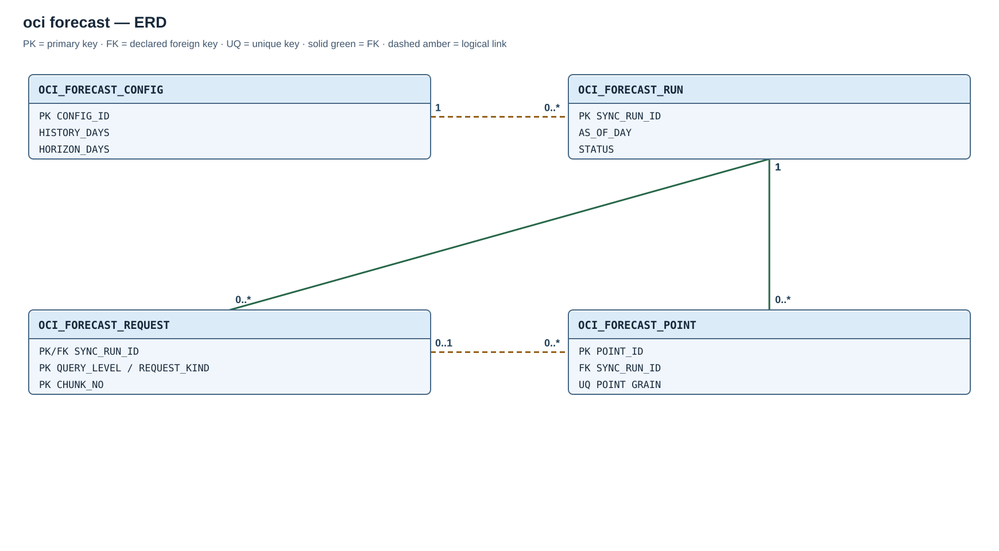

# Module 02 / OCI / 06 — Native Forecast

## Purpose

Native Forecast is an independent OCI provider extension. It requires the shared schema/core and its OCI API permissions; it does not depend on the other optional collectors.

## Entity relationships

The Usage API supplies daily actual costs and OCI BASIC forecast points. It does not use FOCUS landing data or train a local model. The [Forecast ERD](diagrams/02-oci-forecast.svg) distinguishes the run FKs from the logical request-to-point association.

## Created objects

| Object | Type | Description |
| --- | --- | --- |
| [OCI_FORECAST_CONFIG](#oci_forecast_config) | Table | Tenancy, history, horizon, and enablement settings. |
| [OCI_FORECAST_RUN](#oci_forecast_run) | Table | One forecast vintage and its audit state. |
| [OCI_FORECAST_REQUEST](#oci_forecast_request) | Table | Actual/forecast API request chunks within a vintage. |
| [OCI_FORECAST_POINT](#oci_forecast_point) | Table | Daily actual or forecast amounts by reporting grain. |
| [OCI_FORECAST_CURRENT_V](#reporting-views) | View | Points from the latest complete vintage. |
| [OCI_FORECAST_SUMMARY_V](#reporting-views), [OCI_FORECAST_LATEST_SUMMARY_V](#reporting-views) | Views | Coverage and qualified forward/month-end estimates. |
| [OCI_FORECAST_ERROR_V](#reporting-views) | View | Comparison of older forecasts with later actuals. |
| [OCI_FORECAST_HEALTH_V](#reporting-views) | View | Latest run and data quality status. |
| [OCI_FORECAST_GRAIN_UQ](#oci_forecast_point) | Unique index | Prevents duplicate point grains within a vintage. |
| [OCI_SYNC_FORECAST](#oci_sync_forecast) | Procedure | Reads Usage API actuals and BASIC forecast points. |
| [OCI_FORECAST_DAILY](#oci_forecast_daily) | Scheduler job | Requests daily synchronization. |

PK constraints create the remaining key indexes.

## Table columns and Oracle types

### `OCI_FORECAST_CONFIG`

Singleton configuration with primary key `CONFIG_ID=1`. `HISTORY_DAYS` accepts 31–90 and defaults to 60; `HORIZON_DAYS` accepts 1–60 and defaults to 30.

| Column | Type |
| --- | --- |
| `CONFIG_ID` | `NUMBER` |
| `TENANCY_OCID` | `VARCHAR2(512)` |
| `ENDPOINT_REGION` | `VARCHAR2(64)` |
| `ENDPOINT_DOMAIN` | `VARCHAR2(128)` |
| `CREDENTIAL_NAME` | `VARCHAR2(128)` |
| `HISTORY_DAYS` | `NUMBER` |
| `HORIZON_DAYS` | `NUMBER` |
| `IS_SYNC_ENABLED` | `CHAR(1)` |

### `OCI_FORECAST_RUN`

One forecast vintage with identity PK `SYNC_RUN_ID`. States are `RUNNING`, `COMPLETED`, `FAILED` and `SKIPPED`.

| Column | Type |
| --- | --- |
| `SYNC_RUN_ID` | `NUMBER` |
| `STARTED_AT` | `TIMESTAMP WITH TIME ZONE` |
| `COMPLETED_AT` | `TIMESTAMP WITH TIME ZONE` |
| `STATUS` | `VARCHAR2(16)` |
| `FORECAST_ORIGIN` | `VARCHAR2(32)` |
| `TENANCY_OCID` | `VARCHAR2(512)` |
| `ENDPOINT_REGION` | `VARCHAR2(64)` |
| `AS_OF_DAY` | `DATE` |
| `HISTORY_START` | `DATE` |
| `ACTUAL_END` | `DATE` |
| `HORIZON_END` | `DATE` |
| `FORECAST_END` | `DATE` |
| `ACTUAL_ROWS` | `NUMBER` |
| `FORECAST_ROWS` | `NUMBER` |
| `ERROR_CODE` | `NUMBER` |
| `ERROR_MESSAGE` | `VARCHAR2(4000)` |

### `OCI_FORECAST_REQUEST`

One request chunk per primary key `(SYNC_RUN_ID, QUERY_LEVEL, REQUEST_KIND, CHUNK_NO)`, with a run foreign key. Levels are `TENANCY` or `SERVICE`; kinds are `ACTUAL` or `FORECAST`. `REQUEST_PAYLOAD` must contain valid JSON.

| Column | Type |
| --- | --- |
| `SYNC_RUN_ID` | `NUMBER` |
| `QUERY_LEVEL` | `VARCHAR2(16)` |
| `REQUEST_KIND` | `VARCHAR2(16)` |
| `CHUNK_NO` | `NUMBER` |
| `REQUEST_PAYLOAD` | `CLOB` |
| `PAGES_READ` | `NUMBER` |
| `POINTS_STORED` | `NUMBER` |

### `OCI_FORECAST_POINT`

One daily amount with identity PK `POINT_ID` and a run foreign key. `OCI_FORECAST_GRAIN_UQ` enforces uniqueness within run, level, kind, tenant, nullable service/currency and day. A check requires a midnight start and one-day period; `SOURCE_PAYLOAD` must contain valid JSON.

| Column | Type |
| --- | --- |
| `POINT_ID` | `NUMBER` |
| `SYNC_RUN_ID` | `NUMBER` |
| `QUERY_LEVEL` | `VARCHAR2(16)` |
| `POINT_KIND` | `VARCHAR2(16)` |
| `TENANT_ID` | `VARCHAR2(512)` |
| `SERVICE_NAME` | `VARCHAR2(512)` |
| `CURRENCY_CODE` | `VARCHAR2(32)` |
| `PERIOD_START` | `DATE` |
| `PERIOD_END` | `DATE` |
| `AMOUNT` | `NUMBER` |
| `SOURCE_PAYLOAD` | `CLOB` |

## Reporting views

`OCI_FORECAST_CURRENT_V` exposes points in the latest completed vintage. `OCI_FORECAST_SUMMARY_V` derives quality states and qualified forward/month-end estimates for every completed vintage; `OCI_FORECAST_LATEST_SUMMARY_V` selects the newest. `OCI_FORECAST_ERROR_V` compares an older forecast to later observed actuals on the same day and grain. `OCI_FORECAST_HEALTH_V` exposes the latest run and `DATA_STATUS`. `CHECK_SERIES_COVERAGE` means the run contains actual and forecast rows; consumers must still inspect the summary's series-level coverage states before using an estimate.

`TENANCY` and `SERVICE` levels overlap and must not be added together. Currency and missing daily values remain explicit; incomplete coverage never becomes zero cost.

## Routines and schedule

### `OCI_SYNC_FORECAST`

`OCI_SYNC_FORECAST` makes read-only `RequestSummarizedUsages` POST calls, records request chunks and points, and publishes a vintage only after a complete read.

### `OCI_FORECAST_DAILY`

`OCI_FORECAST_DAILY` calls `OCI_SYNC_FORECAST` at **07:15 in the installation-selected time zone**.
