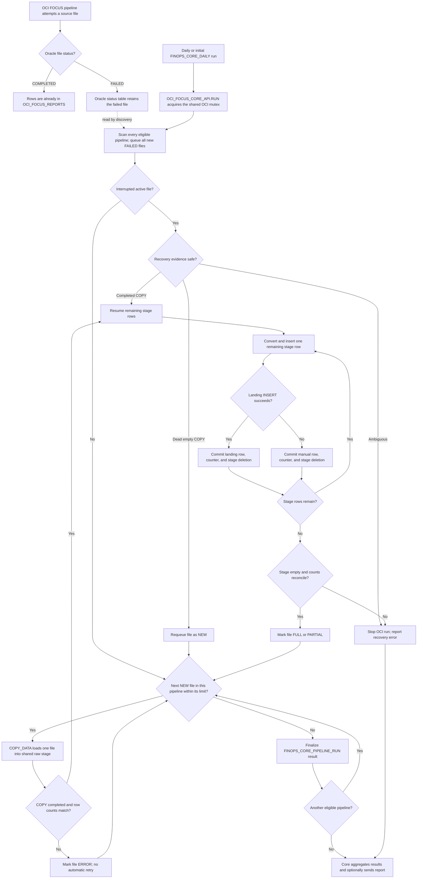
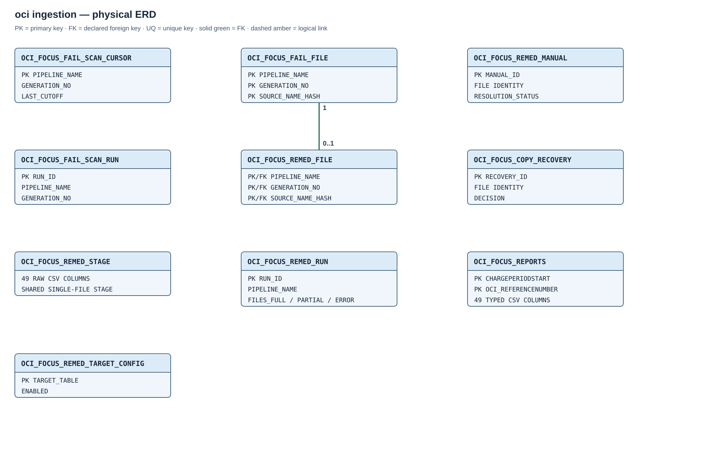

# Module 02 / OCI / 00 — FOCUS ingestion and remediation

## Purpose

This module belongs to `02_providers/OCI/00_ingestion`. It owns OCI-specific CSV ingestion and remediation in `FOCUSPLATFORM`. All years share `OCI_FOCUS_REPORTS`, one raw stage, and one serialized remediation worker. The common Module 01 job and Notifications topic remain owned by the core. No OCI ingestion object is shared with future AWS, Azure, or GCP providers.

## Daily and initial workflow

[Open the same workflow on its own page](diagrams/02-oci-ingestion-flow.mmd).

Oracle pipelines load successful files directly into `OCI_FOCUS_REPORTS`. Under the shared OCI mutex, the coordinator scans every eligible pipeline before remediation, using generation-aware watermarks with overlap. New pipelines without a status table are skipped until a later run; Oracle's file statuses remain unchanged.

One `COPY_DATA` call stages a failed file. Decimal/UTC conversion and JSON parsing precede each landing insert; invalid rows, including duplicate keys, go to manual review. Each row commits together with its stage deletion and counters. A COPY failure stays `ERROR` without automatic retry. `FULL` means all staged rows reached landing; `PARTIAL` means some went to manual review. Both require an empty stage and reconciled counts.

Recovery compares file/stage accounting, load-operation and session evidence: a completed COPY resumes, a dead empty attempt requeues, and ambiguity blocks automatic action. Manual resolution validates the landing key before closing the item. The common daily job handles up to 2,000 files per pipeline, without imposing a per-file deadline, and optionally sends the combined report. Overlapping coordinator calls skip under the Core lock.

## Optional rolling-retention execution

Retention removes complete months from the landing independently of ingestion and remediation. The policy defaults to 24 months and accepts whole values of at least 12. Selection uses stored UTC charge periods, not file dates; the cutoff is the earlier of the current UTC year's start and the current month's start minus the policy. The current UTC year is protected, and later loads can reintroduce old charges.

Runs use a non-waiting lock and autonomous transactions. Each month's deletion and progress commit together: a failed month rolls back, earlier commits remain, and the next invocation marks abandoned `RUNNING` audits `FAILED`. Configuration is captured at run start; audits store metadata, not row copies.

Affected historical pipelines must be stopped and idle; checks repeat between monthly commits. The current-year pipeline may remain active. No automatic pipeline stop or database-wide writer lock is provided, so competing manual/recovery writes are excluded. A nonempty delete requires MV FAST-after-delete capability; preview does not test it. Retention does not refresh the MV, remove bucket objects/partitions, or guarantee segment-space reclamation.

A separate [manual range-cleanup script](../deployment/install/maintenance-and-diagnostics.md#purge-expired-oci-focus-landing-rows) accepts explicit months and does not inherit the rolling policy's minimum-retention protection. Its invocation, writer coordination and recovery details are in [maintenance procedures](../deployment/install/maintenance-and-diagnostics.md#configure-and-run-rolling-retention).

The [retention API](#oci_focus_retention_api) and [monthly job](#oci_focus_retention_monthly) are defined with the other routines below.

## Entity relationships

The [full-size SVG](diagrams/02-oci-ingestion.svg) is the **physical ERD** for the OCI ingestion tables. It shows the remediation-file foreign key. Rolling retention additionally declares `OCI_FOCUS_RETENTION_MONTH.RUN_ID` referencing `OCI_FOCUS_RETENTION_RUN.RUN_ID`, documented in the table definitions below; their logical associations are listed below and their processing sequence is shown in the workflow diagram.

| Parent | Child or target | Relationship |
| --- | --- | --- |
| `FINOPS_CORE_PROVIDER` | `FINOPS_CORE_PROVIDER_RUN` | Declared FK on `PROVIDER_CODE`. |
| `FINOPS_CORE_PROVIDER_RUN` | `FINOPS_CORE_PIPELINE_RUN` | Declared composite FK on `(RUN_ID, PROVIDER_CODE)`. |
| `OCI_FOCUS_FAIL_SCAN_CURSOR` | `OCI_FOCUS_FAIL_FILE`, `OCI_FOCUS_FAIL_SCAN_RUN` | Logical link by pipeline and generation; no declared FK. |
| `OCI_FOCUS_FAIL_FILE` | `OCI_FOCUS_REMED_FILE` | Declared composite FK on `(PIPELINE_NAME, GENERATION_NO, SOURCE_NAME_HASH)`. |
| `OCI_FOCUS_REMED_FILE` | `OCI_FOCUS_REMED_MANUAL`, `OCI_FOCUS_COPY_RECOVERY` | Logical file identity; no declared FK. |
| `OCI_FOCUS_REMED_FILE` | `OCI_FOCUS_REPORTS` | Successful row insertion; landing has no source-file FK. |
| `OCI_FOCUS_REMED_TARGET_CONFIG` | `OCI_FOCUS_REPORTS` | Configured target table name; no declared FK. |

File identity is `(PIPELINE_NAME, GENERATION_NO, SOURCE_NAME_HASH)`. The source name itself is also stored and checked to guard against a hash collision. A pipeline reset changes its status table/operation identity; the detector advances `GENERATION_NO` and can process failures in the new generation. Oracle-generated status tables are read only and are never purged by remediation.

## Landing and source pipelines

### Created object inventory

| Object | Type | Description |
| --- | --- | --- |
| [OCI_FOCUS_REPORTS](#oci_focus_reports) | Partitioned table | Typed OCI FOCUS landing shared by all source years. |
| [OCI_FOCUS_REMED_STAGE](#oci_focus_remed_stage) | Table | Shared raw CSV stage for one rejected file at a time. |
| [OCI_FOCUS_FAIL_SCAN_CURSOR](#oci_focus_fail_scan_cursor) | Table | Pipeline-generation identity and incremental scan watermark. |
| [OCI_FOCUS_FAIL_FILE](#oci_focus_fail_file) | Table | Discovered failed-file queue and Oracle source evidence. |
| [OCI_FOCUS_FAIL_SCAN_RUN](#oci_focus_fail_scan_run) | Table | Discovery-scan audit. |
| [OCI_FOCUS_REMED_FILE](#oci_focus_remed_file) | Table | Per-file remediation state and row counters. |
| [OCI_FOCUS_REMED_MANUAL](#oci_focus_remed_manual) | Table | Rejected rows awaiting or recording manual resolution. |
| [OCI_FOCUS_REMED_RUN](#oci_focus_remed_run) | Table | Per-pipeline remediation-run audit. |
| [OCI_FOCUS_COPY_RECOVERY](#oci_focus_copy_recovery) | Table | Durable interrupted-`COPY_DATA` decisions. |
| [OCI_FOCUS_REMED_TARGET_CONFIG](#oci_focus_remed_target_config) | Table | Approved landing target and enablement. |
| [OCI_FOCUS_REPORTS_PK](#oci_focus_reports) | Local PK index | Enforces the landing key within monthly partitions. |
| [OCI_FOCUS_FAIL_FILE_STATE_I](#oci_focus_fail_file), [OCI_FOCUS_REMED_ONE_ACTIVE](#oci_focus_remed_file) | Indexes | Select queue states and enforce one active file across OCI pipelines. |
| [OCI_FOCUS_REMED_MANUAL_PENDING_I](#oci_focus_remed_manual), [OCI_FOCUS_COPY_RECOVERY_FILE_I](#oci_focus_copy_recovery) | Indexes | Locate unresolved rows and recovery history. |
| [OCI_FOCUS_SOURCE_PREFIX](#oci_focus_source_prefix), [OCI_FOCUS_FILL_SOURCE_URIS](#oci_focus_fill_source_uris), [OCI_FOCUS_DISCOVER_FAILURES](#oci_focus_discover_failures) | Function and procedures | Resolve source URIs and discover new Oracle `FAILED` file statuses. |
| [OCI_FOCUS_REMED_MUTEX](#oci_focus_remed_mutex) | Package and body | Serializes use of the shared stage and remediation worker. |
| [OCI_FOCUS_REMED_NUMBER](#oci_focus_remed_number), [OCI_FOCUS_REMED_TIMESTAMP](#oci_focus_remed_timestamp), [OCI_FOCUS_REMEDIATE_FILES](#oci_focus_remediate_files) | Functions and procedure | Convert raw values and route each staged row to landing or manual review. |
| [OCI_FOCUS_COPY_RECOVERY_DECIDE](#oci_focus_copy_recovery_decide), [OCI_FOCUS_RECOVER_COPYING](#oci_focus_recover_copying), [OCI_FOCUS_RECOVER_ACTIVE_FILE](#oci_focus_recover_active_file) | Function and procedures | Decide and apply safe recovery of interrupted file work. |
| [OCI_FOCUS_RESOLVE_MANUAL_ROW](#oci_focus_resolve_manual_row), [OCI_FOCUS_GET_INGESTION_REPORT](#oci_focus_get_ingestion_report) | Procedures | Close a reviewed manual row and produce an on-demand ingestion report. |
| [OCI_FOCUS_CORE_API](#oci_focus_core_api) | Package and body | Provider adapter exposing `RUN` and `REPORT` to the shared core. |
| [OCI_FOCUS_REPORTS_LOAD_YYYY](#year-pipelines) | Oracle LOAD pipelines | One started pipeline per chosen source year; each targets the shared landing. Oracle creates its own `PIPELINE$...` job and status table. |
| [OCI_FOCUS_RETENTION_CONFIG](#oci_focus_retention_config) | Table | Whole-month retention policy. |
| [OCI_FOCUS_RETENTION_RUN](#oci_focus_retention_run) | Table | Retention invocation audit and outcomes. |
| [OCI_FOCUS_RETENTION_MONTH](#oci_focus_retention_month) | Table | Per-month eligibility, deletion and commit progress. |
| [OCI_FOCUS_RETENTION_API](#oci_focus_retention_api) | Package and body | Preview and serialized monthly retention. |
| [OCI_FOCUS_RETENTION_MONTHLY](#oci_focus_retention_monthly) | Scheduler job | Disabled-by-default monthly retention invocation. |

Primary and unique constraints create additional supporting indexes on the owner tables. Oracle's pipeline status tables are read-only source evidence, not objects created by this module's SQL DDL.

### Year pipelines

The source location identifies a region, Object Storage namespace, bucket and optional base prefix within the tenancy's realm, with [source-specific IAM prerequisites](../deployment/install/oci-resource-principal-iam.md#2-choose-the-source-policy). Oracle-managed defaults are the tenancy home region, namespace `bling`, the tenancy OCID as bucket name and prefix `FOCUS Reports/`; these values can be overridden. Immediate year prefixes define the available source years. The [source configuration guide](../deployment/install/python-installation.md#focus-report-source) owns the editable fields and bucket layout requirements. One `OCI_FOCUS_REPORTS_LOAD_YYYY` LOAD pipeline is created for each selected year through the current UTC year. Oracle-managed locations use the `<prefix>/YYYY/*/*/*.csv.gz` layout. Customer locations use `regexuri` and match compressed CSV files at any depth below `base-prefix/YYYY/`; month and day folders are not required. All pipelines target the same landing, use the same 49-field order, gzip CSV settings and timestamp masks, run at 60-minute intervals, and start in the `STOPPED` state. Their startup gate permits activation only after the OAC MV has completed its initial empty `COMPLETE` refresh. A pipeline's `FAILED` file status is the trigger for remediation; it is not changed by our code.

## Table columns and Oracle types

### `OCI_FOCUS_REPORTS`

**Named constraint:** `OCI_FOCUS_REPORTS_PK` (PRIMARY KEY).

`OCI_FOCUS_REPORTS` has exactly 49 CSV-order columns. Its monthly interval partition key is `CHARGEPERIODSTART TIMESTAMP(6)` and its local primary key is `(CHARGEPERIODSTART, OCI_REFERENCENUMBER)`. The fixed `P_INIT` partition holds values before 1 January 2024 and is normally empty because OCI FOCUS reports began in 2024. Oracle creates monthly interval partitions for inserted rows from 2024 onward. The chosen first pipeline year does not affect this table definition. The four FOCUS period timestamps are stored as UTC `TIMESTAMP(6)` values, avoiding session time-zone presentation shifts. `TAGS` uses Oracle's native `JSON` type. The landing uses `COMPRESS FOR QUERY HIGH`.

| Column | Type |
| --- | --- |
| `AVAILABILITYZONE` | `VARCHAR2(100)` |
| `BILLEDCOST` | `NUMBER` |
| `BILLINGACCOUNTID` | `VARCHAR2(256)` |
| `BILLINGACCOUNTNAME` | `VARCHAR2(512)` |
| `BILLINGCURRENCY` | `VARCHAR2(10)` |
| `BILLINGPERIODEND` | `TIMESTAMP(6)` |
| `BILLINGPERIODSTART` | `TIMESTAMP(6)` |
| `CHARGECATEGORY` | `VARCHAR2(100)` |
| `CHARGEDESCRIPTION` | `VARCHAR2(4000)` |
| `CHARGEFREQUENCY` | `VARCHAR2(100)` |
| `CHARGEPERIODEND` | `TIMESTAMP(6)` |
| `CHARGEPERIODSTART` | `TIMESTAMP(6)` |
| `CHARGESUBCATEGORY` | `VARCHAR2(100)` |
| `COMMITMENTDISCOUNTCATEGORY` | `VARCHAR2(100)` |
| `COMMITMENTDISCOUNTID` | `VARCHAR2(256)` |
| `COMMITMENTDISCOUNTNAME` | `VARCHAR2(512)` |
| `COMMITMENTDISCOUNTTYPE` | `VARCHAR2(100)` |
| `EFFECTIVECOST` | `NUMBER` |
| `INVOICEISSUER` | `VARCHAR2(256)` |
| `LISTCOST` | `NUMBER` |
| `LISTUNITPRICE` | `NUMBER` |
| `PRICINGCATEGORY` | `VARCHAR2(100)` |
| `PRICINGQUANTITY` | `NUMBER` |
| `PRICINGUNIT` | `VARCHAR2(100)` |
| `PROVIDER` | `VARCHAR2(100)` |
| `PUBLISHER` | `VARCHAR2(256)` |
| `REGION` | `VARCHAR2(100)` |
| `RESOURCEID` | `VARCHAR2(1500)` |
| `RESOURCENAME` | `VARCHAR2(1500)` |
| `RESOURCETYPE` | `VARCHAR2(512)` |
| `SERVICECATEGORY` | `VARCHAR2(512)` |
| `SERVICENAME` | `VARCHAR2(512)` |
| `SKUID` | `VARCHAR2(512)` |
| `SKUPRICEID` | `VARCHAR2(512)` |
| `SUBACCOUNTID` | `VARCHAR2(512)` |
| `SUBACCOUNTNAME` | `VARCHAR2(512)` |
| `TAGS` | `JSON` |
| `USAGEQUANTITY` | `NUMBER` |
| `USAGEUNIT` | `VARCHAR2(100)` |
| `OCI_REFERENCENUMBER` | `VARCHAR2(512)` |
| `OCI_COMPARTMENTID` | `VARCHAR2(1500)` |
| `OCI_COMPARTMENTNAME` | `VARCHAR2(512)` |
| `OCI_OVERAGEFLAG` | `VARCHAR2(10)` |
| `OCI_UNITPRICEOVERAGE` | `NUMBER` |
| `OCI_BILLEDQUANTITYOVERAGE` | `NUMBER` |
| `OCI_COSTOVERAGE` | `NUMBER` |
| `OCI_ATTRIBUTEDUSAGE` | `NUMBER` |
| `OCI_ATTRIBUTEDCOST` | `NUMBER` |
| `OCI_BACKREFERENCENUMBER` | `VARCHAR2(512)` |

### `OCI_FOCUS_REMED_STAGE`

The same 49 column names and order as landing; 48 raw `VARCHAR2(32767)` columns and `TAGS CLOB`. No extra visible columns. `NOCOMPRESS` preserves stable row identifiers for row-by-row processing and recovery. It holds at most one failed file at a time.

| Column | Type |
| --- | --- |
| `AVAILABILITYZONE` | `VARCHAR2(32767)` |
| `BILLEDCOST` | `VARCHAR2(32767)` |
| `BILLINGACCOUNTID` | `VARCHAR2(32767)` |
| `BILLINGACCOUNTNAME` | `VARCHAR2(32767)` |
| `BILLINGCURRENCY` | `VARCHAR2(32767)` |
| `BILLINGPERIODEND` | `VARCHAR2(32767)` |
| `BILLINGPERIODSTART` | `VARCHAR2(32767)` |
| `CHARGECATEGORY` | `VARCHAR2(32767)` |
| `CHARGEDESCRIPTION` | `VARCHAR2(32767)` |
| `CHARGEFREQUENCY` | `VARCHAR2(32767)` |
| `CHARGEPERIODEND` | `VARCHAR2(32767)` |
| `CHARGEPERIODSTART` | `VARCHAR2(32767)` |
| `CHARGESUBCATEGORY` | `VARCHAR2(32767)` |
| `COMMITMENTDISCOUNTCATEGORY` | `VARCHAR2(32767)` |
| `COMMITMENTDISCOUNTID` | `VARCHAR2(32767)` |
| `COMMITMENTDISCOUNTNAME` | `VARCHAR2(32767)` |
| `COMMITMENTDISCOUNTTYPE` | `VARCHAR2(32767)` |
| `EFFECTIVECOST` | `VARCHAR2(32767)` |
| `INVOICEISSUER` | `VARCHAR2(32767)` |
| `LISTCOST` | `VARCHAR2(32767)` |
| `LISTUNITPRICE` | `VARCHAR2(32767)` |
| `PRICINGCATEGORY` | `VARCHAR2(32767)` |
| `PRICINGQUANTITY` | `VARCHAR2(32767)` |
| `PRICINGUNIT` | `VARCHAR2(32767)` |
| `PROVIDER` | `VARCHAR2(32767)` |
| `PUBLISHER` | `VARCHAR2(32767)` |
| `REGION` | `VARCHAR2(32767)` |
| `RESOURCEID` | `VARCHAR2(32767)` |
| `RESOURCENAME` | `VARCHAR2(32767)` |
| `RESOURCETYPE` | `VARCHAR2(32767)` |
| `SERVICECATEGORY` | `VARCHAR2(32767)` |
| `SERVICENAME` | `VARCHAR2(32767)` |
| `SKUID` | `VARCHAR2(32767)` |
| `SKUPRICEID` | `VARCHAR2(32767)` |
| `SUBACCOUNTID` | `VARCHAR2(32767)` |
| `SUBACCOUNTNAME` | `VARCHAR2(32767)` |
| `TAGS` | `CLOB` |
| `USAGEQUANTITY` | `VARCHAR2(32767)` |
| `USAGEUNIT` | `VARCHAR2(32767)` |
| `OCI_REFERENCENUMBER` | `VARCHAR2(32767)` |
| `OCI_COMPARTMENTID` | `VARCHAR2(32767)` |
| `OCI_COMPARTMENTNAME` | `VARCHAR2(32767)` |
| `OCI_OVERAGEFLAG` | `VARCHAR2(32767)` |
| `OCI_UNITPRICEOVERAGE` | `VARCHAR2(32767)` |
| `OCI_BILLEDQUANTITYOVERAGE` | `VARCHAR2(32767)` |
| `OCI_COSTOVERAGE` | `VARCHAR2(32767)` |
| `OCI_ATTRIBUTEDUSAGE` | `VARCHAR2(32767)` |
| `OCI_ATTRIBUTEDCOST` | `VARCHAR2(32767)` |
| `OCI_BACKREFERENCENUMBER` | `VARCHAR2(32767)` |

### `OCI_FOCUS_FAIL_SCAN_CURSOR`

PK `PIPELINE_NAME`. Tracks the current Oracle status-table generation and incremental scan watermark.

| Column | Type |
| --- | --- |
| `PIPELINE_NAME` | `VARCHAR2(128)` |
| `PIPELINE_ID` | `NUMBER` |
| `OPERATION_ID` | `NUMBER` |
| `STATUS_TABLE` | `VARCHAR2(128)` |
| `STATUS_TABLE_CREATED` | `DATE` |
| `GENERATION_NO` | `NUMBER` |
| `LAST_CUTOFF` | `TIMESTAMP WITH TIME ZONE` |
| `LAST_SCAN_AT` | `TIMESTAMP WITH TIME ZONE` |

### `OCI_FOCUS_FAIL_FILE`

**Index:** `OCI_FOCUS_FAIL_FILE_STATE_I` on `(FILE_STATE, PIPELINE_NAME, GENERATION_NO)`.

PK on the three-part file identity. `FILE_STATE` is `NEW`, `IN_PROGRESS`, `FULL`, `PARTIAL`, `MANUAL`, or `ERROR`. Index `OCI_FOCUS_FAIL_FILE_STATE_I` supports queue selection.

| Column | Type |
| --- | --- |
| `PIPELINE_NAME` | `VARCHAR2(128)` |
| `GENERATION_NO` | `NUMBER` |
| `SOURCE_NAME_HASH` | `RAW(32)` |
| `SOURCE_NAME` | `VARCHAR2(4000)` |
| `SOURCE_URI` | `VARCHAR2(4000)` |
| `SOURCE_ID` | `NUMBER` |
| `SOURCE_BYTES` | `NUMBER` |
| `SOURCE_CHECKSUM` | `VARCHAR2(128)` |
| `SOURCE_LAST_MODIFIED` | `TIMESTAMP WITH TIME ZONE` |
| `SOURCE_END_TIME` | `TIMESTAMP WITH TIME ZONE` |
| `ERROR_CODE` | `NUMBER` |
| `ERROR_MESSAGE` | `VARCHAR2(4000)` |
| `ROWS_LOADED` | `NUMBER` |
| `FILE_STATE` | `VARCHAR2(20)` |
| `FIRST_SEEN_AT` | `TIMESTAMP WITH TIME ZONE` |

### `OCI_FOCUS_FAIL_SCAN_RUN`

Identity PK. Durable audit of each discovery scan.

| Column | Type |
| --- | --- |
| `RUN_ID` | `NUMBER` |
| `PIPELINE_NAME` | `VARCHAR2(128)` |
| `GENERATION_NO` | `NUMBER` |
| `STATUS_TABLE` | `VARCHAR2(128)` |
| `WINDOW_START` | `TIMESTAMP WITH TIME ZONE` |
| `WINDOW_END` | `TIMESTAMP WITH TIME ZONE` |
| `NEW_FILE_COUNT` | `NUMBER` |
| `COMPLETED_AT` | `TIMESTAMP WITH TIME ZONE` |

### `OCI_FOCUS_REMED_FILE`

**Index:** `OCI_FOCUS_REMED_ONE_ACTIVE` on `(CASE WHEN STATE IN ('COPYING','STAGED','PROCESSING') THEN 1 END)`.

PK/file FK on the three-part identity. `STATE`: `NEW`, `COPYING`, `STAGED`, `PROCESSING`, `FULL`, `PARTIAL`, `ERROR`. Unique function-based index `OCI_FOCUS_REMED_ONE_ACTIVE` permits only one active file across all OCI pipelines.

| Column | Type |
| --- | --- |
| `PIPELINE_NAME` | `VARCHAR2(128)` |
| `GENERATION_NO` | `NUMBER` |
| `SOURCE_NAME_HASH` | `RAW(32)` |
| `STATE` | `VARCHAR2(20)` |
| `COPY_OPERATION_ID` | `NUMBER` |
| `COPY_SESSION_SID` | `NUMBER` |
| `COPY_SESSION_SERIAL` | `NUMBER` |
| `STAGED_ROWS` | `NUMBER` |
| `INSERTED_ROWS` | `NUMBER` |
| `MANUAL_ROWS` | `NUMBER` |
| `RESOLVED_ROWS` | `NUMBER` |
| `WAIVED_ROWS` | `NUMBER` |
| `RESOLUTION_COMPLETED_AT` | `TIMESTAMP WITH TIME ZONE` |
| `ERROR_MESSAGE` | `VARCHAR2(4000)` |
| `STARTED_AT` | `TIMESTAMP WITH TIME ZONE` |
| `FINISHED_AT` | `TIMESTAMP WITH TIME ZONE` |

### `OCI_FOCUS_REMED_MANUAL`

**Index:** `OCI_FOCUS_REMED_MANUAL_PENDING_I` on `(RESOLUTION_STATUS, CREATED_AT, MANUAL_ID)`.

Identity PK and unique `(file identity, STAGE_ROWID)`. Pending index on `(RESOLUTION_STATUS, CREATED_AT, MANUAL_ID)`. `RESOLUTION_STATUS`: `PENDING`, `INSERTED`, `ACCEPTED_EXISTING`, `WAIVED`.

| Column | Type |
| --- | --- |
| `MANUAL_ID` | `NUMBER` |
| `PIPELINE_NAME` | `VARCHAR2(128)` |
| `GENERATION_NO` | `NUMBER` |
| `SOURCE_NAME_HASH` | `RAW(32)` |
| `STAGE_ROWID` | `VARCHAR2(30)` |
| `ERROR_CODE` | `NUMBER` |
| `ERROR_MESSAGE` | `VARCHAR2(4000)` |
| `RAW_ROW_JSON` | `CLOB` |
| `CREATED_AT` | `TIMESTAMP WITH TIME ZONE` |
| `RESOLUTION_STATUS` | `VARCHAR2(20)` |
| `RESOLVED_AT` | `TIMESTAMP WITH TIME ZONE` |
| `RESOLVED_BY` | `VARCHAR2(128)` |
| `RESOLUTION_NOTE` | `VARCHAR2(4000)` |
| `RESOLVED_CHARGEPERIODSTART` | `TIMESTAMP(6)` |
| `RESOLVED_OCI_REFERENCENUMBER` | `VARCHAR2(512)` |

### `OCI_FOCUS_REMED_RUN`

Identity PK. Per-pipeline worker invocation counters.

| Column | Type |
| --- | --- |
| `RUN_ID` | `NUMBER` |
| `PIPELINE_NAME` | `VARCHAR2(128)` |
| `STARTED_AT` | `TIMESTAMP WITH TIME ZONE` |
| `FINISHED_AT` | `TIMESTAMP WITH TIME ZONE` |
| `FILES_FULL` | `NUMBER` |
| `FILES_PARTIAL` | `NUMBER` |
| `FILES_ERROR` | `NUMBER` |
| `ERROR_MESSAGE` | `VARCHAR2(4000)` |

### `OCI_FOCUS_COPY_RECOVERY`

**Index:** `OCI_FOCUS_COPY_RECOVERY_FILE_I` on `(PIPELINE_NAME, GENERATION_NO, SOURCE_NAME_HASH, DECISION)`.

Identity PK; file lookup index. Audits automatic decisions `REQUEUED` or `STAGED` after interrupted COPY_DATA.

| Column | Type |
| --- | --- |
| `RECOVERY_ID` | `NUMBER` |
| `PIPELINE_NAME` | `VARCHAR2(128)` |
| `GENERATION_NO` | `NUMBER` |
| `SOURCE_NAME_HASH` | `RAW(32)` |
| `COPY_OPERATION_ID` | `NUMBER` |
| `DECISION` | `VARCHAR2(20)` |
| `STAGE_ROWS` | `NUMBER` |
| `RECOVERED_AT` | `TIMESTAMP WITH TIME ZONE` |
| `REASON` | `VARCHAR2(4000)` |

### `OCI_FOCUS_REMED_TARGET_CONFIG`

PK `TARGET_TABLE`. Exactly one enabled approved target initially: `OCI_FOCUS_REPORTS`.

| Column | Type |
| --- | --- |
| `TARGET_TABLE` | `VARCHAR2(128)` |
| `ENABLED` | `CHAR(1)` |
| `UPDATED_AT` | `TIMESTAMP WITH TIME ZONE` |

### `OCI_FOCUS_RETENTION_CONFIG`

| Column | Oracle definition |
| --- | --- |
| `CONFIG_ID` | `NUMBER(1) PRIMARY KEY CHECK (CONFIG_ID=1)` |
| `KEEP_MONTHS` | `NUMBER DEFAULT 24 NOT NULL CHECK (KEEP_MONTHS>=12 AND KEEP_MONTHS=TRUNC(KEEP_MONTHS))` |

### `OCI_FOCUS_RETENTION_RUN`

| Column | Oracle definition |
| --- | --- |
| `RUN_ID` | `NUMBER GENERATED ALWAYS AS IDENTITY PRIMARY KEY` |
| `STARTED_AT` | `TIMESTAMP WITH TIME ZONE DEFAULT SYSTIMESTAMP NOT NULL` |
| `FINISHED_AT` | `TIMESTAMP WITH TIME ZONE` |
| `KEEP_MONTHS` | `NUMBER NOT NULL` |
| `CUTOFF_UTC` | `TIMESTAMP(6) NOT NULL` |
| `PREVIEW_ONLY` | `NUMBER(1) NOT NULL CHECK (PREVIEW_ONLY IN (0,1))` |
| `STATUS` | `VARCHAR2(16) NOT NULL CHECK (STATUS IN ('RUNNING','PREVIEW','COMPLETED','NO_DATA','BLOCKED','FAILED'))` |
| `ROWS_ELIGIBLE` | `NUMBER DEFAULT 0 NOT NULL` |
| `ROWS_DELETED` | `NUMBER DEFAULT 0 NOT NULL` |
| `MESSAGE` | `VARCHAR2(4000)` |

### `OCI_FOCUS_RETENTION_MONTH`

**Primary key:** `(RUN_ID, MONTH_START_UTC)` identifies one month within a retention invocation.

| Column | Oracle definition |
| --- | --- |
| `RUN_ID` | `NUMBER REFERENCES OCI_FOCUS_RETENTION_RUN(RUN_ID)` |
| `MONTH_START_UTC` | `DATE NOT NULL` |
| `ROWS_ELIGIBLE` | `NUMBER NOT NULL` |
| `ROWS_DELETED` | `NUMBER DEFAULT 0 NOT NULL` |
| `COMMITTED_AT` | `TIMESTAMP WITH TIME ZONE` |

## Routines and runtime state

### `OCI_FOCUS_SOURCE_PREFIX`

`OCI_FOCUS_SOURCE_PREFIX(location)`

Extracts the fixed Object Storage prefix before the pipeline location's wildcard or regex; rejects malformed locations.

### `OCI_FOCUS_FILL_SOURCE_URIS`

`OCI_FOCUS_FILL_SOURCE_URIS(pipeline_name)`

Completes queued file URIs from the pipeline's fixed source prefix; validates source names before updating the owner queue.

### `OCI_FOCUS_DISCOVER_FAILURES`

`OCI_FOCUS_DISCOVER_FAILURES(pipeline_name, overlap_minutes, settle_minutes)`

Reads the pipeline's Oracle-owned status table incrementally, tracks a reset as a new generation, queues new `FAILED` files, and audits the scan. Oracle metadata is read only.

### `OCI_FOCUS_REMED_MUTEX`

`OCI_FOCUS_REMED_MUTEX.ENTER/LEAVE`

Serializes the single shared stage and remediation worker across all OCI pipelines.

### `OCI_FOCUS_REMED_NUMBER`

`OCI_FOCUS_REMED_NUMBER(value)`

Converts one raw decimal field using explicit decimal characters.

### `OCI_FOCUS_REMED_TIMESTAMP`

`OCI_FOCUS_REMED_TIMESTAMP(value)`

Converts UTC ISO 8601 minute, second or fractional-second forms to a UTC `TIMESTAMP` for every period field.

### `OCI_FOCUS_REMEDIATE_FILES`

`OCI_FOCUS_REMEDIATE_FILES(pipeline_name, max_files, source_name)`

Processes up to 2000 queued failed files for one pipeline, one file at a time. `COPY_DATA` fills the shared stage; each row is inserted into landing or recorded for manual resolution, with a durable counter and stage deletion. Optional source name narrows an operator diagnostic.

### `OCI_FOCUS_COPY_RECOVERY_DECIDE`

`OCI_FOCUS_COPY_RECOVERY_DECIDE(...)`

Pure decision function over stage, ledger, COPY operation, and session evidence. Returns `STAGED`, `REQUEUE`, or `BLOCK`; ambiguous evidence blocks automatic action.

### `OCI_FOCUS_RECOVER_COPYING`

`OCI_FOCUS_RECOVER_COPYING(action OUT)`

Applies a safe interrupted-COPY decision, audits it in `OCI_FOCUS_COPY_RECOVERY`, and leaves an unsupported state for investigation.

### `OCI_FOCUS_RECOVER_ACTIVE_FILE`

Called before processing another file; resumes a staged or processing file at its remaining rows and delegates an interrupted COPY to the evidence check.

### `OCI_FOCUS_RESOLVE_MANUAL_ROW`

`OCI_FOCUS_RESOLVE_MANUAL_ROW(...)`

Operator action after a landing insert or confirmed existing row; verifies the landing key and records the chosen resolution and note.

### `OCI_FOCUS_GET_INGESTION_REPORT`

`OCI_FOCUS_GET_INGESTION_REPORT(report OUT, since)`

Builds an on-demand CLOB with Oracle pipeline status, product remediation results, and outstanding manual rows; does not send email.

### `OCI_FOCUS_CORE_API`

`OCI_FOCUS_CORE_API.RUN/REPORT`

Provider-neutral Module 01 entry points. `RUN` discovers failures across eligible OCI pipelines before processing their queues and writes per-pipeline core results. `REPORT` returns the provider section of the combined daily report.

`FINOPS_CORE_DAILY` is the only daily coordinator job for all registered providers. OCI creates no separate remediation Scheduler job. Oracle's `PIPELINE$<id>` jobs are created by `DBMS_CLOUD_PIPELINE` for each started source pipeline; stopping one pipeline does not delete the product's failed-file queue or the common coordinator.

Outcomes are recorded in `FINOPS_CORE_RUN`, `FINOPS_CORE_PROVIDER_RUN`, `FINOPS_CORE_PIPELINE_RUN`, `OCI_FOCUS_FAIL_FILE` and `OCI_FOCUS_REMED_MANUAL`. `FINOPS_CORE_REPORT(NULL)` reads the latest audit hierarchy and provider status without starting reconciliation or sending email. Structural availability, file processing and row remediation are distinct states.

### `OCI_FOCUS_RETENTION_API`

| Entry point | Contract |
| --- | --- |
| `OCI_FOCUS_RETENTION_API.SET_POLICY(P_KEEP_MONTHS)` | Changes the stored policy without deleting rows or enabling the job. |
| `OCI_FOCUS_RETENTION_API.RUN(P_KEEP_MONTHS, P_PREVIEW_ONLY)` | Uses the stored policy unless overridden. `P_PREVIEW_ONLY=1` is the default and records audit counts without deletion; `0` deletes eligible months. |
| `OCI_FOCUS_RETENTION_API.RUN_SCHEDULED` | Executes non-preview retention using the stored policy. |

### `OCI_FOCUS_RETENTION_MONTHLY`

The job is disabled by default and calls `RUN_SCHEDULED` on day 1 at 03:30 in the shared time zone. Enabling it opts into recurring deletion.
