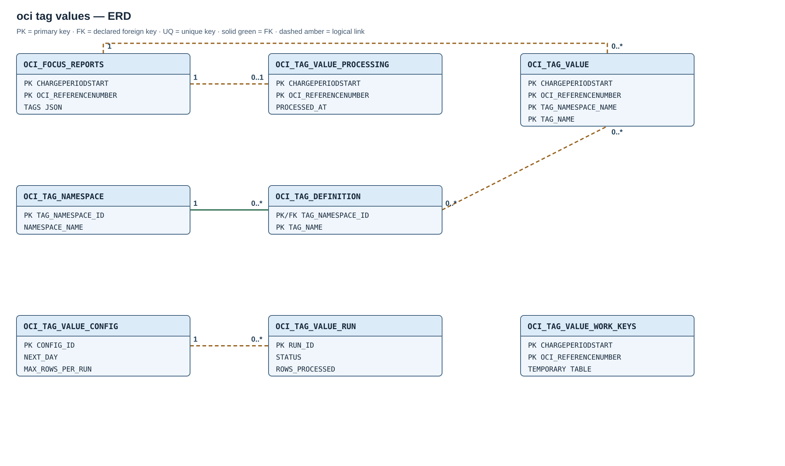

# Module 02 / OCI / 01b — optional defined-tag values

## Purpose

Store nonblank values for all cataloged OCI defined tags in a long-form bridge keyed by FOCUS charge. This optional component performs bounded historical processing independently of OAC's selected-profile projection.

## How it works

The worker reads the stored defined-tag catalog and examines unprocessed FOCUS charges in landing-key order, in batches of at most 500 keys. It extracts nonblank scalar values from flat `Namespace.TagName` JSON keys and commits the values together with a completion marker for each charge, including charges without matching tags. Failed batches roll back together; earlier commits remain durable and completed charges are skipped. Non-scalar values or values longer than 4,000 characters fail the batch.

A shared non-waiting lock prevents parallel manual and scheduled processing. The hourly worker defaults to 10,000 charges per invocation, allocating 20% to today's charges and 80% to the historical cursor during catch-up. `NEXT_DAY` advances only when its day is complete. At today it uses the full limit; after moving beyond today, it cycles from the earliest day to pick up late-arriving charges.

The worker uses the last stored catalog rather than calling OCI Identity per batch. New catalog definitions do not automatically reopen completed charges; explicit rechecking controls historical expansion. The source landing, pipeline statuses, remediation, reporting profile and OAC objects are unchanged.

### Run states and recovery

| State | Meaning |
| --- | --- |
| `RUNNING` | Processing is active; counters reflect committed batches. |
| `COMPLETE` | This invocation ended successfully, possibly with zero rows; it does not establish completion of the day or historical backfill. |
| `ERROR` | A processing step failed or a later invocation detected an abandoned run. Committed batches remain available for recovery. |
| `SKIPPED` | No source rows were available or another invocation held the lock. |

The database releases the lock after a lost session; the next invocation closes stale audits and resumes from the committed ledger. Transaction size is bounded by the 500-row batch, while total invocation work is bounded by the configured row limit. Adjustment procedures are in the [maintenance guide](../deployment/install/maintenance-and-diagnostics.md#optional-defined-tag-catch-up-capacity).

## Why this module is optional

OAC projects its selected-profile tags directly from `OCI_FOCUS_REPORTS.TAGS` and does not depend on this bridge. This module instead provides a long-form dataset of **all cataloged defined-tag values**, including tags outside the reporting profile. Free-form tags are outside its scope.

Omitting it avoids one completion marker per charge, potentially several value rows per charge and their indexes. Index storage can exceed table storage, and a lookup index does not eliminate full-row extraction work. Raw tag JSON remains in the landing either way; processing cost and catch-up duration depend on data volume, row limit and job cadence.

## Entity relationships

The [full-size SVG](diagrams/02-oci-tag-values.svg) distinguishes one declared catalog foreign key from the extraction module's logical links. The bridge deduplicates catalog identities with the same namespace/tag **name** because the FOCUS JSON contains names, not OCI namespace OCIDs.

| Parent | Child | Relationship |
| --- | --- | --- |
| `OCI_FOCUS_REPORTS` | `OCI_TAG_VALUE_PROCESSING` | Logical one-to-zero-or-one by `(CHARGEPERIODSTART, OCI_REFERENCENUMBER)`; no declared FK. |
| `OCI_FOCUS_REPORTS` | `OCI_TAG_VALUE` | Logical one-to-many by the same landing key; no declared FK. |
| `OCI_TAG_NAMESPACE` | `OCI_TAG_DEFINITION` | Declared FK on `TAG_NAMESPACE_ID` in the separately installed catalog module. |
| `OCI_TAG_DEFINITION` | `OCI_TAG_VALUE` | Logical match by namespace and tag **names** in JSON; no declared FK. |
| `OCI_TAG_VALUE_CONFIG` | `OCI_TAG_VALUE_RUN` | One worker configuration controls many runs; no declared FK. |

`OCI_TAG_VALUE_WORK_KEYS` is a session-local temporary batch table. It holds landing keys during one transaction and has no foreign key to persistent tables.

## Created objects

| Object | Type | Description |
| --- | --- | --- |
| [OCI_TAG_VALUE](#oci_tag_value) | Partitioned table | Nonblank scalar values of cataloged defined tags by FOCUS charge. |
| [OCI_TAG_VALUE_PROCESSING](#oci_tag_value_processing) | Partitioned table | Durable per-charge examination marker, including zero-value charges. |
| [OCI_TAG_VALUE_WORK_KEYS](#oci_tag_value_work_keys) | Global temporary table | Up to 500 charge keys for a worker transaction. |
| [OCI_TAG_VALUE_CONFIG](#oci_tag_value_config) | Table | Singleton historical cursor and per-run row limit. |
| [OCI_TAG_VALUE_RUN](#oci_tag_value_run) | Table | Audit and counters for extraction attempts. |
| [OCI_TAG_VALUE_LOOKUP_IX](#oci_tag_value), [OCI_TAG_VALUE_RUN_STATUS_IX](#oci_tag_value_run) | Secondary indexes | Support tag lookup and worker-run diagnosis; PK constraints supply the other indexes. |
| [OCI_TAG_VALUE_API](#oci_tag_value_api) | Package and body | Bounded extraction, historical catch-up, and on-demand recheck. |
| [OCI_TAG_VALUE_HOURLY](#oci_tag_value_hourly) | Scheduler job | Requests periodic bounded extraction. |

## Table columns and Oracle types

### `OCI_TAG_VALUE`

**Index:** `OCI_TAG_VALUE_LOOKUP_IX` on `(TAG_NAMESPACE_NAME,TAG_NAME,CHARGEPERIODSTART)`.

One nonblank scalar value by `(CHARGEPERIODSTART TIMESTAMP(6), OCI_REFERENCENUMBER VARCHAR2(512), TAG_NAMESPACE_NAME VARCHAR2(100), TAG_NAME VARCHAR2(100))` primary key. `TAG_VALUE VARCHAR2(4000)` and `EXTRACTED_AT TIMESTAMP(6) WITH TIME ZONE`. Monthly interval partitions with empty pre-2024 `P_INIT`; local PK and local `(TAG_NAMESPACE_NAME, TAG_NAME, CHARGEPERIODSTART)` lookup index.

| Column | Type and rule | Meaning |
| --- | --- | --- |
| `CHARGEPERIODSTART` | `TIMESTAMP(6) NOT NULL`; PK position 1; partition key | Charge start from the landing row. |
| `OCI_REFERENCENUMBER` | `VARCHAR2(512) NOT NULL`; PK position 2 | OCI FOCUS reference number from the landing row. |
| `TAG_NAMESPACE_NAME` | `VARCHAR2(100) NOT NULL`; PK position 3 | Namespace part of the flat JSON key. |
| `TAG_NAME` | `VARCHAR2(100) NOT NULL`; PK position 4 | Definition name part of the flat JSON key. |
| `TAG_VALUE` | `VARCHAR2(4000) NOT NULL` | Nonblank scalar value as returned by `JSON_VALUE`; not normalized or uppercased. |
| `EXTRACTED_AT` | `TIMESTAMP(6) WITH TIME ZONE DEFAULT SYSTIMESTAMP NOT NULL` | Insert time of this bridge row. |

### `OCI_TAG_VALUE_PROCESSING`

One completion marker for **every** examined landing key, including charges with zero matching tags. Composite local PK on the landing key, `PROCESSED_AT TIMESTAMP(6) WITH TIME ZONE`; same monthly partition scheme. Its presence means value insertion and examination committed together.

| Column | Type and rule | Meaning |
| --- | --- | --- |
| `CHARGEPERIODSTART` | `TIMESTAMP(6) NOT NULL`; PK position 1; partition key | Examined charge start. |
| `OCI_REFERENCENUMBER` | `VARCHAR2(512) NOT NULL`; PK position 2 | Examined OCI FOCUS reference number. |
| `PROCESSED_AT` | `TIMESTAMP(6) WITH TIME ZONE DEFAULT SYSTIMESTAMP NOT NULL` | Time that all currently cataloged tag keys for this charge were examined. |

### `OCI_TAG_VALUE_WORK_KEYS`

Global temporary table of at most 500 landing keys for the current transaction; composite PK; `ON COMMIT DELETE ROWS`. It prevents repeated whole-day scans for each catalog tag within a batch.

| Column | Type and rule | Meaning |
| --- | --- | --- |
| `CHARGEPERIODSTART` | `TIMESTAMP(6) NOT NULL`; PK position 1 | Current batch charge start. |
| `OCI_REFERENCENUMBER` | `VARCHAR2(512) NOT NULL`; PK position 2 | Current batch reference number. |

### `OCI_TAG_VALUE_CONFIG`

Exactly one row (`CONFIG_ID=1`): `NEXT_DAY TIMESTAMP(6)` for the cyclic historical cursor, `MAX_ROWS_PER_RUN NUMBER(6)` initially 10,000, `UPDATED_AT`. The limit is constrained to 100–100,000 rows.

| Column | Type and rule | Meaning |
| --- | --- | --- |
| `CONFIG_ID` | `NUMBER(1) DEFAULT 1 NOT NULL`; PK; check `=1` | Single configuration row. |
| `NEXT_DAY` | `TIMESTAMP(6)`; nullable | Historical cursor day; null until the first worker run. |
| `MAX_ROWS_PER_RUN` | `NUMBER(6) DEFAULT 10000 NOT NULL`; check 100–100,000 | Maximum landing rows examined per scheduled invocation, split between current and historical days. |
| `UPDATED_AT` | `TIMESTAMP(6) WITH TIME ZONE DEFAULT SYSTIMESTAMP NOT NULL` | Last cursor/configuration update. |

### `OCI_TAG_VALUE_RUN`

**Index:** `OCI_TAG_VALUE_RUN_STATUS_IX` on `(STATUS,STARTED_AT)`.

The inline `RUN_ID` primary key also has an Oracle-generated supporting index.

One scheduled invocation by identity `RUN_ID`: window, start/end times, `STATUS` (`RUNNING`, `COMPLETE`, `ERROR`, `SKIPPED`), cumulative committed `ROWS_PROCESSED`, `VALUES_INSERTED`, and `ERROR_MESSAGE`. `(STATUS, STARTED_AT)` index supports diagnosis.

| Column | Type and rule | Meaning |
| --- | --- | --- |
| `RUN_ID` | `NUMBER GENERATED ALWAYS AS IDENTITY`; PK | Audit identity for one processed day or skipped invocation. |
| `WINDOW_START`, `WINDOW_END` | `TIMESTAMP(6)`; nullable for `SKIPPED` | End-exclusive charge-day window. |
| `STARTED_AT` | `TIMESTAMP(6) WITH TIME ZONE DEFAULT SYSTIMESTAMP NOT NULL` | Invocation start. |
| `FINISHED_AT` | `TIMESTAMP(6) WITH TIME ZONE`; nullable while running | Invocation finish. |
| `STATUS` | `VARCHAR2(12) NOT NULL`; check `RUNNING`, `COMPLETE`, `ERROR`, `SKIPPED` | Audit state. |
| `ROWS_PROCESSED` | `NUMBER DEFAULT 0 NOT NULL` | Landing rows whose values and markers committed. |
| `VALUES_INSERTED` | `NUMBER DEFAULT 0 NOT NULL` | New bridge rows committed; may be zero for processed charges. |
| `ERROR_MESSAGE` | `VARCHAR2(4000)` | Error or skip reason when applicable. |

## Routines and schedule

### `OCI_TAG_VALUE_API`

Private package helpers are `CHECK_WINDOW` (time-range validation), `GET_LOCK` and `RELEASE_LOCK` (`DBMS_LOCK` coordination), `PROCESS_WINDOW_IMPL` (selection, extraction, ledger insertion and 500-row commits), and `PROCESS_DAY` (one day audit and remaining-work check). These are internal implementation helpers. The catalog procedure `OCI_TAG_SYNC_CATALOG` is owned by the preceding catalog/profile module and is **not** called from this worker; the worker uses the last successfully stored catalog. The direct `DBMS_LOCK` grant from Module 00 is required. `DBMS_SCHEDULER` creates and executes the job inside ADB; no external host process participates in scheduled execution.

#### `OCI_TAG_VALUE_API.PROCESS_WINDOW`

`OCI_TAG_VALUE_API.PROCESS_WINDOW(P_START, P_END, P_MAX_ROWS DEFAULT 10000)`

Manual, bounded, end-exclusive charge window of at most one day. Acquires the module lock, processes at most `P_MAX_ROWS` previously unexamined landing rows in 500-row transactions, prints row/value counts, and leaves `NEXT_DAY` unchanged. Validates a 1–100,000 row limit. Repeating the call skips completed rows.

#### `OCI_TAG_VALUE_API.RECHECK_WINDOW`

`OCI_TAG_VALUE_API.RECHECK_WINDOW(P_START, P_END)`

Manual correction after the catalog gains a defined tag. Acquires the same lock, removes completion markers for the specified day in 500-row transactions, retains existing value rows, and re-extracts the day in 500-row transactions. The bridge PK and `NOT EXISTS` admit only newly discovered values. This can run for a long time; one day is the maximum window.

#### `OCI_TAG_VALUE_API.RUN_SCHEDULED`

`OCI_TAG_VALUE_API.RUN_SCHEDULED`

Action of `OCI_TAG_VALUE_HOURLY`. Acquires the same lock without waiting, closes stale `RUNNING` audit rows as `ERROR`, processes today's rows plus the historical cursor day within `MAX_ROWS_PER_RUN`, writes one `OCI_TAG_VALUE_RUN` per processed day, and advances `NEXT_DAY` only after the historical day has no unprocessed rows. An overlapping call writes `SKIPPED` and returns.

### `OCI_TAG_VALUE_HOURLY`

Enabled `DBMS_SCHEDULER` stored-procedure job, `FREQ=HOURLY;BYMINUTE=00;BYSECOND=00`. Processing outcomes are recorded in `OCI_TAG_VALUE_RUN` and Scheduler history.
