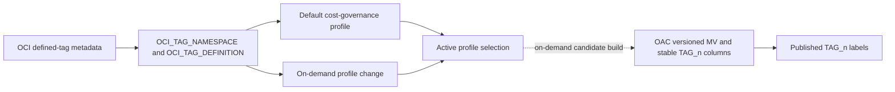
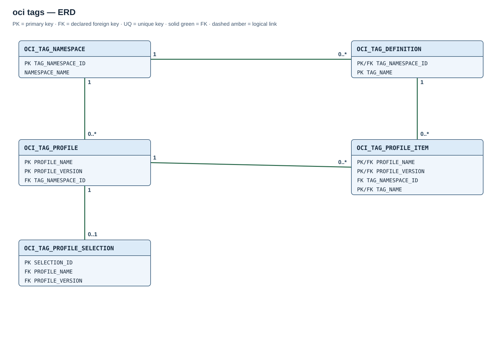

# Module 02 / OCI / 01a — defined-tag catalog and reporting profiles

## Purpose

Maintain OCI defined-tag metadata and immutable reporting profiles that select tags for cost reporting. FOCUS row-value extraction is a separate optional component.

## Execution flow

## Scope and dependencies

OCI ingestion stores the original `TAGS` JSON in `OCI_FOCUS_REPORTS`. This module inventories **defined-tag** namespaces and definitions from the tenancy and stores versioned reporting profiles. It does not create or modify OCI tags, process FOCUS rows, or create OAC objects. Free-form tags are outside its scope.

The catalog job refreshes metadata only. A profile change selects an immutable revision; it does not publish new OAC columns until a separate candidate build succeeds.

Catalog synchronization paginates visible tenancy namespaces and defined tags, retaining historical definitions after they cease to be current. Profile specifications identify an existing namespace or an explicit tag list. The governed default uses the required cost-governance definitions; custom profiles retain their exact tag identities.

The module depends on the shared core, authorized Resource Principal access and valid OCI defined-tag metadata. It has no FOCUS landing dependency. The [tag profile specification](../installation-guide/database-modules/manual-sql-installation.md#tag-specification) defines the configuration fields and the NAMESPACE and TAG_LIST formats.

## Entity relationships

The [full-size SVG](diagrams/02-oci-tags.svg) shows declared foreign keys; an active selection points to one immutable profile revision.

| Parent table and key | Child table and foreign key | Cardinality |
| --- | --- | --- |
| `OCI_TAG_NAMESPACE(TAG_NAMESPACE_ID)` | `OCI_TAG_DEFINITION(TAG_NAMESPACE_ID)` | One namespace to zero or more definitions. |
| `OCI_TAG_NAMESPACE(TAG_NAMESPACE_ID)` | `OCI_TAG_PROFILE(TAG_NAMESPACE_ID)` | One namespace to zero or more profile revisions. |
| `OCI_TAG_PROFILE(PROFILE_NAME, PROFILE_VERSION)` | `OCI_TAG_PROFILE_ITEM(PROFILE_NAME, PROFILE_VERSION)` | One revision to zero or more selected tags. |
| `OCI_TAG_DEFINITION(TAG_NAMESPACE_ID, TAG_NAME)` | `OCI_TAG_PROFILE_ITEM(TAG_NAMESPACE_ID, TAG_NAME)` | One definition to zero or more profile items. |
| `OCI_TAG_PROFILE(PROFILE_NAME, PROFILE_VERSION)` | `OCI_TAG_PROFILE_SELECTION(PROFILE_NAME, PROFILE_VERSION)` | One revision to zero or one active selection. |

## Created objects

| Object | Type | Description |
| --- | --- | --- |
| [OCI_TAG_NAMESPACE](#oci_tag_namespace) | Table | Catalog of OCI defined-tag namespaces and their scan state. |
| [OCI_TAG_DEFINITION](#oci_tag_definition) | Table | Defined tags keyed within a namespace, including retired history. |
| [OCI_TAG_PROFILE](#oci_tag_profile) | Table | Immutable reporting-profile revisions. |
| [OCI_TAG_PROFILE_ITEM](#oci_tag_profile_item) | Table | Selected tag identities, display labels, and stable `TAG_n` slot numbers per revision. |
| [OCI_TAG_PROFILE_SELECTION](#oci_tag_profile_selection) | Table | Singleton pointer to the selected revision. |
| [OCI_TAG_NAMESPACE_PK](#oci_tag_namespace), [OCI_TAG_DEFINITION_PK](#oci_tag_definition), [OCI_TAG_PROFILE_PK](#oci_tag_profile), [OCI_TAG_PROFILE_ITEM_PK](#oci_tag_profile_item), [OCI_TAG_PROFILE_SELECTION_PK](#oci_tag_profile_selection) | PK indexes | Enforce the corresponding table keys. |
| [OCI_TAG_PROFILE_ITEM_ORDER_UQ](#oci_tag_profile_item), [OCI_TAG_PROFILE_ITEM_LOGICAL_UQ](#oci_tag_profile_item) | Unique indexes | Prevent duplicate slots and logical labels within one revision. |
| [OCI_TAG_SYNC_CATALOG](#oci_tag_sync_catalog) | Procedure | Reads OCI namespace and defined-tag metadata into the catalog. |
| [OCI_TAG_PROFILE_API](#oci_tag_profile_api) | Package and body | Installs the default profile and handles on-demand revision changes. |
| [OCI_TAG_CATALOG_DAILY](#oci_tag_catalog_daily) | Scheduler job | Refreshes catalog metadata without changing the selected profile. |

OCI 01a creates no FOCUS row-value bridge or OAC materialized view; those are owned by OCI 01b and Module 03 respectively.

The primary and unique constraints create their supporting indexes. There are no standalone indexes for the small metadata catalog. `IS_CURRENT` describes presence in the latest completed OCI scan, independent of OCI lifecycle state; callers requiring usable tags check both `IS_CURRENT='Y'` and `LIFECYCLE_STATE='ACTIVE'`.

## Table columns and Oracle types

### `OCI_TAG_NAMESPACE`

**Named constraint:** `OCI_TAG_NAMESPACE_PK` (PRIMARY KEY).

One namespace per `TAG_NAMESPACE_ID` primary key.

| Column | Type |
| --- | --- |
| `TAG_NAMESPACE_ID` | `VARCHAR2(255)` |
| `NAMESPACE_NAME` | `VARCHAR2(100)` |
| `DESCRIPTION` | `VARCHAR2(400)` |
| `LIFECYCLE_STATE` | `VARCHAR2(30)` |
| `IS_RETIRED` | `VARCHAR2(5)` |
| `OCI_TIME_CREATED` | `VARCHAR2(40)` |
| `OCI_TIME_UPDATED` | `VARCHAR2(40)` |
| `IS_CURRENT` | `CHAR(1)` |
| `FIRST_SEEN_AT` | `TIMESTAMP(6) WITH TIME ZONE` |
| `LAST_SEEN_AT` | `TIMESTAMP(6) WITH TIME ZONE` |
| `NO_LONGER_SEEN_AT` | `TIMESTAMP(6) WITH TIME ZONE` |

### `OCI_TAG_DEFINITION`

**Named constraint:** `OCI_TAG_DEFINITION_PK` (PRIMARY KEY).

One definition per primary key `(TAG_NAMESPACE_ID, TAG_NAME)`, with a namespace foreign key.

| Column | Type |
| --- | --- |
| `TAG_NAMESPACE_ID` | `VARCHAR2(255)` |
| `TAG_NAME` | `VARCHAR2(100)` |
| `DESCRIPTION` | `VARCHAR2(400)` |
| `LIFECYCLE_STATE` | `VARCHAR2(30)` |
| `IS_RETIRED` | `VARCHAR2(5)` |
| `IS_COST_TRACKING` | `VARCHAR2(5)` |
| `OCI_TIME_CREATED` | `VARCHAR2(40)` |
| `OCI_TIME_UPDATED` | `VARCHAR2(40)` |
| `IS_CURRENT` | `CHAR(1)` |
| `FIRST_SEEN_AT` | `TIMESTAMP(6) WITH TIME ZONE` |
| `LAST_SEEN_AT` | `TIMESTAMP(6) WITH TIME ZONE` |
| `NO_LONGER_SEEN_AT` | `TIMESTAMP(6) WITH TIME ZONE` |

### `OCI_TAG_PROFILE`

**Named constraint:** `OCI_TAG_PROFILE_PK` (PRIMARY KEY).

One immutable revision per primary key `(PROFILE_NAME, PROFILE_VERSION)`, with an optional namespace foreign key. `PROFILE_KIND` is `DEFAULT`, `CUSTOM` or `MIXED` and `SPEC_JSON` contains valid JSON. Explicit lists leave the header namespace null; each item retains its own namespace identity.

| Column | Type |
| --- | --- |
| `PROFILE_NAME` | `VARCHAR2(128)` |
| `PROFILE_VERSION` | `NUMBER(8)` |
| `TAG_NAMESPACE_ID` | `VARCHAR2(255)` |
| `PROFILE_KIND` | `VARCHAR2(10)` |
| `SPEC_JSON` | `CLOB` (required valid JSON) |
| `CREATED_AT` | `TIMESTAMP(6) WITH TIME ZONE` |

### `OCI_TAG_PROFILE_ITEM`

**Named constraint:** `OCI_TAG_PROFILE_ITEM_LOGICAL_UQ` (UNIQUE).

**Named constraint:** `OCI_TAG_PROFILE_ITEM_ORDER_UQ` (UNIQUE).

**Named constraint:** `OCI_TAG_PROFILE_ITEM_PK` (PRIMARY KEY).

One active or retired tag identity per primary key `(PROFILE_NAME, PROFILE_VERSION, TAG_NAMESPACE_ID, TAG_NAME)`, with profile and definition foreign keys. `DISPLAY_ORDER` is the stable reporting slot and `LOGICAL_TAG_NAME` its display label; both are unique within a revision. Including namespace identity permits equal tag names from different namespaces.

| Column | Type |
| --- | --- |
| `PROFILE_NAME` | `VARCHAR2(128)` |
| `PROFILE_VERSION` | `NUMBER(8)` |
| `DISPLAY_ORDER` | `NUMBER(4)` |
| `LOGICAL_TAG_NAME` | `VARCHAR2(256)` |
| `IS_ACTIVE` | `CHAR(1)` (`Y`/`N`) |
| `TAG_NAMESPACE_ID` | `VARCHAR2(255)` |
| `TAG_NAME` | `VARCHAR2(100)` |
| `CREATED_AT` | `TIMESTAMP(6) WITH TIME ZONE` |

### `OCI_TAG_PROFILE_SELECTION`

**Named constraint:** `OCI_TAG_PROFILE_SELECTION_PK` (PRIMARY KEY).

Singleton selection with `SELECTION_ID=1` and a composite foreign key to an immutable profile revision.

| Column | Type |
| --- | --- |
| `SELECTION_ID` | `NUMBER(1)` |
| `PROFILE_NAME` | `VARCHAR2(128)` |
| `PROFILE_VERSION` | `NUMBER(8)` |
| `SELECTED_AT` | `TIMESTAMP(6) WITH TIME ZONE` |

## Reporting-column contract

The profile stores tag identity as `(TAG_NAMESPACE_ID, TAG_NAME)` and assigns each item a numeric `DISPLAY_ORDER`. The OAC cost-detail MV uses that number for a physical column such as `TAG_1`; it does **not** derive a column name from `LOGICAL_TAG_NAME`. Two namespaces may each define a tag called `Owner` without a key or MV-column collision. The [OAC slot view](03-oac-oci-focus-cost-detail.md#published-tag-labels) maps each published `TAG_n` column to its current namespace, tag, and display label.

The profile API resolves names to stable `(namespace OCID, exact tag name)` identities. A recreated namespace with a different OCID is a new identity, never a silent rebinding. Identical display/logical labels can collide; such ambiguous mappings are rejected by metadata constraints rather than assigned silently. Use an explicitly reviewed new profile identity when an existing namespace identity is replaced.

First application assigns explicit lists in their order; ordinary namespace selection initially sorts names. The governance profile preserves its established six-tag order, with additional tags afterwards. Within one `profile_name`, existing identities always retain their original `DISPLAY_ORDER` and physical `TAG_n` column. New identities append after the highest reserved slot, irrespective of where they are placed in a later input list. Reordering retained entries does not renumber them.

Removing a tag creates a new immutable profile revision that retains its old slot as `IS_ACTIVE='N'`. A new candidate exposes that retired column as typed `NULL`; other tags are not shifted into it. Reintroducing the same identity reactivates its original slot. Retired slots count toward the maximum of 9999 positions and the MV SQL-size limit. An unchanged specification/resolved selection reuses the existing revision. Metadata history is not purged automatically.

The published mapping view reports `ASSIGNED='N'` for retired positions. Labels resolve through the **published** MV/profile revision, so selecting a new profile cannot relabel columns still served from the old MV. Changing to another `profile_name` establishes a separate mapping and requires explicit candidate review/publication; stability across different profiles is not promised.

The API serializes profile changes with its own nonwaiting database lock. Removing an item reserves its slot rather than reusing it; a different profile name has its own mapping. These rules do not promise stable meanings across different profile names.

## Routines and schedule

### `OCI_TAG_SYNC_CATALOG`

Refreshes paginated namespace/definition metadata using the ADB Resource Principal. Marks absent definitions noncurrent only after a complete successful scan.

### `OCI_TAG_PROFILE_API`

The package defines immutable profile selection through these public entry points.

#### `OCI_TAG_PROFILE_API.APPLY_SPEC`

`OCI_TAG_PROFILE_API.APPLY_SPEC(P_SPEC IN CLOB)`

Validates the specification, synchronizes the catalog, preserves existing identity slots, appends new identities and selects the resulting immutable revision. An unchanged resolved selection reuses its revision.

#### `OCI_TAG_PROFILE_API.INSTALL_DEFAULT`

`OCI_TAG_PROFILE_API.INSTALL_DEFAULT`

Compatibility delegate to `APPLY_SPEC` for the reserved governance namespace/profile. Its required existing definitions are listed in the [Python resource prerequisites](../installation-guide/database-modules/python-installation.md#resources-that-must-already-exist).

#### `OCI_TAG_PROFILE_API.SWITCH_NAMESPACE`

`OCI_TAG_PROFILE_API.SWITCH_NAMESPACE(name)`

Delegate that constructs a namespace specification and calls `APPLY_SPEC`.

#### `OCI_TAG_PROFILE_API.REFRESH_ACTIVE`

`OCI_TAG_PROFILE_API.REFRESH_ACTIVE`

Reapplies the selected revision's stored specification. Namespace mode can discover new active definitions; an explicit list does not expand automatically.

### `OCI_TAG_CATALOG_DAILY`

Catalog-only sync at 00:00 in the core-selected time zone; does not change profiles or reporting columns.

Applying or refreshing a profile selects an immutable revision without building or publishing an OAC MV. Candidate construction and explicit publication belong to the [OAC reporting lifecycle](03-oac-oci-focus-cost-detail.md#how-it-works).

## Separate FOCUS row-value extraction

The [optional extraction component](02-oci-tag-values.md) stores nonblank **defined-tag values** from `OCI_FOCUS_REPORTS.TAGS` in a long-form OCI-owned table with a per-row processing ledger. It supports bounded historical catch-up and marks rows containing no applicable tag values as processed. Value insertion and processing marks commit together. Its processing and schedule are independent of the catalog/profile module and OAC objects.
