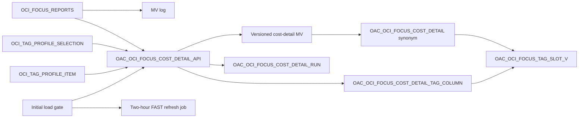
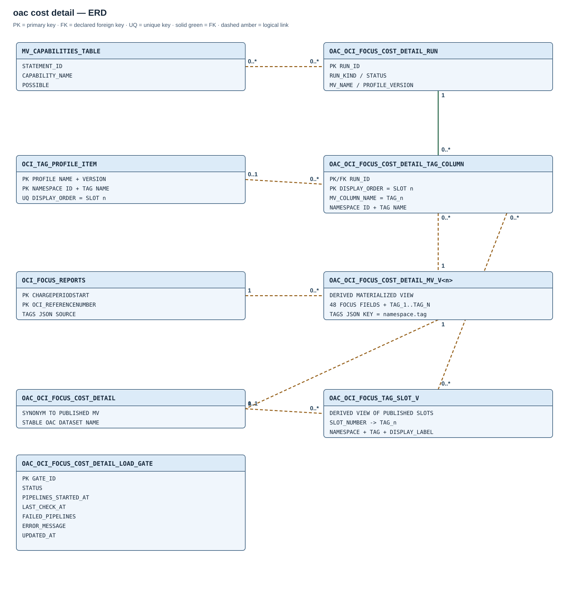

# Module 03 / OAC — OCI FOCUS cost detail

## Purpose

This module publishes a stable database interface for an OAC cost-detail dataset. Its materialized view and tag-column contract are defined here; OAC connections, datasets, and workbooks are separate service assets. The [installation guide](../SETUP.md) provides the deployment and verification sequence.

## Execution flow

## How it works

Initial population builds an empty, deferred MV with COMPLETE refresh before the year pipelines start. The temporary initial-load gate waits for each pipeline's first successful run and for pending/running files to clear. A verified FAST refresh then enables recurring refresh and completes the gate.

Later profile changes produce separate candidates. A validated candidate is `READY` until explicit publication selects its `RUN_ID`; the existing synonym remains available while that candidate builds. Failed candidates and older published versions are retained without automatic purge.

The refresher follows the published synonym, skips an unpopulated MV and compiles `NEEDS_COMPILE` before FAST refresh. It does not change profiles or fall back automatically to COMPLETE refresh. Build and refresh share a non-waiting lock.

Initial publication can briefly expose a `READY` build before its audit reaches `COMPLETE`. Recovery finalizes a published READY build, marks an unpublished READY build without a recorded row count `ERROR` and leaves validated READY candidates available for explicit publication.

## Scope and dependencies

The module requires the OCI landing, an active reporting profile, Module 00 reporting privileges and FAST-refresh eligibility. Ingestion-owned retention changes the landing; its deletes reach reporting through the MV log and a later successful FAST refresh. DELETE propagation requires `REFRESH_FAST_AFTER_ONETAB_DML` capability.

A custom-source rebuild can use another compatible local landing table or scalar structure. It projects available fields/tags, emits typed `NULL` for unavailable slots and validates a separate READY candidate before publication. `SOURCE_TABLE` in the build audit identifies that source. Source-table requirements and procedures are in the [maintenance guide](../installation-guide/database-modules/maintenance-and-diagnostics.md#rebuild-and-publish-the-oac-cost-detail-mv).

## Capacity considerations

Storage covers the landing, MV, MV log, indexes and temporary build workspace. Initial population uses an empty landing; later candidates scan populated data. Builds and FAST refreshes use parallel degree 8.

Tag-value extraction and OAC builds have independent locks and can compete for capacity. Long scans need a consistent snapshot and sufficient UNDO; `ORA-01555` represents a failed build, not a published candidate. The validated synonym target remains available while a replacement is incomplete. Diagnosis procedures are in the [maintenance guide](../installation-guide/database-modules/maintenance-and-diagnostics.md#oac-build-capacity-and-failures).

## Entity relationships

[Open the full-size ERD](diagrams/03-oac-cost-detail.svg). The only declared FK within this module links `OAC_OCI_FOCUS_COST_DETAIL_TAG_COLUMN.RUN_ID` to `OAC_OCI_FOCUS_COST_DETAIL_RUN.RUN_ID`. Other arrows represent logical links among the source profile, versioned MV, published synonym and tag labels. Profile-table foreign keys belong to the [tag catalog model](02-oci-tags.md#entity-relationships).

## Created objects

| Object | Type | Purpose |
| --- | --- | --- |
| [MV log on OCI_FOCUS_REPORTS](#mv-log-on-oci_focus_reports) | Materialized view log | Tracks source changes for FAST refresh. |
| [MV_CAPABILITIES_TABLE](#mv_capabilities_table) | Table | Stores `DBMS_MVIEW.EXPLAIN_MVIEW` diagnostics |
| [OAC_OCI_FOCUS_COST_DETAIL_RUN](#oac_oci_focus_cost_detail_run) | Table | Audit for builds and refreshes |
| [OAC_OCI_FOCUS_COST_DETAIL_TAG_COLUMN](#oac_oci_focus_cost_detail_tag_column) | Table | Frozen tag-column contract for a build |
| [OAC_OCI_FOCUS_COST_DETAIL_LOAD_GATE](#oac_oci_focus_cost_detail_load_gate) | Table | Initial-load state machine |
| [OAC_OCI_FOCUS_TAG_SLOT_V](#published-tag-labels) | View | OAC label and slot lookup for the published MV |
| [OAC_OCI_FOCUS_COST_DETAIL_API](#oac_oci_focus_cost_detail_api) | Package and body | Builds, publishes and refreshes the reporting MV. |
| [OAC_OCI_FOCUS_COST_DETAIL_REBUILD](#oac_oci_focus_cost_detail_rebuild) | Procedure (on-demand maintenance) | Builds a replacement MV candidate from a chosen landing table. |
| [OAC_OCI_FOCUS_COST_DETAIL_MV_V<n>](#published-cost-interface) | Materialized view | Initially empty MV, then populated published MV or later candidate |
| [OAC_OCI_FOCUS_COST_DETAIL](#published-cost-interface) | Synonym | Stable consumer name |
| [OAC_OCI_FOCUS_COST_DETAIL_INITIAL_LOAD_GATE](#oac_oci_focus_cost_detail_initial_load_gate) | Scheduler job | Monitors initial pipeline catch-up |
| [OAC_OCI_FOCUS_COST_DETAIL_REFRESH_2H](#oac_oci_focus_cost_detail_refresh_2h) | Scheduler job | Refreshes the published MV |
| [OAC_OCI_FOCUS_COST_DETAIL_INITIAL_BUILD](#oac_oci_focus_cost_detail_initial_build) | Scheduler job | Populates the first MV in the background |
| [OAC_OCI_FOCUS_COST_DETAIL_GATE_STOP](#oac_oci_focus_cost_detail_gate_stop) | Scheduler job | Stops the completed load monitor |

## Table columns and Oracle types

### `MV_CAPABILITIES_TABLE`

| Column | Type |
| --- | --- |
| `STATEMENT_ID` | `VARCHAR2(30)` |
| `MVOWNER` | `VARCHAR2(128)` |
| `MVNAME` | `VARCHAR2(128)` |
| `CAPABILITY_NAME` | `VARCHAR2(30)` |
| `POSSIBLE` | `CHAR(1)` |
| `RELATED_TEXT` | `VARCHAR2(2000)` |
| `RELATED_NUM` | `NUMBER` |
| `MSGNO` | `INTEGER` |
| `MSGTXT` | `VARCHAR2(2000)` |
| `SEQ` | `NUMBER` |

### `OAC_OCI_FOCUS_COST_DETAIL_RUN`

**Key:** `RUN_ID` is the primary key of the build/refresh audit.

| Column | Type |
| --- | --- |
| `RUN_ID` | `NUMBER` |
| `RUN_KIND` | `VARCHAR2(10)` |
| `STATUS` | `VARCHAR2(12)` |
| `MV_NAME` | `VARCHAR2(128)` |
| `PROFILE_NAME` | `VARCHAR2(128)` |
| `PROFILE_VERSION` | `NUMBER(8)` |
| `TAG_COLUMNS` | `NUMBER` |
| `MV_ROWS` | `NUMBER` |
| `STARTED_AT` | `TIMESTAMP(6) WITH TIME ZONE` |
| `FINISHED_AT` | `TIMESTAMP(6) WITH TIME ZONE` |
| `ERROR_CODE` | `NUMBER` |
| `ERROR_MESSAGE` | `VARCHAR2(4000)` |

### `OAC_OCI_FOCUS_COST_DETAIL_TAG_COLUMN`

**Keys:** primary key `(RUN_ID, DISPLAY_ORDER)`, unique `(RUN_ID, MV_COLUMN_NAME)` and a foreign key from `RUN_ID` to the build audit.

| Column | Type |
| --- | --- |
| `RUN_ID` | `NUMBER` |
| `DISPLAY_ORDER` | `NUMBER(4)` |
| `LOGICAL_TAG_NAME` | `VARCHAR2(256)` |
| `MV_COLUMN_NAME` | `VARCHAR2(128)` |
| `TAG_NAMESPACE_ID` | `VARCHAR2(255)` |
| `TAG_NAME` | `VARCHAR2(100)` |

### `OAC_OCI_FOCUS_COST_DETAIL_LOAD_GATE`

**Key:** `GATE_ID` is the singleton primary key.

| Column | Type |
| --- | --- |
| `GATE_ID` | `NUMBER` |
| `STATUS` | `VARCHAR2(14)` |
| `PIPELINES_STARTED_AT` | `TIMESTAMP WITH TIME ZONE` |
| `LAST_CHECK_AT` | `TIMESTAMP WITH TIME ZONE` |
| `FAILED_PIPELINES` | `NUMBER` |
| `ERROR_MESSAGE` | `VARCHAR2(4000)` |
| `UPDATED_AT` | `TIMESTAMP WITH TIME ZONE` |

## Reporting objects

### Published cost interface

`OAC_OCI_FOCUS_COST_DETAIL` is the stable private synonym for the published `OAC_OCI_FOCUS_COST_DETAIL_MV_V<n>`. Each MV has monthly interval partitions by `CHARGEPERIODSTART` and `BUILD DEFERRED REFRESH FAST ON DEMAND` storage. It projects all landing rows without a date filter: 48 scalar FOCUS columns plus `TAG_1` through the selected profile's highest reserved slot.

Values come from `JSON_VALUE` on the original flat `<namespace name>.<tag name>` key; missing, non-scalar or retired values are typed `NULL`. The [tag-profile contract](02-oci-tags.md#reporting-column-contract) defines identity, slot retention and profile changes. There is no fixed ten-tag limit: the ceiling is the builder's SQL-size check and the profile's four-digit slot number.

A populated `STALE` MV remains queryable but excludes later landing commits until a successful refresh. Object validity, source coverage and reporting freshness are separate states.

### Published tag labels

`OAC_OCI_FOCUS_TAG_SLOT_V` exposes `MV_NAME`, `PROFILE_NAME`, `PROFILE_VERSION`, `SLOT_NUMBER`, `MV_COLUMN_NAME`, `DISPLAY_LABEL`, `NAMESPACE_NAME`, `TAG_NAME` and `ASSIGNED`. It resolves through the published synonym and its build audit, so a pending profile revision cannot relabel data still served by the old MV. Publication switches values and their label contract together; retired slots remain unassigned.

OAC binds to `MV_COLUMN_NAME` and uses `DISPLAY_LABEL` for meaning. A different profile can change slot meanings or column count; consumer update steps are defined in the [workbook guide](../installation-guide/oac/oac-workbook-import.md#after-reporting-profile-changes).

### MV log on `OCI_FOCUS_REPORTS`

The Oracle-maintained log captures primary key, ROWID, SEQUENCE and new values for FAST refresh. Oracle owns its generated `MLOG$` table and the MV's storage/partition indexes. Supporting-table primary and unique constraints provide their own indexes.

## Routines and jobs

### `OAC_OCI_FOCUS_COST_DETAIL_API`

Prepares and populates the first MV, monitors first pipeline catch-up, builds profile candidates, explicitly publishes a reviewed candidate, and refreshes the published MV. `BUILD_ACTIVE`, `PUBLISH_READY`, `POPULATE_INITIAL`, `CHECK_INITIAL_LOAD`, `STOP_INITIAL_LOAD_GATE`, `REFRESH_CURRENT`.

### `OAC_OCI_FOCUS_COST_DETAIL_REBUILD`

A `FOCUSPLATFORM`-owned, definer-rights procedure created on demand by the source-table rebuild maintenance script, outside the standard module installation. Its `P_SOURCE_TABLE IN VARCHAR2` input selects a local landing table. It builds and validates a FAST-capable candidate with the selected tag profile under the shared build/refresh lock, recording a `READY` candidate while leaving the published synonym unchanged.

See [rebuild and publish the OAC cost-detail MV](../installation-guide/database-modules/maintenance-and-diagnostics.md#rebuild-and-publish-the-oac-cost-detail-mv) for the maintenance procedure.

### `OAC_OCI_FOCUS_COST_DETAIL_INITIAL_LOAD_GATE`

Monitors initial pipeline catch-up. Enabled every five minutes only during initial loading; a one-time stop job disables it after success.

### `OAC_OCI_FOCUS_COST_DETAIL_REFRESH_2H`

Refreshes the published MV. Every two hours at minute 30 in the selected installation time zone; disabled until first-load FAST refresh succeeds.

### `OAC_OCI_FOCUS_COST_DETAIL_INITIAL_BUILD`

Populates the first MV in the background. One-time Scheduler job retained for installation history.

### `OAC_OCI_FOCUS_COST_DETAIL_GATE_STOP`

Stops the completed load monitor. One-time, auto-drop Scheduler job.
