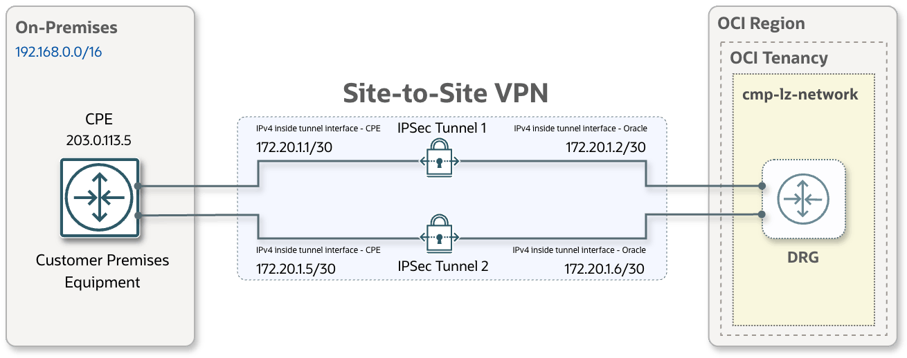
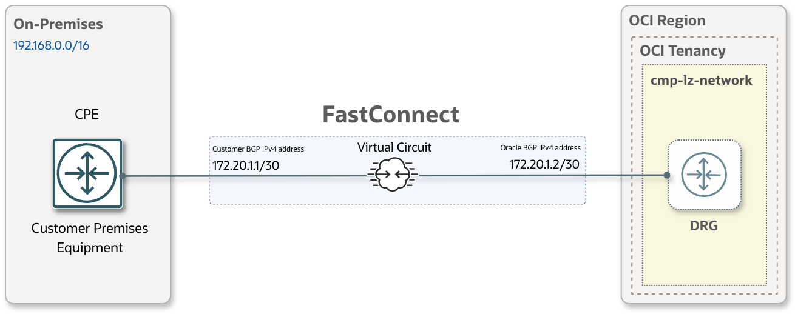

# **OCI Hybrid Connectivity**
## **An OCI Landing Zone add-on for Site-to-Site VPN and FastConnect**

&nbsp;

## Overview

The OCI Hybrid Connectivity addon provides configuration and deployment options for connecting an OCI One-OE Landing Zone to your on-premises network (or a network hosted by another cloud service provider) using Site-to-Site VPN, FastConnect, or both.

This guide introduces the two connectivity options and links to their architecture, prerequisites, configuration, and deployment instructions.

#### Connectivity options

| **[Site-to-Site VPN](vpn.md)** |  **[FastConnect](fastconnect.md)** |
|:-:|:-:|
|  |  |
| [Overview and configuration](vpn.md) | [Overview and configuration](fastconnect.md) |

&nbsp;

Each option can be deployed independently. You can also deploy both and configure routing preferences to use Site-to-Site VPN as a backup path for FastConnect.

You can design and prepare the configuration using [Landing Zone Studio](../oci-landingzone-studio/README.md) or define JSON configurations with [Blueprint Factory](../oci-lz-blueprint-factory/README.md). The resulting JSON configuration is deployed with Terraform to create the OCI connectivity resources and configure the associated landing zone routing.

**Note**: This addon configures the OCI networking resources required for hybrid connectivity. To complete the connection, the customer or network provider must separately configure the corresponding infrastructure, routing, and security controls in the remote network (on-premises or in another cloud), and coordinate service activation.

&nbsp;

## License

Copyright (c) 2026 Oracle and/or its affiliates.

Licensed under the Universal Permissive License (UPL), Version 1.0. See [LICENSE](../../LICENSE.txt).
