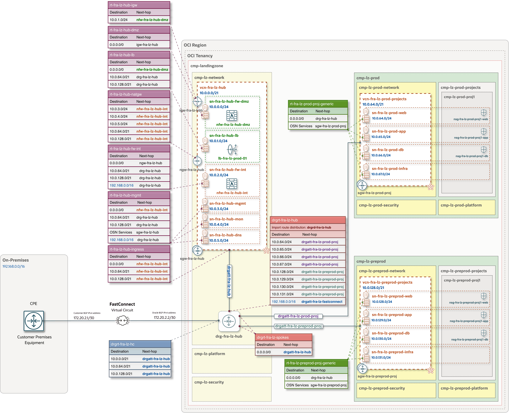

## FastConnect for the One-OE Landing Zone

&nbsp;

### Overview

The OCI Hybrid Connectivity add-on provides guidance and configuration options for integrating [OCI FastConnect](https://docs.oracle.com/en-us/iaas/Content/Network/Concepts/fastconnectoverview.htm) with an OCI One-OE Landing Zone. FastConnect provides a dedicated, private connection between your network and OCI. 

FastConnect supports both **Private peering** for access to VCNs and **Public peering** for access to supported public OCI services. This guide describes **IPv4 Private peering** with the One-OE Landing Zone.

The required OCI configurations can be generated using Landing Zone Studio or the Blueprint Factory and used for subsequent Terraform deployment.

&nbsp;

### Architecture and routing

This architecture diagram illustrates **FastConnect connectivity** to an **OCI One-OE Landing Zone with Hub A**. It shows a private virtual circuit connecting the remote network (`192.168.0.0/16`) to the landing zone’s DRG, with BGP peering addresses `172.20.2.1/30` on the customer side and `172.20.2.2/30` on the Oracle side.

The virtual circuit attachment is associated with the `drgrt-fra-lz-hc` DRG route table, which directs traffic destined for the Hub and Spoke VCNs through the hub attachment. Traffic between the remote network and spoke VCNs passes through the internal network firewall for inspection in both directions:


This routing and inspection model applies to **Hubs A, B**, and **C**. For **Hub E**, traffic between the remote network and spoke VCNs is routed directly through the DRG without traversing the hub VCN.

&nbsp;



&nbsp;

> [!NOTE]
> With the routing shown, traffic between the remote network and the hub’s management, monitoring, and DNS subnets (`sn-fra-lz-hub-mgmt`, `sn-fra-lz-hub-mon`, and `sn-fra-lz-hub-dns`) does not pass through the internal firewall. If these flows also require inspection, update the relevant routing rules in both directions to maintain symmetric routing through the firewall.

&nbsp;

#### Main components

| Resource | Purpose |
|---|---|
| **Private Virtual Circuit** | The logical FastConnect connection used for private peering with the landing zone’s DRG. |
| **DRG attachment** | Connects the private virtual circuit to the DRG. OCI creates this attachment when the virtual circuit is created. |
| **DRG route table** | Custom route table `drgrt-<region>-lz-hc`, which directs traffic to the appropriate next hop based on the deployed hub model. |
| **Cross-connect / cross-connect group** | Physical connectivity resources used for third-party provider or colocation connections. A cross-connect group provides link aggregation. These resources are not created by the customer for a FastConnect partner connection. |

&nbsp;

#### Connectivity models

| Model | Connection and configuration |
|---|---|
| **With a FastConnect partner** | Use a service from the [FastConnect partner list](https://www.oracle.com/cloud/networking/fastconnect/partners/). Configure the partner service reference in OCI and coordinate provisioning and activation with the partner. |
| **With a third-party provider** | Use a provider that connects your network to Oracle at a FastConnect location. Arrange the physical cross-connect using Oracle’s Letter of Authorization (LOA). |
| **Colocation with Oracle** | Connect your equipment to Oracle at a FastConnect location using physical cross-connects. Configure the physical interfaces, VLANs, and BGP sessions. |

For the service-specific procedures, see [FastConnect with an Oracle partner](https://docs.oracle.com/en-us/iaas/Content/Network/Concepts/fastconnectprovider.htm), [FastConnect with a third-party provider](https://docs.oracle.com/en-us/iaas/Content/Network/Concepts/fastconnectthirdpartyprovider.htm), and [colocation with Oracle](https://docs.oracle.com/en-us/iaas/Content/Network/Concepts/fastconnectcolocate.htm).

&nbsp;

#### BGP routing and redundancy

FastConnect uses **BGP dynamic routing**. For partner services, the BGP session from your network can terminate at Oracle (a Layer 2 service) or at the partner (a Layer 3 service). The partner service determines which ASN and peering settings you need to supply.

The add-on requires `remote_cidrs` to prepare One-OE Landing Zone routes. This does not configure remote BGP advertisements or prefix filters; the expected networks must also be advertised through the connection.

**Important:** Plan redundancy across the complete connection, including the remote network and provider path. The required circuits and physical connections depend on the connectivity model. See [FastConnect Redundancy Best Practices](https://docs.oracle.com/en-us/iaas/Content/Network/Concepts/fastconnectresiliency.htm).

&nbsp;

#### Configuration requirements

The following information is needed to configure the FastConnect connection:

| Input | Requirement |
|---|---|
| **Connectivity model** | FastConnect partner, third-party provider, or colocation with Oracle. |
| **Remote network CIDRs** | IPv4 networks reachable through the connection. These must not overlap the connected OCI networks. |
| **Partner service reference** | For partner connections: the provider service OCID for the target OCI region and realm, plus a partner service key if required. These are separate values. |
| **Provisioned bandwidth** | A bandwidth supported by the selected service and location. |
| **BGP settings** | Customer ASN and customer/Oracle peering addresses where required by the service. For private peering, use different host addresses in the same `/28` through `/31` subnet. |
| **Physical connection details** | For third-party provider or colocation connections: provisioned cross-connect or cross-connect group OCIDs and the agreed VLAN. For new ports, also provide the FastConnect location and port speed. |
| **Optional settings** | BGP MD5 authentication, IP MTU, and BFD, where supported and required by the peers. |

See [FastConnect Requirements](https://docs.oracle.com/en-us/iaas/Content/Network/Concepts/fastconnectrequirements.htm) and the [FastConnect configuration reference](../oci-lz-blueprint-factory/blueprint-factory-configuration-reference.md#95-fastconnect-virtual-circuits) for details.

&nbsp;

---

### Example JSON Configuration

The following JSON configuration blocks illustrate the FastConnect settings in the `network.json` file for the architecture diagram above.

The example consists of two configuration blocks: a private virtual circuit with BGP peering settings and a custom DRG route table.

#### Block 1: Private Virtual Circuit

This block defines a **1 Gbps private virtual circuit** through a FastConnect partner, including references to the One-OE Landing Zone DRG and the custom DRG route table.

The circuit specifies the customer BGP Autonomous System Number (ASN) and the customer and Oracle IPv4 peering addresses used to establish the BGP session. In this example, the customer ASN is `65001`, with peering addresses `172.20.2.1/30` and `172.20.2.2/30`.

```json
{
    "fast_connect_virtual_circuits": {
        "FCVC-FRA-LZ-HUB-PRIMARY-KEY": {
            "display_name": "fcvc-fra-lz-hub-primary",
            "type": "PRIVATE",
            "bandwidth_shape_name": "1 Gbps",
            "customer_asn": "65001",
            "drg_route_table_id": "DRGRT-FRA-LZ-HUB-HC-KEY",
            "gateway_key": "DRG-FRA-LZ-HUB-KEY",
            "is_bfd_enabled": false,
            "provider_service_id": "ocid1.providerservice.oc1.eu-frankfurt-1.REPLACE_WITH_PROVIDER_SERVICE_OCID",
            "provision_fc_virtual_circuit": true,
            "show_available_fc_virtual_circuit_providers": false,
            "cross_connect_mappings": {
                "primary": {
                    "customer_bgp_peering_ip": "172.20.2.1/30",
                    "oracle_bgp_peering_ip": "172.20.2.2/30"
                }
            }
        }
    }
}
```

The `provider_service_id` identifies the selected FastConnect partner service. Replace the placeholder with the service OCID for your OCI region and realm. For a Layer 3 partner service, use the BGP settings required by that service.

#### Block 2: Custom DRG Route Table

This block defines the custom DRG route table used to control traffic entering the DRG from the remote network through FastConnect.

The route table, `drgrt-fra-lz-hc`, directs traffic destined for the Hub, Production, and Pre-Production VCN CIDRs to the Hub VCN attachment (`DRGATT-FRA-LZ-HUB-VCN-KEY`), allowing spoke traffic to follow the Hub’s firewall inspection path.

Equal-Cost Multi-Path (ECMP) routing is disabled in this example.

```json
{
    "DRGRT-FRA-LZ-HUB-HC-KEY": {
        "display_name": "drgrt-fra-lz-hc",
        "is_ecmp_enabled": false,
        "route_rules": {
            "rr-hybrid-hc-hub": {
                "destination": "10.0.0.0/21",
                "destination_type": "CIDR_BLOCK",
                "next_hop_drg_attachment_key": "DRGATT-FRA-LZ-HUB-VCN-KEY"
            },
            "rr-hybrid-hc-preprod": {
                "destination": "10.0.128.0/21",
                "destination_type": "CIDR_BLOCK",
                "next_hop_drg_attachment_key": "DRGATT-FRA-LZ-HUB-VCN-KEY"
            },
            "rr-hybrid-hc-prod": {
                "destination": "10.0.64.0/21",
                "destination_type": "CIDR_BLOCK",
                "next_hop_drg_attachment_key": "DRGATT-FRA-LZ-HUB-VCN-KEY"
            }
        }
    }
}
```

**Note:** The configuration values shown above are examples. Update the partner service OCID, bandwidth, BGP parameters, network CIDRs, and resource references to match your environment. Include the blocks in their corresponding sections of the complete `network.json` file before Terraform deployment.

&nbsp;

---

### Preparing and Generating JSON Configuration Files

The FastConnect configuration can be prepared using **Landing Zone Studio** or the **Blueprint Factory**. Both methods generate JSON configuration files for subsequent Terraform deployment.

&nbsp;

#### Option 1: Landing Zone Studio

Landing Zone Studio provides a graphical interface for configuring partner-based private virtual circuits as part of a One-OE Landing Zone design. Use Blueprint Factory for physical cross-connect preparation and mappings to existing physical connections.

[](https://oci-landing-zones.github.io/oci-landing-zone-operating-entities/)

1. Open an existing landing zone design or create a new one, selecting the OCI region and hub model.
2. Navigate to **Hub Network → FastConnect** and add a circuit.
3. Enter the **Remote IPv4 CIDRs**, select the **Provider service**, and specify the **Provisioned bandwidth**. If the service is not listed, enter its provider service OCID.
4. Enter the **Customer ASN** and **BGP mapping** addresses where required by the selected partner service. Configure BGP authentication only when required by the peer.
5. Under **Advanced circuit settings**, enter the **Partner service key** if supplied and configure any required MTU or BFD settings.
6. Navigate to **Review**, validate the configuration and routing, and download the deployment package containing `network.json` and the other generated files.

&nbsp;

#### Option 2: Blueprint Factory

The [Blueprint Factory](../oci-lz-blueprint-factory/README.md) generates landing zone deployment files from a JSON or Jsonnet source configuration.

1. Add the `hybrid_connectivity` section to your landing zone source configuration.
2. Define each connection under `fast_connect_virtual_circuits`, with `type` set to `PRIVATE`, the `remote_cidrs`, and the required bandwidth.
3. Configure the selected connection model:
   - **Partner connection:** Set `provider_service_id` and, if supplied, `provider_service_key_name`. Add `customer_asn` and `cross_connect_mappings` with the BGP settings required by the service.
   - **Existing physical connection:** Add `cross_connect_mappings` referencing provisioned cross-connect or group OCIDs, with the VLAN and BGP settings.
   - **New physical connection:** Define `cross_connect_groups` and their ports first, with virtual circuits omitted. Deploy these resources, complete cabling and activation, then add the circuits using the provisioned physical OCIDs. Retain the managed physical resources in the source configuration.
4. Generate the files following the [Blueprint Factory generation workflow](../oci-lz-blueprint-factory/README.md#4-generation-workflow), then review the virtual circuits and routing in `network.json`.

For field definitions, see the [virtual circuit](../oci-lz-blueprint-factory/blueprint-factory-configuration-reference.md#95-fastconnect-virtual-circuits) and [physical connection](../oci-lz-blueprint-factory/blueprint-factory-configuration-reference.md#96-physical-groups-and-ports) references.

&nbsp;

&nbsp;

## License

Copyright (c) 2026 Oracle and/or its affiliates.

Licensed under the Universal Permissive License (UPL), Version 1.0. See [LICENSE](../../LICENSE.txt).
