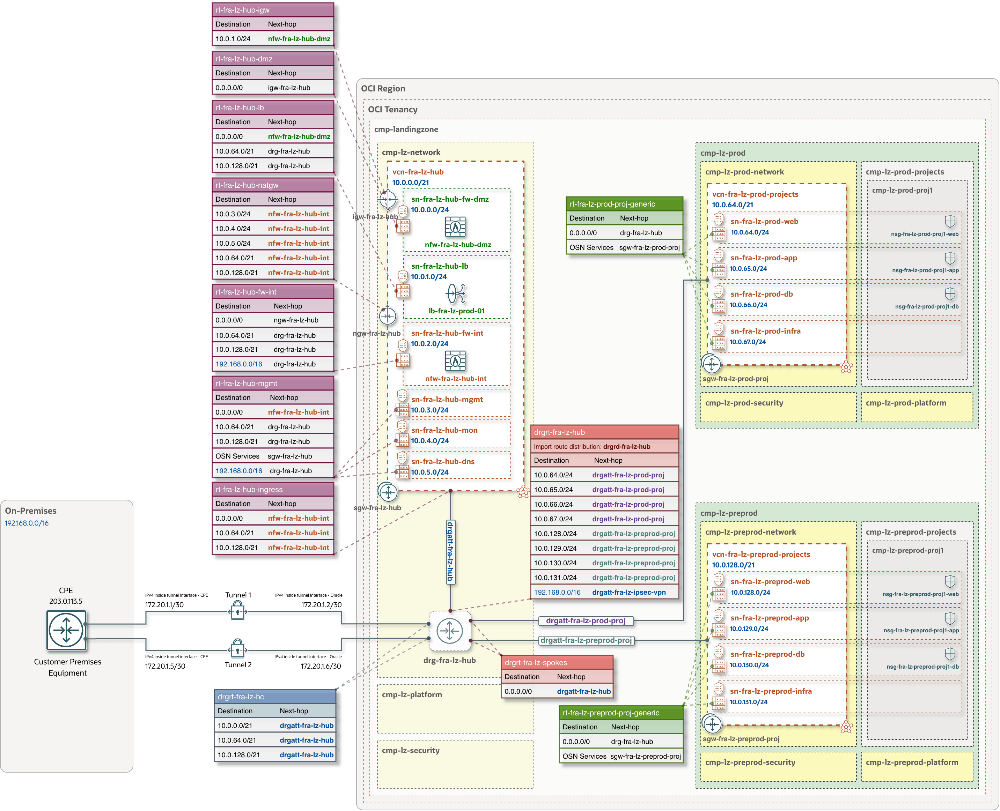

## Site-to-Site VPN for the One-OE Landing Zone

&nbsp;

### Overview
The OCI Hybrid Connectivity addon provides guidance and configuration options for integrating [OCI Site-to-Site VPN](https://docs.oracle.com/en-us/iaas/Content/Network/Tasks/overviewIPsec.htm) with an OCI One-OE Landing Zone. It supports both static and BGP dynamic routing and enables customers to generate the required OCI networking configurations using Landing Zone Studio or the Blueprint Factory. The resulting configuration files can then be used for subsequent Terraform deployment.

&nbsp;

#### Main components

| Resource&nbsp;&nbsp;&nbsp;&nbsp;&nbsp;&nbsp;&nbsp;&nbsp;&nbsp;&nbsp;&nbsp;&nbsp;&nbsp;&nbsp;&nbsp;&nbsp; | Purpose |
|---|---|
| **CPE object** | The OCI representation of the remote VPN device, including its public IP address. |
| **IPSec connection** | Connects the CPE object to the Landing Zone’s DRG and contains two redundant IPSec tunnels. |
| **DRG Route Table** | Custom route table `drgrt-fra-lz-hc`, which directs traffic to the appropriate next hop based on the deployed hub model. |

&nbsp;

#### Architecture and routing

This architecture diagram illustrates **Site-to-Site VPN connectivity** to an **OCI One-OE Landing Zone with Hub A**. The VPN connection uses **BGP dynamic routing**, and the diagram shows the IPv4 addresses assigned to both ends of each IPSec tunnel.


Both VPN tunnel attachments are associated with the `drgrt-fra-lz-hc` DRG route table, which directs traffic destined for the hub and spoke VCNs through the hub attachment. With the routing configuration illustrated, traffic between the remote network and spoke VCNs traverses the internal network firewall for inspection in both directions.

This routing and inspection model applies to **One-OE Landing Zone deployments with Hubs A, B, and C** models. For **Hub E**, which does not include a network firewall, traffic between the remote network and spoke VCNs can be routed directly through the DRG.



&nbsp;

> [!NOTE]
> With the routing configuration shown, traffic between the remote network and the Hub VCN’s private subnets (`sn-fra-lz-hub-mgmt`, `sn-fra-lz-hub-mon`, and `sn-fra-lz-hub-dns`) does not pass through the internal network firewall. If these flows also require inspection, update the relevant routing rules in both directions to maintain symmetric routing through the firewall.


&nbsp;

#### Configuration requirements

| Input&nbsp;&nbsp;&nbsp;&nbsp;&nbsp;&nbsp;&nbsp;&nbsp;&nbsp;&nbsp;&nbsp;&nbsp;&nbsp;&nbsp;&nbsp;&nbsp;&nbsp;&nbsp;&nbsp;&nbsp;&nbsp;&nbsp;&nbsp;&nbsp;&nbsp;&nbsp;&nbsp;&nbsp;&nbsp;&nbsp;&nbsp;&nbsp;&nbsp;&nbsp;&nbsp; | Requirement |
|---|---|
| **CPE public IP address** | The remote VPN gateway’s public IPv4 address, or its translated public address when behind NAT. Alternatively, provide an existing CPE object OCID. |
| **Remote network CIDRs** | Networks reachable through the VPN. These must not overlap the connected OCI networks. |
| **Tunnel settings** | Routing type, IKE version, and shared secret source for each tunnel. |
| **BGP settings** | For BGP routing: the customer ASN and a separate customer/Oracle inside-tunnel IP pair for each tunnel. |
| **CPE IKE identifier** | Required when the identity presented by the remote gateway differs from the public IP recorded in the CPE object. |

&nbsp;

#### VPN Routing types

| Option&nbsp;&nbsp;&nbsp;&nbsp;&nbsp;&nbsp;&nbsp;&nbsp;&nbsp;&nbsp;&nbsp;&nbsp;&nbsp;&nbsp;&nbsp;&nbsp;&nbsp;&nbsp;&nbsp;&nbsp;&nbsp;&nbsp;&nbsp;&nbsp;&nbsp;&nbsp;&nbsp;&nbsp; | Configuration |
|---|---|
| **Static routing** | Specify the remote network CIDRs. Configure corresponding routes to the OCI networks on the remote gateway. |
| **BGP dynamic routing** | Configure the customer ASN and inside-tunnel IP addresses, then establish BGP sessions and advertise the required networks on the remote gateway. |

For BGP, each inside-tunnel pair must use different host addresses in the same `/30` or `/31` subnet. Use a separate subnet for each tunnel and avoid [OCI’s reserved inside-tunnel ranges](https://docs.oracle.com/en-us/iaas/Content/Network/Tasks/settingupIPsec.htm).

The addon requires `remote_cidrs` for both routing options to prepare landing zone routes. With BGP, the actual remote routes must also be advertised by the peer; `remote_cidrs` does not configure BGP advertisements or prefix filters.

&nbsp;

---

### Example JSON Configuration

The following JSON configuration blocks illustrate the settings required in the `network.json` file to implement the Site-to-Site VPN connectivity described in the architecture diagram above.

The example consists of three configuration blocks: Customer-Premises Equipment (CPE), a custom DRG route table, and an IPSec connection with two BGP-enabled tunnels.

#### Block 1: Customer-Premises Equipment (CPE)

This block defines the Customer-Premises Equipment (CPE), including its display name, public IP address, and device vendor. In this example, the CPE vendor is set to `Other`.

```json
"customer_premises_equipments": {
    "CPE-FRA-LZ-ONPREM-KEY": {
        "display_name": "cpe-fra-lz-onprem",
        "ip_address": "203.0.113.5",
        "cpe_device_shape_vendor_name": "Other"
    }
},
```

#### Block 2: Custom DRG Route Table

This block defines the custom DRG route table used to control the routing of traffic entering the DRG from the remote network through the IPSec VPN tunnels.

The route table, `drgrt-fra-lz-hc`, contains route rules that direct traffic destined for the hub, pre-production, and production VCN CIDR blocks to the hub VCN attachment (`DRGATT-FRA-LZ-HUB-VCN-KEY`), allowing traffic to follow the hub's routing and firewall inspection path.

Equal-Cost Multi-Path (ECMP) routing is disabled in this example.

```json
"DRGRT-FRA-LZ-HUB-HC-KEY": {
    "display_name": "drgrt-fra-lz-hc",
    "is_ecmp_enabled": false,

    "route_rules": {
        "rr-hybrid-hc-hub": {
            "destination": "10.0.0.0/21",
            "destination_type": "CIDR_BLOCK",
            "next_hop_drg_attachment_key": "DRGATT-FRA-LZ-HUB-VCN-KEY"
        },

        "rr-hybrid-hc-preprod": {
            "destination": "10.0.128.0/21",
            "destination_type": "CIDR_BLOCK",
            "next_hop_drg_attachment_key": "DRGATT-FRA-LZ-HUB-VCN-KEY"
        },

        "rr-hybrid-hc-prod": {
            "destination": "10.0.64.0/21",
            "destination_type": "CIDR_BLOCK",
            "next_hop_drg_attachment_key": "DRGATT-FRA-LZ-HUB-VCN-KEY"
        }
    }
},
```

#### Block 3: IPSec Connection and BGP Tunnel Configuration

This block defines the Site-to-Site IPSec VPN connection, including references to the previously defined CPE and the Landing Zone DRG.

The connection includes two IPSec tunnels, both configured with **IKEv2** and **BGP dynamic routing**. Each tunnel specifies the customer BGP Autonomous System Number (ASN) and the IPv4 interface addresses used to establish the BGP session between OCI and the remote network.

Both tunnels reference the custom DRG route table (`DRGRT-FRA-LZ-HUB-HC-KEY`) defined in the previous block, ensuring that traffic entering the DRG through either tunnel follows the specified routing rules.

```json
"ipsecs": {
    "IPSEC-FRA-LZ-ONPREM-KEY": {
        "display_name": "ipsec-fra-lz-onprem",
        "cpe_key": "CPE-FRA-LZ-ONPREM-KEY",
        "drg_key": "DRG-FRA-LZ-HUB-KEY",
        "static_routes": ["192.168.0.0/16"],

        "tunnels_management": {
            "tunnel_1": {
                "drg_route_table_id": "DRGRT-FRA-LZ-HUB-HC-KEY",
                "ike_version": "V2",
                "routing": "BGP",

                "bgp_session_info": {
                    "customer_bgp_asn": "65001",
                    "customer_interface_ip": "172.20.1.1/30",
                    "oracle_interface_ip": "172.20.1.2/30"
                }
            },

            "tunnel_2": {
                "drg_route_table_id": "DRGRT-FRA-LZ-HUB-HC-KEY",
                "ike_version": "V2",
                "routing": "BGP",

                "bgp_session_info": {
                    "customer_bgp_asn": "65001",
                    "customer_interface_ip": "172.20.1.5/30",
                    "oracle_interface_ip": "172.20.1.6/30"
                }
            }
        }
    }
},
```

**Note:** The configuration values shown above are examples based on the reference architecture. Update the CPE public IP address, BGP parameters, network CIDR blocks, and resource references to match your environment. The configuration blocks must be included in their corresponding sections of the `network.json` file before being used for Terraform deployment.

&nbsp;

---

### Preparing and Generating JSON Configuration Files

The Site-to-Site VPN configuration can be prepared using either **OCI Landing Zone Studio** or the **OCI LZ Blueprint Factory**. Both methods generate the JSON configuration files required for subsequent Terraform deployment.

The following instructions describe how to generate the deployment configuration illustrated in the example above, without manually defining the individual resource blocks in `network.json`.

&nbsp;

#### Option 1: Landing Zone Studio

Landing Zone Studio provides a graphical interface for configuring Site-to-Site VPN connectivity as part of an OCI One-OE Landing Zone design.

[](https://oci-landing-zones.github.io/oci-landing-zone-operating-entities/)

1. Open an existing Landing Zone design or create a new one, selecting the required OCI region and hub network model.
2. Navigate to **Hub Network → VPN**.
3. Under **Customer VPN equipment**, define the Customer-Premises Equipment (CPE), including its public IPv4 address. Alternatively, reference an existing CPE using its OCID when configuring the VPN connection.
4. Under **Site-to-Site VPN**, add a VPN connection, select the CPE, and specify the **Remote IPv4 CIDRs** representing the networks reachable through the VPN. If the CPE uses an IKE identifier different from its public IP address, configure the corresponding **Router identity**.
5. Configure **Tunnel 1** and **Tunnel 2**, specifying the routing type (`BGP` or `STATIC`), IKE version, and shared secret settings. For BGP routing, provide the customer ASN and the customer and Oracle tunnel interface IP addresses. Configure additional IKE and IPSec parameters as required.
6. Navigate to **Review** to validate the Landing Zone configuration and review the network and routing settings.
7. Download the generated deployment package (ZIP), which includes the JSON configuration files, including `network.json`, required for Terraform deployment.

&nbsp;

#### Option 2: Blueprint Factory

The [OCI LZ Blueprint Factory](../oci-lz-blueprint-factory/README.md) provides a configuration-driven approach for generating Landing Zone deployment files from a JSON or Jsonnet source configuration.

1. Add the `hybrid_connectivity` section to your Landing Zone source configuration.
2. Define the required Site-to-Site VPN settings:
   - **`customer_premises_equipments`**: Define the CPE, including its public IP address.
   - **`ipsecs`**: Define the VPN connection, remote network CIDRs, and configuration of both IPSec tunnels.
   - **`cpe_key` / `cpe_id`**: Reference a CPE defined in the configuration using `cpe_key`, or an existing OCI CPE using `cpe_id`.
3. Generate the deployment JSON files following the [Blueprint Factory generation workflow](../oci-lz-blueprint-factory/README.md#4-generation-workflow).
4. Review the generated `network.json` to verify the VPN settings and associated routing configuration.

For detailed field definitions and supported configuration parameters, refer to the [VPN configuration reference](../oci-lz-blueprint-factory/blueprint-factory-configuration-reference.md#93-vpn-connections).

&nbsp;

&nbsp;

## License

Copyright (c) 2026 Oracle and/or its affiliates.

Licensed under the Universal Permissive License (UPL), Version 1.0. See [LICENSE](../../LICENSE.txt).