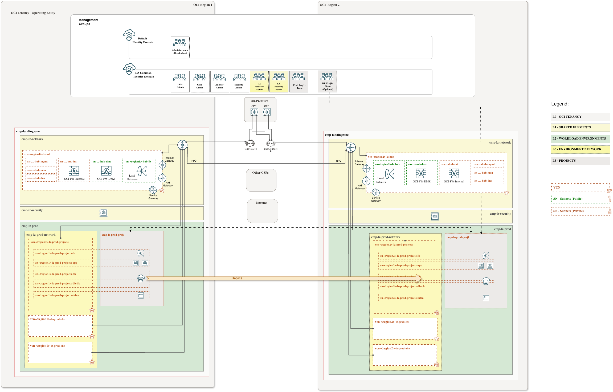
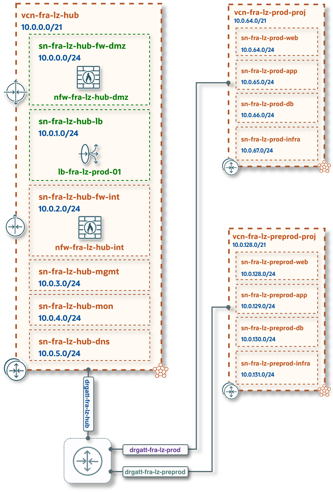
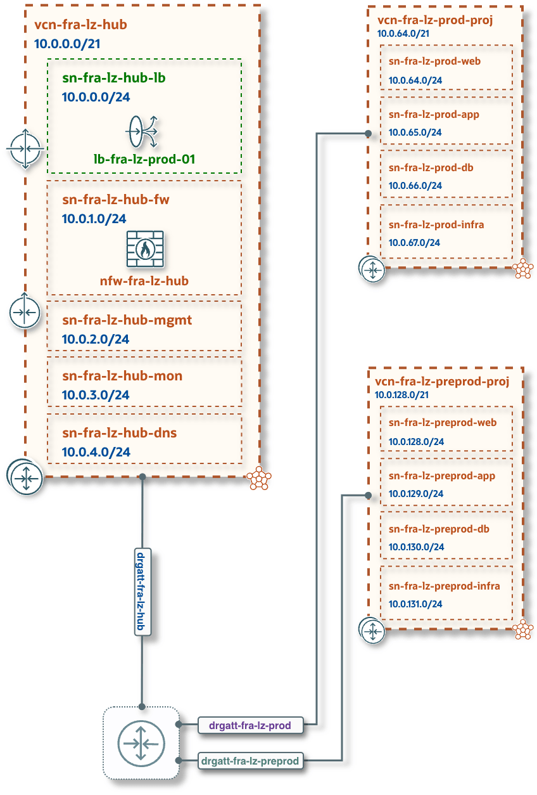
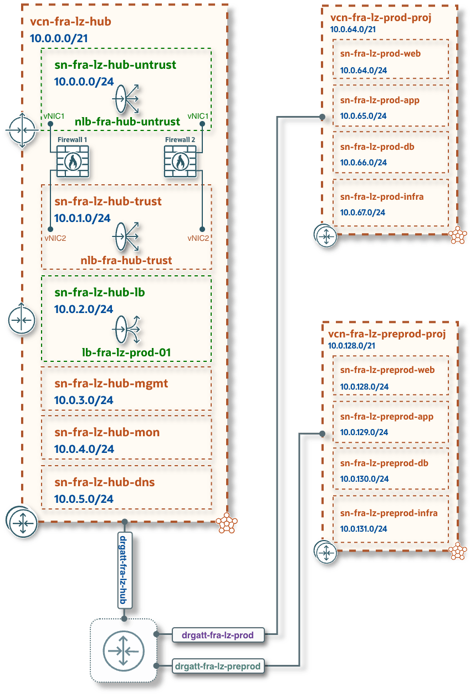
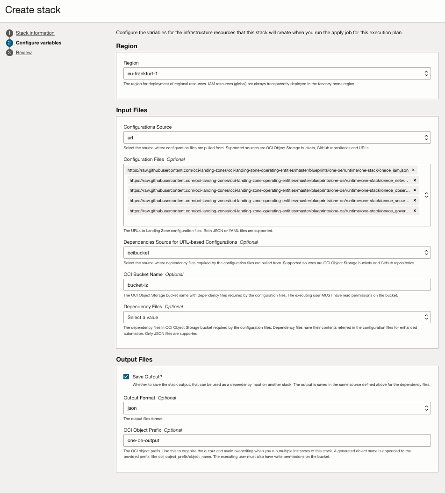
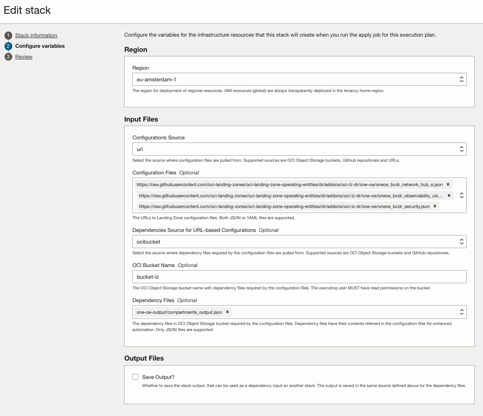

# **OCI LZ BCDR for One-OE**
## **Extending the One-OE blueprint with regional BCDR resources**

**Table of Contents**

- [**OCI LZ BCDR for One-OE**](#oci-lz-bcdr-for-one-oe)
  - [**Extending the One-OE blueprint with regional BCDR resources**](#extending-the-one-oe-blueprint-with-regional-bcdr-resources)
  - [1. Overview](#1-overview)
  - [2. Design](#2-design)
  - [3. Scope](#3-scope)
  - [4. Deployment model](#4-deployment-model)
    - [4.0. Prerequisite: Deploy the One-OE blueprint](#40-prerequisite-deploy-the-one-oe-blueprint)
    - [4.1. Deploy the One-OE DR extension](#41-deploy-the-one-oe-dr-extension)
      - [4.1.1. Deploy complete hub networking](#411-deploy-complete-hub-networking)
      - [4.1.2. Complete staged observability](#412-complete-staged-observability)
      - [4.1.3. Configure Service Connector bucket replication](#413-configure-service-connector-bucket-replication)
    - [4.2. Deploy inter-region RPC within the same tenancy](#42-deploy-inter-region-rpc-within-the-same-tenancy)
  - [License](#license)

## 1. Overview

This add-on provides the Disaster Recovery (DR) extension for the published One-OE One-Stack blueprint. It extends an existing One-OE deployment into a DR region.

## 2. Design

The One-OE BCDR design extends an existing One-OE blueprint into a DR region while reusing tenancy-level resources managed from the home region.

<strong>Figure 1: Generic two-region One-OE disaster recovery architecture</strong>

## 3. Scope

For a One-OE cross-region DR extension, the deployment scope is limited to:

- **Network**: regional VCN, DRG, routing, gateways, subnets, and other network resources required by the selected DR pattern.
- **Inter-region connectivity**: Remote Peering Connection (RPC) resources and the associated DRG attachments and routes. Blueprint Factory composes these resources into each region's canonical `network.json` by using the shared RPC model. Follow [Deploy inter-region RPC within the same tenancy](#42-deploy-inter-region-rpc-within-the-same-tenancy). Use the [OCI Remote Peering Connections add-on](../../oci-x-rpc/README.md) for complete same-tenancy and cross-tenancy guidance.
- **Observability**: regional events, alarms, logs, topics, subscriptions, and monitoring resources required to operate and validate the DR environment.
- **Regional security**: this add-on deploys Vulnerability Scanning Service (VSS) recipes and targets, plus DR-local Vaults and keys for CIS2. IAM, governance, Cloud Guard, and Security Zones remain home-owned.

## 4. Deployment model

### 4.0. Prerequisite: Deploy the One-OE blueprint

| [**One-OE + Hub A**](../../../blueprints/one-oe/runtime/one-stack/one_oe_hub_a.md) | [**One-OE + Hub B**](../../../blueprints/one-oe/runtime/one-stack/one_oe_hub_b.md) | [**One-OE + Hub C**](../../../blueprints/one-oe/runtime/one-stack/one_oe_hub_c.md) |
|:-|:-|:-|
|  |  |  |

This is a multi-stack deployment. First, deploy or update the One-OE home stack with the matching acceptor-bearing home network file, then deploy the regional BCDR stack in the DR region. Before deploying the BCDR stack, replicate the required One-OE output dependency files from an Object Storage bucket in the home region to a bucket in the DR region. Configure the add-on stack to consume these files by using the orchestrator's outputs and dependencies features described in the [OCI Resource Manager multi-stack deployment guide](../../../commons/content/orm_bp.md). This dependency replication is separate from the Service Connector bucket replication described later in this guide.

<strong>Figure 2: Home-region One-OE stack in Frankfurt</strong>

### 4.1. Deploy the One-OE DR extension

> [!NOTE]
> The published runtime preset uses `eu-frankfurt-1` as the home region and `eu-amsterdam-1` as the DR region.

Before deploying, ensure that the DR configuration uses the same hub model as the home-region One-OE deployment, and select the CIS level required by the DR design.

Use the [OCI LZ Blueprint Factory](../../oci-lz-blueprint-factory/README.md) to generate the two source configs independently. Collect the home and DR regions explicitly. The home source declares `stack_scope: "complete"`, sets `dr_region` to authorize the DR Object Storage service, and owns the X-RPC acceptor. The DR source declares `stack_scope: "regional"`, its own region metadata, and the corresponding requester. Each config explicitly lists its reviewed remote CIDRs and peer region.

The [`runtime`](./runtime/) directory contains the published Frankfurt/Amsterdam regional reference artifacts. Generate the canonical two-region working set from the reviewed pair of source configs; do not mix generated files with these published snapshots.

For cross-region DR, manage each target region as an independent deployment unit. Use a distinct OCI Resource Manager stack or Terraform state/workspace per region so that regional network and observability resources can be planned, applied, and operated independently.

The complete-scope home directory contains the normal complete Blueprint Factory output set, with the acceptor in its canonical network files. The regional-scope DR directory contains regional network, security, observability, and selected workload-extension files, with the requester in its canonical network files. Platforms and registered extensions follow their normal placement contracts. The complete home stack must provision every required compartment, governance resource, and extension IAM policy before regional deployment. Hub A, Hub B, and Hub C each deploy complete networking from `network.json` using Orchestrator v2.2.0 resource-key routing. Hub C also emits `network_backends.json` for designs with third-party firewall backends.

IAM compartments, identity resources, tenancy-wide governance, Cloud Guard, and Security Zones remain home-owned and are omitted from the generated DR directory. CIS2 regional security files deploy Vaults and keys in the DR region, including selected extension keys.

> [!IMPORTANT]
> **CIS Level 2:** deploy the generated regional security prerequisites before dependent buckets and workloads. The regional stack creates its own Vaults and keys; it does not create IAM policies from Vault key grant blocks. The complete home config must include `dr_region` and the IAM required by all selected regional extensions. Fresh regional keys do not replicate existing encryption material or secrets. Workloads that require original key material need a separate, reviewed [Vault and key replication](https://docs.oracle.com/en-us/iaas/Content/KeyManagement/Tasks/replicatingvaults.htm) design.

<strong>Figure 3: DR-region BCDR stack in Amsterdam</strong>

The DR-region BCDR stack reads the replicated One-OE output dependency files from Object Storage and does not save a new output file.

Copy the home `compartments_output.json` and acceptor-bearing `network_output.json` to the DR dependency bucket. Include those objects in `url_dependency_source_oci_objects`. CIS2 uses the keys created by the regional security configuration. The orchestrator's `rms-facade` derives its dependencies from their top-level blocks. Do not provide duplicate dependency documents containing the same top-level block.

When deploying the published Frankfurt/Amsterdam preset with ORM, follow these steps:

1. Update the home stack with `oneoe_bcdr_home_iam.json` and the matching complete `oneoe_bcdr_home_network_hub_*.json` file so it authorizes DR Object Storage and creates the RPC acceptor. Save its compartment and network dependency outputs.
2. Replicate the required One-OE output dependency files from a home-region Object Storage bucket to a DR-region bucket. This is separate from the replication described in [Configure Service Connector bucket replication](#413-configure-service-connector-bucket-replication).
3. Stage the reviewed generated DR files in a customer-controlled private Object Storage bucket or approved private Git source, then create the DR stack in `eu-amsterdam-1` (Netherlands Northwest, Amsterdam).
4. Use the pinned [Orchestrator v2.2.0](https://github.com/oci-landing-zones/terraform-oci-modules-orchestrator/tree/v2.2.0) source and set the working directory to `rms-facade`.
5. Set the stack name you prefer.
6. Set the Terraform version to 1.5.x. Click Next.
7. Review the selected generated JSON configuration files and confirm that they match the intended hub and CIS level. Click Next.
8. Before creating the stack, replace `email.address@example.com` in the selected initial observability file with the operational notification email addresses and confirm each email subscription. Repeat this change in the matching final observability file before following [Complete staged observability](#412-complete-staged-observability); otherwise the final replacement restores the placeholder addresses.
9. Configure the stack dependencies so the BCDR add-on consumes the required outputs from the blueprint One-OE stack.
10. Clear the Run apply check box. Click Create.
11. Run Plan and review the proposed regional network and observability changes before applying.
12. After approving the plan, run Apply to create the initial regional resources.

#### 4.1.1. Deploy complete hub networking

Hub A and Hub B deploy their matching complete home or DR network file in one network apply. Managed firewall route targets use resource keys resolved by Orchestrator v2.2.0. Home files use the `oneoe_bcdr_home_network_*` prefix; DR files use `oneoe_bcdr_network_*`.

Hub C follows the same complete-network process. Use `oneoe_bcdr_network_hub_c.json` for the standard design, or `oneoe_bcdr_network_hub_c_backends.json` when the design uses third-party firewall backend resources. Replace the example backend IP addresses and private-IP OCIDs with the reviewed firewall endpoints before deploying the backend variant.

Select `oneoe_bcdr_security_cis1.json` for regional [Vulnerability Scanning Service (VSS)](https://docs.oracle.com/en-us/iaas/Content/scanning/using/overview.htm) recipes and targets, or `oneoe_bcdr_security_cis2.json` to also deploy the regional Vault and bucket encryption key. Include the selected file in the initial BCDR stack; these published security files do not need a staged replacement. Config-generated extension deployments also emit security pre/final files so prerequisites can be applied before workloads.

Security Zones are not redeployed in the DR region. The One-OE blueprint already associates the shared tenancy-wide compartment hierarchy with its Security Zones; OCI does not allow a compartment to belong to multiple Security Zones. Cloud Guard remains managed by the home-region blueprint. Vaults and encryption keys are regional resources and are created in the DR stack for CIS2.

#### 4.1.2. Complete staged observability

The initial deployment uses `oneoe_bcdr_observability_cis1_pre.json` or `oneoe_bcdr_observability_cis2_pre.json`. After the final hub network configuration is applied, update the same stack or Terraform state to use the matching final observability file (`oneoe_bcdr_observability_cis1.json` or `oneoe_bcdr_observability_cis2.json`). The final file creates the flow logs for the DR-region hub and production network resources.

The BCDR observability files contain only regional DR resources. The home-region events remain managed by the home-region One-OE blueprint and are intentionally excluded from the DR stack.

#### 4.1.3. Configure Service Connector bucket replication

> [!IMPORTANT]
> **Manual post-deployment configuration required:** in the published preset, the BCDR observability files create `bkt-ams-lz-service-connector` as the destination bucket. After both stacks are deployed, configure an Object Storage replication policy from the home-region source bucket `bkt-lz-service-connector` to that DR-region destination. See [Object Storage replication](https://docs.oracle.com/en-us/iaas/Content/Object/Tasks/usingreplication.htm).

This post-deployment replication is separate from the output dependency file replication completed before creating the BCDR stack. The DR-region configuration intentionally creates no Service Connector. The replication destination becomes read-only while replication is active, so it cannot also be the local target of a Service Connector.

### 4.2. Deploy inter-region RPC within the same tenancy

This add-on uses the X-RPC same-tenancy pattern. In the example pair, Frankfurt
owns the acceptor in `home/network.json` (or the matching published `oneoe_bcdr_home_network_*` file) and Amsterdam owns the requester in
`dr/network.json` (or the matching published `oneoe_bcdr_network_*` file). No additional cross-tenancy IAM or governance configuration
is required.

1. Apply the home stack with its complete network file.
2. Save the home network output after it creates the acceptor.
3. Make that output available to the DR stack as its network dependency.
4. Apply the DR stack with its complete network file; its requester resolves the peer from the home dependency.
5. Verify that the RPC is connected, advertised routes are limited to the reviewed CIDRs, and the firewall policy allows only required protocols and ports.

When adding DR to an existing config-generated home stack, retain `stack_scope: "complete"`, set `dr_region`, and add the explicit acceptor. Ensure the complete home config covers every regional platform's compartment, governance, and extension IAM requirements. Define the requester and selected extensions in the independent `stack_scope: "regional"` DR source. Generate both configs and update the home IAM and network before deploying the DR stack. Replicate the updated compartment and network dependency outputs. CIS2 regional security creates the DR Vaults and keys. Do not combine the two regions in one Terraform state.

## License

Copyright (c) 2026 Oracle and/or its affiliates.

Licensed under the Universal Permissive License (UPL), Version 1.0.

See [LICENSE](../../../LICENSE.txt) for more details.
