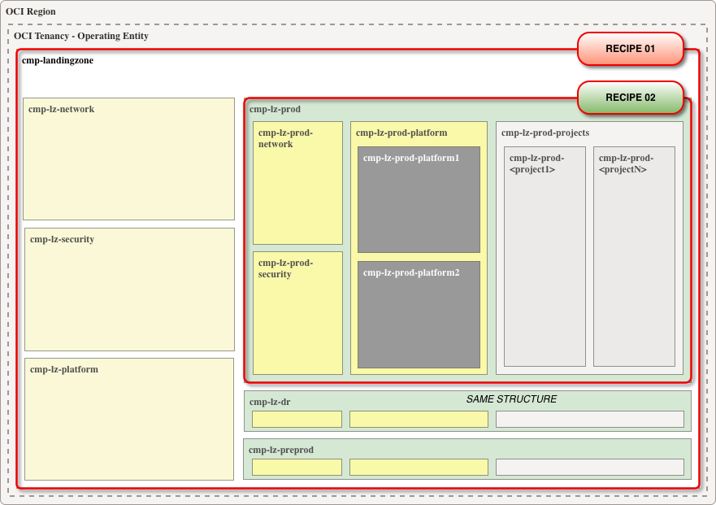

# **OCI Security Zones**

## **Additional Security Zones for OCI Open LZ**

&nbsp;

**Table of Contents**

- [1. Overview](#1-overview)
- [2. Security Zone Configuration](#2-security-zone-configuration)
- [3. Prerequisites](#3-prerequisites)
- [4. Configuration and Deployment](#4-configuration-and-deployment)
- [5. Maintenance](#5-maintenance)
- [License](#license)

&nbsp;

## 1. Overview

The OCI Security Zones add-on extends the [One-OE Landing Zone](../../blueprints/one-oe/runtime/one-stack/readme.md) with optional Security Zones for selected environments.

The blueprint applies **Recipe 01** to the landing-zone compartment. This add-on applies **Recipe 02** to an environment compartment and its subcompartments, using a separate deployment stack. Shared network, platform and security compartments continue to inherit the blueprint's baseline.

  

The example illustrates Recipe 02 applied to production. Select the environments that require these additional restrictions and review the corresponding CIS level before deployment.

&nbsp;

## 2. Security Zone Configuration

Choose the production example matching the landing zone's CIS level. Each example creates one Recipe 02 in the security compartment (`cmp_lz_security`) and one Security Zone protecting production (`cmp_lz_prod`).

| Scope | CIS Level 1 | CIS Level 2 | Existing target compartment |
|---|---|---|---|
| Production | [Configuration](./security_zones_environment_cis1.json) | [Configuration](./security_zones_environment_cis2.json) | `cmp_lz_prod` |

Use **one configuration file per add-on stack**, containing all selected environments under one `security_zones_configuration` root. Do not load both CIS alternatives into the same stack. The files use the [OCI Landing Zone Orchestrator v2.2.0](https://github.com/oci-landing-zones/terraform-oci-modules-orchestrator/tree/v2.2.0).

**To add another environment**, such as preproduction, test or development:

1. Duplicate the production entry in `recipes`, assigning a unique key and `name`. Keep its CIS level, policy list and security compartment reference.
2. Duplicate the production entry in `security_zones`, assigning a unique key and `name`. Set `compartment_id` to the new environment's reference and `recipe_key` to the new recipe's key.
3. Keep the existing production entries and region settings. Review that the plan retains them and adds only the new recipe/zone pair.

For preproduction, replace `PROD` with `PREPROD` in the copied keys and `prod` with `preprod` in the copied names; use `CMP-LZ-PREPROD-KEY` as the target compartment reference. Repeat for each additional environment.

Before deployment, confirm that every compartment reference resolves to the intended OCID in `compartments_output.json`. For literal OCIDs, verify the compartment directly in OCI. Review its subcompartments too: target only the intended environment, never the landing-zone parent or shared network, platform or security compartments.

The add-on creates only recipes and zones in existing compartments. It does not create IAM policies, networks, workloads, Vaults, keys or a separate Cloud Guard configuration block. Each recipe and zone must belong to one Terraform state; see [Prerequisites](#3-prerequisites) before adding protection to an existing deployment.

### 2.1. CIS Benchmark Level

**Both CIS variants include the same 26 environment restrictions**, including private-only subnets and load balancers, controls on network modification, and restrictions on resource movement and association. Selecting CIS Level 1 does not remove these restrictions.

The difference is the CIS baseline included in Recipe 02:

<table>
  <thead>
    <tr>
      <th width="150">Variant</th>
      <th>CIS baseline</th>
      <th>Additional environment restrictions</th>
      <th>Total policies</th>
    </tr>
  </thead>
  <tbody>
    <tr>
      <td>CIS&nbsp;Level&nbsp;1</td>
      <td>2 policies preventing public buckets and public database instances</td>
      <td>26</td>
      <td><strong>28</strong></td>
    </tr>
    <tr>
      <td>CIS&nbsp;Level&nbsp;2</td>
      <td>The Level 1 policies plus 4 policies requiring customer-managed Vault keys</td>
      <td>26</td>
      <td><strong>32</strong></td>
    </tr>
  </tbody>
</table>

For Level 2, provision customer-managed keys and the required IAM permissions for applicable block volumes, boot volumes, buckets and file systems before creating or updating protected resources.

These recipes enforce the module's selected controls. They are not a complete implementation or certification of the CIS benchmark. See the pinned [Security Zones module](https://github.com/oci-landing-zones/terraform-oci-modules-security/tree/v0.2.3/security-zones) for its exact policy set.

For the full policy lists, see [Security Zone Recipes — CIS Level 1](./sz_recipes_cis1.md) and [Security Zone Recipes — CIS Level 2](./sz_recipes_cis2.md).

&nbsp;

## 3. Prerequisites

1. **Existing compartments.** Complete the landing zone first and obtain its `compartments_output.json`. The selected target and security compartment keys must exist in that dependency file. The recipe's placement compartment and the zone's protected compartment have different purposes.
2. **Cloud Guard already enabled.** Verify its reporting region and the operator's [required permissions](https://docs.oracle.com/en-us/iaas/Content/security-zone/using/get-started.htm). The backing Security Zones module can enable Cloud Guard when disabled. This add-on requires it to be enabled beforehand so the new stack does not take responsibility for tenancy-level activation.
3. **A reviewed target compartment.** Check its existing Security Zone association, descendants, resources and Cloud Guard targets. Creating a zone replaces relevant existing Cloud Guard targets and creates a Security Zone target; review any custom detector configuration first. See [Oracle's Security Zones overview](https://docs.oracle.com/en-us/iaas/Content/security-zone/using/security-zones.htm).
4. **A dedicated stack/state.** The add-on must exclusively own its recipes and zones. The base stack continues owning its compartments and other resources.

Before deploying this add-on, check whether your existing One-OE or workload-extension stack already manages a Security Zone or recipe for the selected environment. Each recipe and zone must be managed by only one Terraform state, whether you deploy through Terraform CLI or an ORM stack.

If the existing stack already manages these resources, do not deploy another copy through the add-on stack. Moving existing resources between stacks requires a planned Terraform state migration, which this add-on does not perform. Simply removing their configuration from the original stack and adding it to the add-on stack can cause Terraform to propose deleting and recreating them.

Before updating an existing deployment, confirm which stack manages each recipe and zone, check the resource keys used in the configuration, and review the Terraform or ORM plan for unintended deletions, replacements or duplicate resources.

> [!IMPORTANT]
> **Creating a Security Zone does not automatically remediate existing resources that violate its policies.** Subsequent create and update operations are validated against the zone's recipe, while Cloud Guard detects policy violations in existing resources. Review those findings and plan any required remediation separately; a successful add-on deployment does not mean that all existing resources are compliant. See [Oracle's Security Zones overview](https://docs.oracle.com/en-us/iaas/Content/security-zone/using/security-zones.htm).

> [!IMPORTANT]
> Security Zone policies are enforced based on the recipe assigned to the Security Zone associated with a compartment. When a child compartment is assigned a different Security Zone, only the policies defined in that Security Zone's recipe are enforced for resources within the child compartment.

### 3.1. Region Settings

The published example uses `eu-frankfurt-1` for `reporting_region`. Review this value against the tenancy's actual Cloud Guard configuration. **This field does not set the stack's deployment region**: the Orchestrator's root `region` input configures the provider used to create the recipe and zone.

Oracle lists Security Zones and recipes as [regional resources](https://docs.oracle.com/en-us/iaas/Content/General/Concepts/regions.htm), while compartments span regions. This add-on deploys the selected configuration through one regional provider. It does not prove that an association protects resources in other regions, nor automatically create associations in Primary or DR. When the same compartment contains resources in multiple regions, verify the supported association and enforcement behavior with Oracle before adding another stack. The existing regional DR configuration remains unchanged.

&nbsp;

## 4. Configuration and Deployment

### 4.1. OCI Resource Manager

Configuration contract checked against **Orchestrator v2.2.0**.

Use a dedicated Resource Manager stack with the pinned Orchestrator [rms-facade](https://github.com/oci-landing-zones/terraform-oci-modules-orchestrator/tree/v2.2.0/rms-facade) source. Stage the reviewed configuration and dependency file in a customer-controlled **private OCI Object Storage bucket**, accessible from the stack. Keep that bucket's location consistent with the facade's Object Storage provider configuration.

Set the tenancy, deployment region and authorized execution identity for that stack. For a private bucket source, configure:

| Input | Example / purpose |
|---|---|
| `configuration_source` | `ocibucket` |
| `oci_configuration_bucket` | Name of the customer's private configuration bucket |
| `oci_configuration_objects` | For example `["security-zones/security_zones_environment_cis2.json"]`; select the intended recipe and CIS level |
| `oci_dependency_objects` | `["landing-zone/compartments_output.json"]` |

Replace the example object paths with the actual uploaded objects. If extending protection to other environments, upload the single configuration containing all selected recipe/zone pairs as described in Section 2. The facade reads the dependency's top-level `compartments` block. Keep dependency files separate from configuration files, and do not load the base stack's full security file into this stack.

Review validation, plan and apply as separate steps:

1. **Validate:** verify JSON syntax, the chosen module version, external compartment keys, Cloud Guard status and exclusive resource ownership.
2. **Plan:** run a plan on the new stack. Confirm the intended recipe and zone, their compartments, CIS level and provider region. Stop if it proposes compartment/workload changes, tenancy-level Cloud Guard activation, unexpected replacements or changes to resources owned elsewhere.
3. **Apply:** apply only the reviewed plan. Afterwards, inspect the zone's associated compartments and Cloud Guard findings. In an approved test compartment, verify that an operation violating an enabled policy is denied and an allowed operation succeeds. Source validation alone does not establish enforcement in OCI.

For dependency-file handling, see the [Resource Manager multi-stack guide](../../commons/content/orm_bp.md).

### 4.2. Terraform CLI

Use a dedicated checkout/workspace and backend for the pinned Orchestrator root. Keep tenancy, region, authentication and backend settings in your approved local configuration. Supply the selected JSON file with `-var-file`, and supply the dependency as the root input `compartments_dependency`, pointing to the local `compartments_output.json` file. Run `terraform validate`, then save and review a `terraform plan` before applying it. Never reuse the base landing zone's state for this independent stack.

&nbsp;

## 5. Maintenance

Recipe 02 includes policies that prevent deleting VCNs, network security groups and security lists. A workload or network plan that replaces one of these resources can therefore be blocked while the environment zone is active. See [Oracle's Security Zone policies](https://docs.oracle.com/en-us/iaas/Content/security-zone/using/security-zone-policies.htm).

For an approved environment teardown or a replacement that requires changing this protection:

1. **Review the resource-owning stack's plan.** Identify the affected environment and the denied operation. Determine whether a policy exception or removal of that environment's zone is required; do not weaken other environments as a shortcut.
2. **Plan the add-on change separately.** Keep all unaffected recipes and zones in its configuration. Review the temporary loss of restrictions, permissions and recovery steps before applying any exception or zone removal through the owning state. Retain the base stack's Recipe 01.
3. **Verify the resulting protection and Cloud Guard configuration.** Deleting a child zone does not guarantee that it inherits Recipe 01 again: Oracle conditions this on the parent-inheritance option. Check the actual compartment association and resulting Cloud Guard targets, and restore the intended baseline through a separately reviewed operation where needed. See [Cloud Guard changes after deleting a Security Zone](https://docs.oracle.com/en-us/iaas/Content/security-zone/using/cloud-guard-changes-when-security-zone-deleted.htm).
4. **Execute the reviewed workload change.** For temporary maintenance, restore the add-on configuration afterwards, review and apply its plan, and verify both an allowed operation and rejection of an enabled policy violation in an approved test compartment. For permanent teardown, verify the intended remaining compartments, zones and monitoring.

A recipe cannot be deleted while a zone still uses it. The module's zone-to-recipe reference establishes that dependency; preserve it and review the destroy plan rather than deleting resources manually outside their owning state. See [deleting a Security Zone recipe](https://docs.oracle.com/en-us/iaas/Content/security-zone/using/delete-recipe.htm).

&nbsp;

## License

Copyright (c) 2026 Oracle and/or its affiliates.

Licensed under the Universal Permissive License (UPL), Version 1.0. See [LICENSE](../../LICENSE.txt).
