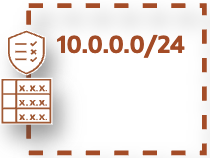
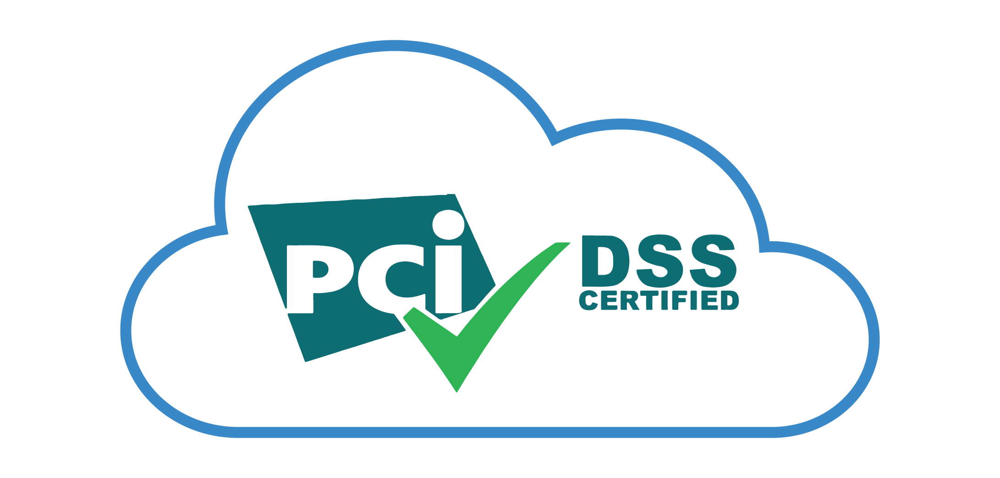

# **The OCI Open LZ &ndash; [Add-ons](#)**

&nbsp; 

Welcome to the **OCI Open LZ Addons**.  

An **add-on** is Landing Zone complementary element, or mechanisms that provide a specific capability to the overall landing zone environment. It can be in form of solutions designs, documentation, IaC configurations, etc.  Find below the list of landing zone add-ons available.

## FinOps tags and Studio compatibility

Published blueprint and add-on assets include the six FinOps tags. Published FinOps Tag Defaults use `is_user_required: false`; this controls whether a value must be supplied, not whether the namespace is needed. Before applying an add-on that references `tagns-lz-cost-governance`, deploy that namespace and its six key definitions through the landing zone governance configuration. Complete that deployment before applying dependent add-on stacks. For a single stack, use the orchestrator's supported resource dependencies rather than relying on input file order. The deploying principal also needs permission to use the namespace, and supplied values must satisfy its definitions.

Studio makes FinOps optional. With FinOps enabled, its generated definitions use `is_user_required: true`. With FinOps disabled, its downloads omit the FinOps namespace, tags, defaults and tag-based budgets, while retaining IAM role tags and compartment-based budgets. Studio does not automatically adapt the separately published FinOps platform or Private DNS add-on configurations.

For a Studio design without FinOps tags, prepare a separate customer-controlled copy of each required add-on configuration. From the repository root, the existing Blueprint Factory filter can adapt a JSON input, including nested tags, without changing the published asset:

```sh
jsonnet -J . \
  --ext-str-file addon=addons/oci-private-dns/oneoe_network_hub_a_private_dns.json \
  -e "(import 'gen/lib/cost_tags.libsonnet').apply(std.parseJson(std.extVar('addon')), { cost_governance: { enable_tags: false } })" \
  --output-file /path/to/customer-config/private-dns.json
```

Replace the output path with a new file in an existing customer-controlled directory. Repeat for every JSON input used by the add-on, including IAM and network files. Use `.auto.tfvars.json` for outputs consumed directly as Terraform variable files. The filter removes only the FinOps entries in tag maps, the FinOps namespace definition and budgets targeting FinOps tags. It preserves other tags, including IAM role tags, and compartment-based budgets. It does not alter Terraform source files or generate missing add-on resources.

Removing FinOps metadata does not reconcile topology: review compartments, resource keys, CIDRs, dependencies and any remaining tag references against the Studio-generated design. For generated assets, keep the published JSON intact and make other configuration changes in their declarative source. Use the reviewed adapted copies for the add-on deployment; do not replace Studio-generated base files with published snapshots. If FinOps is enabled instead, use the design's reviewed business values rather than the published sample values.

The [FinOps Autonomous Database Terraform configuration](oci-finops/finops-setup/terraform/README.md) additionally needs `enable_cost_governance_tags = false` when the namespace is absent. This disables automatic tag injection; any tags explicitly supplied through `defined_tags` are still applied and require their own existing namespace and keys.

For the standalone FinOps add-on, prefer its [customer tag mapping adapter](oci-finops/finops-setup/README.md#apply-customer-tag-mappings-consistently) to prepare IAM, network and ADB tag inputs together. It supports both enabled customer mappings and disabled FinOps tags, while preserving shared hub attribution. It adapts tags only; topology review remains required.

Keep reviewed configuration files in a customer-controlled private location. For OCI Resource Manager, stage them in a private OCI Object Storage bucket and use a pinned orchestrator `rms-facade` workflow. Validate and review the Terraform plan before applying. This procedure is for new add-on deployments; removing tags or budgets from an existing deployment requires a separate change review.

&nbsp; 

|  |  Deployable add-ons  | Description |
|:--:|:-|:-|
|  | **[OCI Network Hubs](/addons/oci-hub-models/readme.md)** | A set of **OCI Network Hub topologies** applicable to any landing zone or OCI deployment. |
|  | **[OCI Database Observability](/addons/oci-db-observability/readme.md)** | Enable native database observability services including **Database Management**, **Ops Insights**, and **Logging Analytics**. |
|  | **[OCI Private DNS](/addons/oci-private-dns/README.md)** | A set of **OCI Private DNS configurations** applicable to any landing zone or OCI deployment. |
|  | **[OCI Remote Peering Connections](./oci-x-rpc/README.md)** | Setup Remote Peering Connections between regions and tenancies. |
|  | **[OCI Sovereign Landing Zones](./oci-sovereign-landing-zone/readme.md)**| A set of **OCI Sovereign Controls** applicable to any OCI LZ deployment. |
|  | **[OCI Secure Desktops](/addons/oci-secure-desktops/readme.md)** | Guidelines to enable and configure **OCI Secure Desktops** in your Landing Zone. 
|  | **[OCI TBAC](./oci-tbac/README.md)**| Use roles to manage IAM permissions for projects onboarding with **Tag-Based Access Controls**.|
|  | **[OCI FinOps](./oci-finops/README.md)**| A set of **OCI FinOps** configurations with FOCUS to enable cost visibility, governance, and optimization. |
|  | **[OCI LZ BCDR](./oci-lz-dr/README.md)** | Deployable **Business Continuity and Disaster Recovery** patterns and configuration guidance for OCI Landing Zones. |
|  | **[OCI Bastion Access](./oci-bastion/README.md)** | Enable native OCI Bastion service and use dynamic SOCKS5 sessions for private web interface and VM access. Including macOS and Windows guides. |


&nbsp; 

|  | Guidance add-ons | Description |
|:--:|:-|:-|
|  | **[OCI Learn LZ](/addons/oci-learn-lz/readme.md)** | A Landing Zone **training** to learn how to design and run a Landing Zone without code. |
|  | **[OCI LZ AI Agent](/addons/oci-lz-ai-agent/README.md)** | Guidelines to use **AI coding agents** for OCI Landing Zone Operating Entities design and review. |
|  | **[OCI LZ Blueprint Factory](/addons/oci-lz-blueprint-factory/README.md)** | Guidance for **config-driven** Landing Zone blueprint generation. |
| </br>&nbsp;&nbsp;&nbsp;&nbsp;&nbsp;&nbsp;&nbsp;&nbsp;&nbsp;&nbsp;&nbsp; | **[Subnetting Guide](/addons/oci-lz-subnetting/readme.md)** | Guidelines to design your network subnetting between tenancies, landing zone & workload environments, and regions, **improving your landing zone scalability and planning for your future growth**. |
|  | </br>**[Oracle Access Governance](/addons/oci-oag/README.md)**</br>&nbsp;&nbsp;&nbsp;&nbsp;&nbsp;&nbsp;&nbsp;&nbsp;&nbsp;&nbsp;&nbsp;&nbsp;&nbsp;&nbsp;&nbsp;&nbsp;&nbsp;&nbsp;&nbsp;&nbsp;&nbsp;&nbsp;&nbsp;&nbsp;&nbsp;&nbsp;&nbsp;&nbsp;&nbsp;&nbsp;&nbsp;&nbsp;&nbsp;&nbsp;&nbsp;&nbsp;&nbsp;&nbsp;&nbsp;&nbsp;&nbsp;&nbsp;&nbsp;&nbsp;&nbsp;&nbsp;&nbsp;&nbsp;&nbsp;&nbsp;&nbsp;&nbsp;&nbsp;&nbsp;&nbsp; | Guidelines to increase the **security governance** of your Landing Zones with OAG. |
| </br>&nbsp;&nbsp;&nbsp;&nbsp;&nbsp;&nbsp;&nbsp;&nbsp;&nbsp;&nbsp;&nbsp; | **[PCI DSS Guidance](/addons/oci-pci-dss-guidance/README.md)** | Guidance for using Operating Entities Landing Zone capabilities to support PCI DSS environment design, segmentation, governance, monitoring, and shared-responsibility planning. |

&nbsp; 

&nbsp; 

# License

Copyright (c) 2026 Oracle and/or its affiliates.

Licensed under the Universal Permissive License (UPL), Version 1.0.

See [LICENSE](/LICENSE.txt) for more details.
