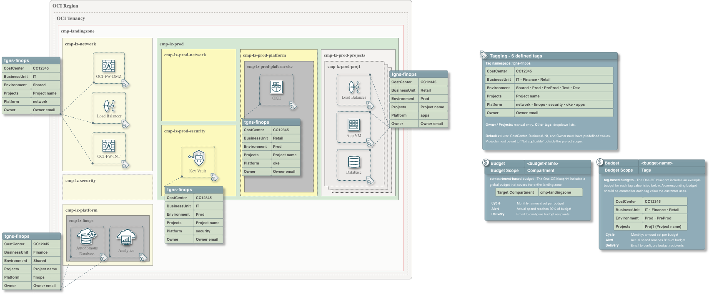

# Cost governance

## 1. Cost governance tags

The One-OE blueprint includes a default cost-governance configuration in
`oneoe_governance.json`. It defines the `tagns-lz-cost-governance` namespace and
six tags: cost center, business unit, owner, platform, environment, and project.

Together, these tags establish a consistent classification model for resources
across the landing zone. They help teams identify ownership, allocate costs,
analyze spending by business and technical scope, and monitor budgets using
shared reporting criteria.

The blueprint assigns these tags to supported resources and requires them on new
taggable resources created within the landing-zone hierarchy. This promotes
consistent cost data as teams add workloads and expand the environment.

### 1.1. Tag values

The table lists the Tag Default values and the example allowed values provided
by the blueprint in `oneoe_governance.json`. The configured allowed values
standardize tagging: users must select a value from the list defined for each
tag rather than enter arbitrary values. Your cost-management team should define
and maintain these lists so that resource tags follow the organization's cost
allocation and reporting conventions. Update the tag validators and resource
assignments together to use those approved values.

Because the Tag Defaults require user-supplied values, the default values in the
table do not automatically fill missing tags.

| Tag | Default value | Allowed values |
|---|---|---|
| `tag-lz-cost-center` | `tobedefined` | `tobedefined`, `CC12345` |
| `tag-lz-business-unit` | `tobedefined` | `tobedefined`, `IT`, `Finance`, `Retail` |
| `tag-lz-owner` | `tobedefined` | `tobedefined`, `email.address@example.com` |
| `tag-lz-platform` | `tobedefined` | `tobedefined`, `network`, `security`, `observability`, `oke`, `ocvs`, `exacs`, `exacc`, `ebs`, `hpc`, `finops`, `ai-services`, `apps` |
| `tag-lz-environment` | `tobedefined` | `dev`, `preprod`, `prod`, `shared`, `staging`, `test`, `tobedefined` |
| `tag-lz-project` | `notapply` | `notapply`, `proj1`, `proj2` |

### 1.2. Tag assignments in the One-OE blueprint

The One-OE blueprint assigns tag values according to each resource's purpose,
environment, and project scope. The following assignments describe the supplied
configuration and should be reviewed against your organization's cost-allocation
model.

Network compartments also use `platform=network`: `CMP-LZ-NETWORK-KEY`,
`CMP-LZ-PROD-NETWORK-KEY`, and `CMP-LZ-PREPROD-NETWORK-KEY`. Security compartments
use `platform=security`: `CMP-LZ-SECURITY-KEY`, `CMP-LZ-PROD-SECURITY-KEY`, and
`CMP-LZ-PREPROD-SECURITY-KEY`. Other IAM resources retain `platform=tobedefined`.

The public load balancer serves production and uses `environment=prod`, even
though it resides in the shared hub. Shared project networks and subnets use
`project=notapply`; project-specific NSGs use `project=proj1`. Existing IAM role tags
are preserved. Components without their own tagging fields, such as listeners,
backends, and NSG rules, do not receive a `defined_tags` field.

All CIS security variants use `platform=security`, including Vaults and keys when
the selected CIS2 security file creates them. Security configuration defaults
also tag module-created resources such as cloned Cloud Guard recipes.
Observability, including flow logs, uses `platform=observability`.

### 1.3. Required tagging

The blueprint requires all six cost-governance tags on new taggable resources
created within the landing-zone compartment hierarchy. Values must match the
configured allowed lists; missing tags are not filled automatically. These
requirements are inherited by child compartments and also apply to new taggable
resources created there by add-ons and workload extensions. Existing resources
are not tagged retroactively. Review the supplied tag values and the
[known issues](known_issues.md#required-tags-on-implicitly-created-resources)
before deploying add-ons or workload extensions, and preserve their existing
access-control tags.

To allow resource creation without users explicitly supplying all six values,
set `is_user_required` to `false` in each of the six `tag_defaults` entries in
your deployment configuration. Once those Tag Defaults are effective, OCI applies
the configured `default_value` when a tag is omitted. This changes tagging to
automatic defaults; it does not disable the tags or their allowed-value
validators. Review the default values with your cost-management team before
using this option. See [OCI Tag Defaults](https://docs.oracle.com/en-us/iaas/Content/Tagging/Tasks/managingtagdefaults.htm).

For deployment prerequisites and sequencing, follow the selected hub guide
linked from the [One-OE deployment overview](readme.md).

[Orchestrator v2.4.1](https://github.com/oci-landing-zones/terraform-oci-modules-orchestrator/releases/tag/v2.4.1)
is the minimum version required to deploy this blueprint's required tagging
configuration.

## 2. Budgets

The One-OE blueprint includes eight monthly budgets by default in
`oneoe_governance.json`. They track spending across the landing zone as a whole
and for selected cost centers, business units, environments, and projects.

These budgets help teams compare actual spending with planned amounts and
identify where costs need attention. Each budget includes an alert configured
at 80% of its monthly amount, helping the responsible teams review usage and
take action. Review the example amounts, targets, and notification recipients
to match your organization's cost-management needs.

| Target | Value | Monthly amount |
|---|---|---:|
| Compartment | `cmp-landingzone` and its children | 10000 |
| `tag-lz-cost-center` | `CC12345` | 5000 |
| `tag-lz-business-unit` | `IT` | 5000 |
| `tag-lz-business-unit` | `Finance` | 5000 |
| `tag-lz-business-unit` | `Retail` | 5000 |
| `tag-lz-environment` | `prod` | 3000 |
| `tag-lz-environment` | `preprod` | 2000 |
| `tag-lz-project` | `proj1` | 500 |

The overall budget covers `cmp-landingzone` and its child compartments.
Tag-based budgets track spending on resources with matching tag values. Update
placeholder values such as `tobedefined` so spending is attributed correctly.

Amounts use the tenancy's rate-card currency, and monthly periods start on day 1.
Replace `email.address@example.com` with your notification recipients.
Budget totals can overlap because the same resource may contribute to several
budgets; do not add them together.

Budgets provide spending alerts, not spending caps: they do not stop resources.
See [OCI Budgets](https://docs.oracle.com/en-us/iaas/Content/Billing/Concepts/budgetsoverview.htm).

## 3. License

Copyright (c) 2026 Oracle and/or its affiliates.

Licensed under the Universal Permissive License (UPL), Version 1.0.

See [LICENSE](../../../../LICENSE.txt) for more details.
