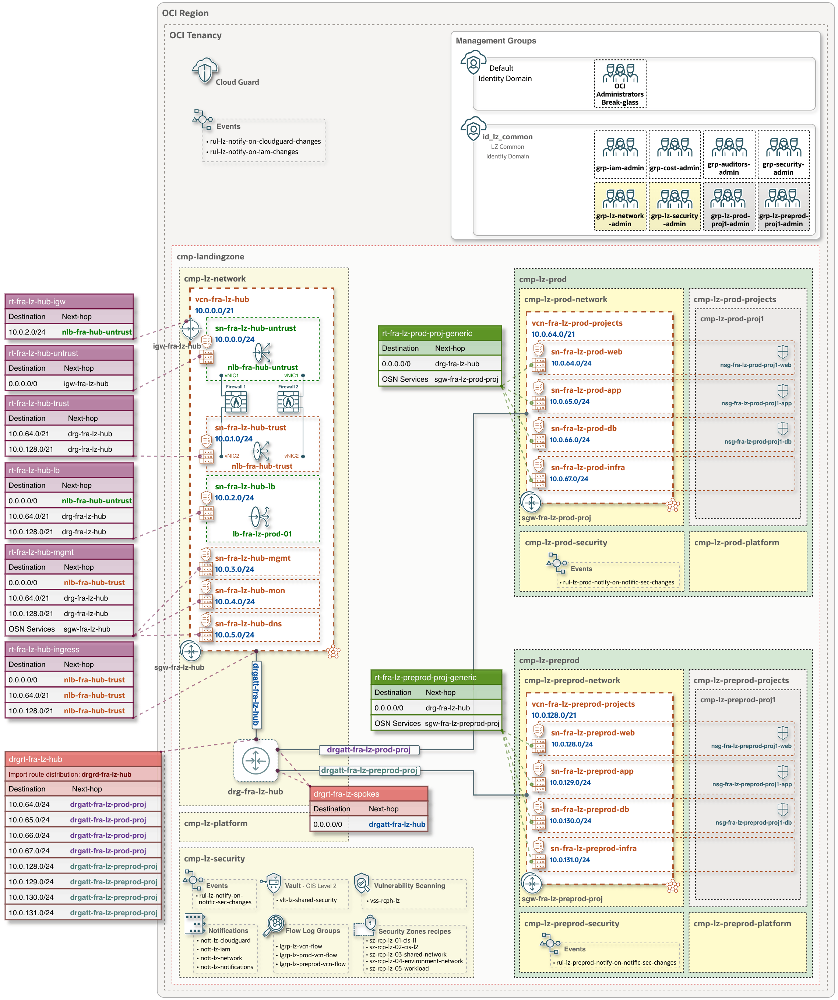

 # **One-OE + Hub C: One-Stack Deployment**
 
 ### Overview
 This document provides a detailed overview of the One-OE Landing Zone with [**Hub C addon**](/addons/oci-hub-models/hub_c/readme.md), including its components and deployment guidance.

 ### Deployment diagram

The diagram provides a comprehensive visual representation of the key OCI resources - such as Identity Domains, groups, compartments, IP CIDR ranges, and route table configurations - including their exact naming conventions, as defined in the One-OE JSON configurations.

&nbsp; 

> [!NOTE]
> - The JSON configuration does not include the deployment of third-party Firewalls; these are depicted in the diagram for illustrative purposes only.
> 
> - In the JSON configurations, the default OCI region is set to Frankfurt, and this is reflected in the naming conventions (e.g., vcn-**fra**-lz-hub). For deployments in other regions, the JSON configurations must be updated accordingly to ensure that the resource names align with the target region.

&nbsp;

### Mandatory cost-governance tags

One-OE uses six mandatory cost-governance tags: cost center, business unit, owner, platform, environment, and project. These tags support FinOps objectives by enabling consistent cost allocation, clear ownership, and spending analysis across business units, platforms, environments, and projects.

They apply to new resources that support tagging in `cmp-landingzone` and its child compartments. Review the values in the supplied configurations before deployment, and include the same tags when adding workloads or add-ons.

See [Cost governance tags](cost-governance.md) for configuration and deployment details.

### CIS security level

Two deployment options are available: One-Stack deployment with **CIS Level 1** and **CIS Level 2** security controls.

- **CIS Level 1** is recommended in scenarios where:
  - CIS Level 1 Security Controls meet your security requirements.
  - You are exploring or testing configurations and need to deploy and tear down environments quickly.
  - You are creating a proof-of-concept (PoC) environment.

- **CIS Level 2** is recommended in scenarios where:
  - Your security requirements mandate CIS Level 2 Security Controls (for example, deploying a Vault to manage your encryption keys and force the encryption of all your data with them, block storage, object storage, etc.).

&nbsp; 

For details on the Security Zone policies included in each deployment option, see [Security Zones - CIS Level 1](./sz_recipes_cis1.md) and [Security Zones - CIS Level 2](./sz_recipes_cis2.md).

## Deployment

### Prerequisites

Before deployment, review and update the configuration files:

1. **Cost-governance tags:** review the tag definitions and allowed values in [oneoe_governance.json](oneoe_governance.json), and update the tag values assigned in the deployment configurations to match your organization. See [Tag values](cost-governance.md#tag-values).
2. **Budget notifications:** replace `email.address@example.com` in each budget's `alert_rule.recipients` in [oneoe_governance.json](oneoe_governance.json) with the intended recipients. Review the budget amounts and targets as described in [Monthly budgets](cost-governance.md#monthly-budgets).
3. **Observability notifications:** replace `email.address@example.com` in the `EMAIL` subscriptions with your notification recipients. Use the complete file for the selected CIS level: [CIS 1](oneoe_observability_cis1.json) or [CIS 2](oneoe_observability_cis2.json). Each file includes VCN and subnet Flow Logs for the initial deployment.

Use the reviewed configuration files when creating or updating the ORM stack.

### CIS Level 1

#### Input configurations

| JSON configurations | Configuration-defined components | 
|:-|:-|
| **IAM configuration**  [oneoe_iam.json](oneoe_iam.json) | • Compartments  • Identity Domain  • IAM groups and policies |
| **Governance configuration**  [oneoe_governance.json](oneoe_governance.json)| • Tag namespaces and definitions   • Six required cost-governance Tag Defaults   • Eight monthly budgets with 80% alerts |
| **Network configuration**: [oneoe_network_hub_c.json](oneoe_network_hub_c.json) or [oneoe_network_hub_c_backends.json](oneoe_network_hub_c_backends.json) | • [Hub C](/addons/oci-hub-models/hub_c/readme.md) VCN with associated subnets   • Private Network Load Balancers (trust and untrust)   • Internet and Service Gateways  • Dynamic Routing Gateway (DRG)  • Route Tables with corresponding route rules  • Two Spoke VCNs (Prod and PreProd) with private-only subnets   • Service gateways in the Spoke VCNs  • Security Lists (SLs) and Network Security Groups (NSGs). For detailed configuration information, see [Security Lists and Network Security Groups](./one_oe_hub_c_sl_nsg.md)   • Public Load Balancer ([free tier LBaaS](https://docs.oracle.com/en-us/iaas/Content/FreeTier/freetier_topic-Always_Free_Resources.htm#loadbalancing)) with two example backend IP addresses from the production web tier: 10.0.64.10 and 10.0.64.20. The LBaaS and backend configurations are provided solely for example purposes and should be updated to reference actual workload instances |
| **Security configuration** for   **Step 1**: [oneoe_security_cis1_pre.json](oneoe_security_cis1_pre.json)  and  **Step 2**: [oneoe_security_cis1.json](oneoe_security_cis1.json)   | • Cloud Guard  • [Security Zones and recipes (CIS Level 1)](./sz_recipes_cis1.md)  • Vulnerability Scanning |
| **Observability configuration**  [oneoe_observability_cis1.json](oneoe_observability_cis1.json) | • Events  • Alarms  • Logging, including VCN and subnet Flow Logs  • Notifications |

&nbsp;

#### Deploy with OCI Resource Manager (ORM)

##### Step 1:
  Click &nbsp; [](https://cloud.oracle.com/resourcemanager/stacks/create?zipUrl=https://github.com/oci-landing-zones/terraform-oci-modules-orchestrator/archive/refs/tags/v2.4.1.zip&zipUrlVariables={"input_config_files_urls":"https://raw.githubusercontent.com/oci-landing-zones/oci-landing-zone-operating-entities/master/blueprints/one-oe/runtime/one-stack/oneoe_iam.json,https://raw.githubusercontent.com/oci-landing-zones/oci-landing-zone-operating-entities/master/blueprints/one-oe/runtime/one-stack/oneoe_network_hub_c.json,https://raw.githubusercontent.com/oci-landing-zones/oci-landing-zone-operating-entities/master/blueprints/one-oe/runtime/one-stack/oneoe_observability_cis1.json,https://raw.githubusercontent.com/oci-landing-zones/oci-landing-zone-operating-entities/master/blueprints/one-oe/runtime/one-stack/oneoe_security_cis1_pre.json,https://raw.githubusercontent.com/oci-landing-zones/oci-landing-zone-operating-entities/master/blueprints/one-oe/runtime/one-stack/oneoe_governance.json"}) 

And follow these steps:
  1. Accept terms, wait for the configuration to load.
  2. Set the working directory to “rms-facade”.
  3. Set the stack name you prefer.
  4. Set the terraform version to 1.5.x. Click Next.
  5. Accept the default files. Click Next. Optionally, replace with your json/yaml config files.
  6. Un-check run apply. Click Create.
  
##### Step 2:
  The following updates, or only those relevant to your deployment - should be performed after the **Step 1** stack and all Landing Zone components have been deployed. This phase updates the **Step 1** ORM stack to add additional Security Zone Recipes and Vulnerability Scanning targets. Observability, including Flow Logs, is already configured in Step 1. Keep a final network configuration selected; change to the backends variant only when its real firewall targets are available. All required updates can be applied in a single operation by replacing the corresponding configuration files as described below.
  

  1. **NLB firewall backends**: 
     - The network route tables reference the Trust and Untrust NLB keys.
     - The published configurations do not deploy third-party firewall VMs. When external firewalls are ready, use [oneoe_network_hub_c_backends.json](oneoe_network_hub_c_backends.json) and replace the firewall private-IP OCID placeholders with their real backend targets. Alternatively, keep [oneoe_network_hub_c.json](oneoe_network_hub_c.json) and manage backend registration separately.
     - When firewall compute is supplied to the same Orchestrator stack or through dependency outputs, backend `target_id` supports primary instance keys and qualified secondary-interface keys.
     - Select one complete network file for the stack; do not load the plain and backends variants together.

  2. **Security - Security Zones, Vulnerability Scanning Service**:  
    Use the configuration [oneoe_security_cis1.json](oneoe_security_cis1.json) to complete the security implementation by adding the following components:
      - Security Zone Targets to apply more restrictive Security Zone Recipes to the following compartments: Hub network compartment and Production compartment. 
      - Vulnerability Scanning on all Host targets within the Landing Zone enclosing compartment.
    
&nbsp; 

Once all required updates are applied, rerun the ORM stack.

&nbsp;

### CIS Level 2

#### Input configurations

| JSON configurations | Configuration-defined components | 
|:-|:-|
| **IAM configuration**  [oneoe_iam.json](oneoe_iam.json) | • Compartments  • Identity Domain  • IAM groups and policies |
| **Governance configuration**  [oneoe_governance.json](oneoe_governance.json)| • Tag namespaces and definitions   • Six required cost-governance Tag Defaults   • Eight monthly budgets with 80% alerts |
| **Network configuration**: [oneoe_network_hub_c.json](oneoe_network_hub_c.json) or [oneoe_network_hub_c_backends.json](oneoe_network_hub_c_backends.json) | • [Hub C](/addons/oci-hub-models/hub_c/readme.md) VCN with associated subnets   • Private Network Load Balancers (trust and untrust)   • Internet and Service Gateways  • Dynamic Routing Gateway (DRG)  • Route Tables with corresponding route rules  • Two Spoke VCNs (Prod and PreProd) with private-only subnets   • Service gateways in the Spoke VCNs  • Security Lists (SLs) and Network Security Groups (NSGs). For detailed configuration information, see [Security Lists and Network Security Groups](./one_oe_hub_c_sl_nsg.md)   • Public Load Balancer ([free tier LBaaS](https://docs.oracle.com/en-us/iaas/Content/FreeTier/freetier_topic-Always_Free_Resources.htm#loadbalancing)) with two example backend IP addresses from the production web tier: 10.0.64.10 and 10.0.64.20. The LBaaS and backend configurations are provided solely for example purposes and should be updated to reference actual workload instances |
| **Security configuration** for   **Step 1**: [oneoe_security_cis2_pre.json](oneoe_security_cis2_pre.json)  and  **Step 2**: [oneoe_security_cis2.json](oneoe_security_cis2.json)   | • Cloud Guard  • [Security Zones and recipes (CIS Level 2)](./sz_recipes_cis2.md)  • Vulnerability Scanning  • Vault and Software Key |
| **Observability configuration**  [oneoe_observability_cis2.json](oneoe_observability_cis2.json) | • Events  • Alarms  • Logging, including VCN and subnet Flow Logs  • Notifications |

&nbsp;

#### Deploy with OCI Resource Manager (ORM)

##### Step 1:
  Click &nbsp; [](https://cloud.oracle.com/resourcemanager/stacks/create?zipUrl=https://github.com/oci-landing-zones/terraform-oci-modules-orchestrator/archive/refs/tags/v2.4.1.zip&zipUrlVariables={"input_config_files_urls":"https://raw.githubusercontent.com/oci-landing-zones/oci-landing-zone-operating-entities/master/blueprints/one-oe/runtime/one-stack/oneoe_iam.json,https://raw.githubusercontent.com/oci-landing-zones/oci-landing-zone-operating-entities/master/blueprints/one-oe/runtime/one-stack/oneoe_network_hub_c.json,https://raw.githubusercontent.com/oci-landing-zones/oci-landing-zone-operating-entities/master/blueprints/one-oe/runtime/one-stack/oneoe_observability_cis2.json,https://raw.githubusercontent.com/oci-landing-zones/oci-landing-zone-operating-entities/master/blueprints/one-oe/runtime/one-stack/oneoe_security_cis2_pre.json,https://raw.githubusercontent.com/oci-landing-zones/oci-landing-zone-operating-entities/master/blueprints/one-oe/runtime/one-stack/oneoe_governance.json"}) 

And follow these steps:
  1. Accept terms, wait for the configuration to load.
  2. Set the working directory to “rms-facade”.
  3. Set the stack name you prefer.
  4. Set the terraform version to 1.5.x. Click Next.
  5. Accept the default files. Click Next. Optionally, replace with your json/yaml config files.
  6. Un-check run apply. Click Create.

##### Step 2:
Follow the same procedure described in [Deploy with OCI Resource Manager (ORM) - CIS Level 1: Step 2](#step-2), using the JSON configuration files specific to CIS Level 2.

&nbsp;

# License

Copyright (c) 2026 Oracle and/or its affiliates.

Licensed under the Universal Permissive License (UPL), Version 1.0.

See [LICENSE](/LICENSE.txt) for more details.
