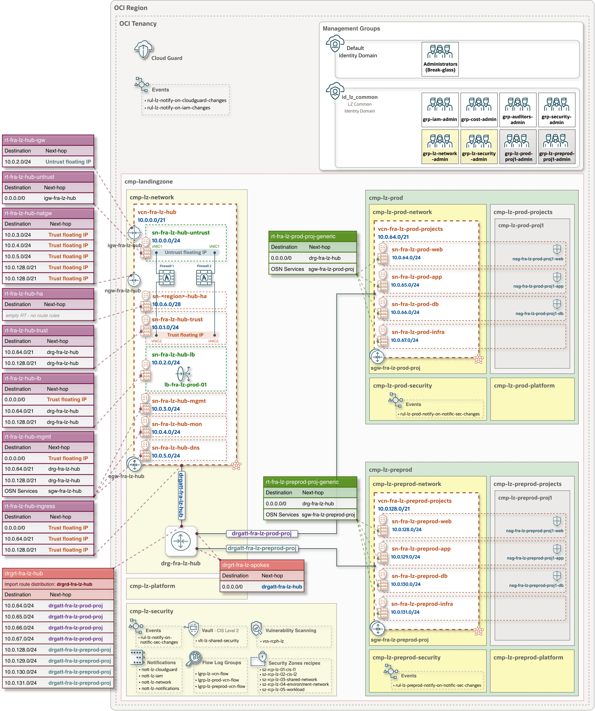

 # **One-OE + Hub D: One-Stack Deployment**
 
 ### Overview
 This document describes the architecture, components, routing, and deployment requirements of the One-OE Landing Zone with the [**Hub D addon**](/addons/oci-hub-models/hub_d/readme.md). Hub D uses a pair of third-party firewalls in an **Active/Passive** deployment, with one firewall inspecting traffic while the other remains on standby. Floating private IPs on the trust and untrust interfaces direct traffic to the active firewall and provide the route targets for failover.

&nbsp; 

 ### Deployment diagram

The diagram provides a comprehensive visual representation of the key OCI resources - such as Identity Domains, groups, compartments, IP CIDR ranges, and route table configurations - including example naming conventions and the intended Hub D routing.

&nbsp; 

> [!NOTE]
> - Third-party firewall appliances, HA configuration, floating-IP failover automation, and firewall policies must be supplied separately. The diagram does not imply that these components are deployed by the published JSON files.
> 
> - In the JSON configurations, the default OCI region is set to Frankfurt, and this is reflected in the naming conventions (e.g., vcn-**fra**-lz-hub). For deployments in other regions, the JSON configurations must be updated accordingly to ensure that the resource names align with the target region.

&nbsp;

Two deployment options are available: One-Stack deployment with **CIS Level 1** and **CIS Level 2** security controls.

- **CIS Level 1** is recommended in scenarios where:
  - CIS Level 1 Security Controls meet your security requirements.
  - You are exploring or testing configurations and need to deploy and tear down environments quickly.
  - You are creating a proof-of-concept (PoC) environment.

- **CIS Level 2** is recommended in scenarios where:
  - Your security requirements mandate CIS Level 2 Security Controls (for example, deploying a Vault to manage your encryption keys and force the encryption of all your data with them, block storage, object storage, etc.).

&nbsp; 

For details on the Security Zone policies included in each deployment option, see [Security Zones - CIS Level 1](./sz_recipes_cis1.md) and [Security Zones - CIS Level 2](./sz_recipes_cis2.md).

&nbsp; 

---

 ### Input configurations for **CIS Level 1** 

| JSON configurations | Configuration-defined components | 
|:-|:-|
| **IAM configuration**  [oneoe_iam.json](oneoe_iam.json) | • Compartments  • Identity Domain  • IAM groups and policies |
| **Governance configuration**  [oneoe_governance.json](oneoe_governance.json)| • Tag namespace   • Tag key definition|
| **Network configuration**: Hub D network configuration | • [Hub D](/addons/oci-hub-models/hub_d/readme.md) VCN with associated subnets   • Trust and untrust floating private IP route targets for the Active/Passive firewall pair   • Dedicated HA subnet   • NAT Gateway   • Internet and Service Gateways  • Dynamic Routing Gateway (DRG)  • Route Tables with corresponding route rules  • Two Spoke VCNs (Prod and PreProd) with private-only subnets   • Service gateways in the Spoke VCNs  • Security Lists (SLs) and Network Security Groups (NSGs). Hub D-specific rules must cover the selected firewall HA solution and inspected traffic.   • Public Load Balancer ([free tier LBaaS](https://docs.oracle.com/en-us/iaas/Content/FreeTier/freetier_topic-Always_Free_Resources.htm#loadbalancing)) with two example backend IP addresses from the production web tier: 10.0.64.10 and 10.0.64.20. The LBaaS and backend configurations are provided solely for example purposes and should be updated to reference actual workload instances |
| **Security configuration** for   **Step 1**: [oneoe_security_cis1_pre.json](oneoe_security_cis1_pre.json)  and  **Step 2**: [oneoe_security_cis1.json](oneoe_security_cis1.json)   | • Cloud Guard  • [Security Zones and recipes (CIS Level 1)](./sz_recipes_cis1.md)  • Vulnerability Scanning |
| **Observability configuration** for  **Step 1**: [oneoe_observability_cis1_pre.json](oneoe_observability_cis1_pre.json)  and  **Step 2**: [oneoe_observability_cis1.json](oneoe_observability_cis1.json) &nbsp;&nbsp;&nbsp;&nbsp;&nbsp;&nbsp;&nbsp;&nbsp;&nbsp;&nbsp;&nbsp;&nbsp;&nbsp;&nbsp;&nbsp;&nbsp;&nbsp;&nbsp;&nbsp;&nbsp;&nbsp;&nbsp;&nbsp;&nbsp;&nbsp;&nbsp;&nbsp;&nbsp;&nbsp;&nbsp;&nbsp;&nbsp;&nbsp;&nbsp;&nbsp;&nbsp;&nbsp;&nbsp;&nbsp;&nbsp;&nbsp;&nbsp;&nbsp;&nbsp;&nbsp;&nbsp;&nbsp; | • Events  • Alarms  • Logging  • Notifications |

&nbsp;

### Deploy with OCI Resource Manager (ORM) - **CIS Level 1**

#### Step 1: 
  Create an ORM stack using the Orchestrator and the IAM, governance, security, observability, and Hub D network configurations listed above. 

And follow these steps:
  1. Accept terms, wait for the configuration to load.
  2. Set the working directory to “rms-facade”.
  3. Set the stack name you prefer.
  4. Set the terraform version to 1.5.x. Click Next.
  5. Accept the default files. Click Next. Optionally, replace with your json/yaml config files.
  6. Un-check run apply. Click Create.
  
#### Step 2: 
  The following updates, or only those relevant to your deployment - should be performed after the **Step 1** stack and all Landing Zone components have been deployed. This phase updates the **Step 1** ORM stack to add additional Security Zone Recipes and enable Network Flow Logs. Keep the reviewed Hub D network configuration selected and integrate the real floating-IP route targets when the firewall pair is ready. All required updates can be applied in a single operation by replacing the corresponding configuration files as described below.
  

  1. **Active/Passive firewall integration**: 
     - Deploy the third-party firewall pair and configure its vendor-supported HA integration using the dedicated HA subnet, firewall policies, and address translation.
     - Configure the trust and untrust floating private IPs and ensure that both follow the active firewall during failover.
     - Confirm that the hub ingress, gateway ingress, and relevant subnet route tables reference the intended trust or untrust floating private-IP targets.
     - Validate spoke-to-spoke traffic, internet egress, public ingress, load balancer backend connections, and their return paths. Perform a controlled failover and confirm that the standby takes over both floating IPs before enabling workload traffic.

  2. **Security - Security Zones, Vulnerability Scanning Service**:  
    Use the configuration [oneoe_security_cis1.json](oneoe_security_cis1.json) to complete the security implementation by adding the following components:
      - Security Zone Targets to apply more restrictive Security Zone Recipes to the following compartments: Hub network compartment and Production compartment. 
      - Vulnerability Scanning on all Host targets within the Landing Zone enclosing compartment.
    
  3. **Observability - Flow Logs**: 
     - Use the configuration [oneoe_observability_cis1.json](oneoe_observability_cis1.json) to enable flow logs for your VCNs and Subnets.  Note that by default, VCN and Subnet flow logs are not deployed. The first 10 GB of log storage per month is free. This configuration creates a log group for the shared network and for each network environment. Actual log storage usage will depend on the amount of traffic in your VCNs and subnets, which may exceed the free monthly quota.

&nbsp; 

Once all required updates are applied, rerun the ORM stack.

&nbsp;

---

 ### Input configurations for **CIS Level 2** 

| JSON configurations | Configuration-defined components | 
|:-|:-|
| **IAM configuration**  [oneoe_iam.json](oneoe_iam.json) | • Compartments  • Identity Domain  • IAM groups and policies |
| **Governance configuration**  [oneoe_governance.json](oneoe_governance.json)| • Tag namespace   • Tag key definition|
| **Network configuration**: Hub D network configuration | • [Hub D](/addons/oci-hub-models/hub_d/readme.md) VCN with associated subnets   • Trust and untrust floating private IP route targets for the Active/Passive firewall pair   • Dedicated HA subnet   • NAT Gateway   • Internet and Service Gateways  • Dynamic Routing Gateway (DRG)  • Route Tables with corresponding route rules  • Two Spoke VCNs (Prod and PreProd) with private-only subnets   • Service gateways in the Spoke VCNs  • Security Lists (SLs) and Network Security Groups (NSGs). Hub D-specific rules must cover the selected firewall HA solution and inspected traffic.   • Public Load Balancer ([free tier LBaaS](https://docs.oracle.com/en-us/iaas/Content/FreeTier/freetier_topic-Always_Free_Resources.htm#loadbalancing)) with two example backend IP addresses from the production web tier: 10.0.64.10 and 10.0.64.20. The LBaaS and backend configurations are provided solely for example purposes and should be updated to reference actual workload instances |
| **Security configuration** for   **Step 1**: [oneoe_security_cis2_pre.json](oneoe_security_cis2_pre.json)  and  **Step 2**: [oneoe_security_cis2.json](oneoe_security_cis2.json)   | • Cloud Guard  • [Security Zones and recipes (CIS Level 2)](./sz_recipes_cis2.md)  • Vulnerability Scanning  • Vault and Software Key |
| **Observability configuration** for  **Step 1**: [oneoe_observability_cis2_pre.json](oneoe_observability_cis2_pre.json)  and  **Step 2**: [oneoe_observability_cis2.json](oneoe_observability_cis2.json) &nbsp;&nbsp;&nbsp;&nbsp;&nbsp;&nbsp;&nbsp;&nbsp;&nbsp;&nbsp;&nbsp;&nbsp;&nbsp;&nbsp;&nbsp;&nbsp;&nbsp;&nbsp;&nbsp;&nbsp;&nbsp;&nbsp;&nbsp;&nbsp;&nbsp;&nbsp;&nbsp;&nbsp;&nbsp;&nbsp;&nbsp;&nbsp;&nbsp;&nbsp;&nbsp;&nbsp;&nbsp;&nbsp;&nbsp;&nbsp;&nbsp;&nbsp;&nbsp;&nbsp;&nbsp;&nbsp;&nbsp; | • Events  • Alarms  • Logging  • Notifications |

&nbsp;

### Deploy with OCI Resource Manager (ORM) - **CIS Level 2**

#### Step 1: 
  Create an ORM stack using the Orchestrator and the IAM, governance, security, observability, and Hub D network configurations listed above. 

And follow these steps:
  1. Accept terms, wait for the configuration to load.
  2. Set the working directory to “rms-facade”.
  3. Set the stack name you prefer.
  4. Set the terraform version to 1.5.x. Click Next.
  5. Accept the default files. Click Next. Optionally, replace with your json/yaml config files.
  6. Un-check run apply. Click Create.

#### Step 2: 
Follow the same procedure described in [Deploy with OCI Resource Manager (ORM) - CIS Level 1: Step 2](#step-2), using the JSON configuration files specific to CIS Level 2.

---

&nbsp;

# License

Copyright (c) 2026 Oracle and/or its affiliates.

Licensed under the Universal Permissive License (UPL), Version 1.0.

See [LICENSE](/LICENSE.txt) for more details.
