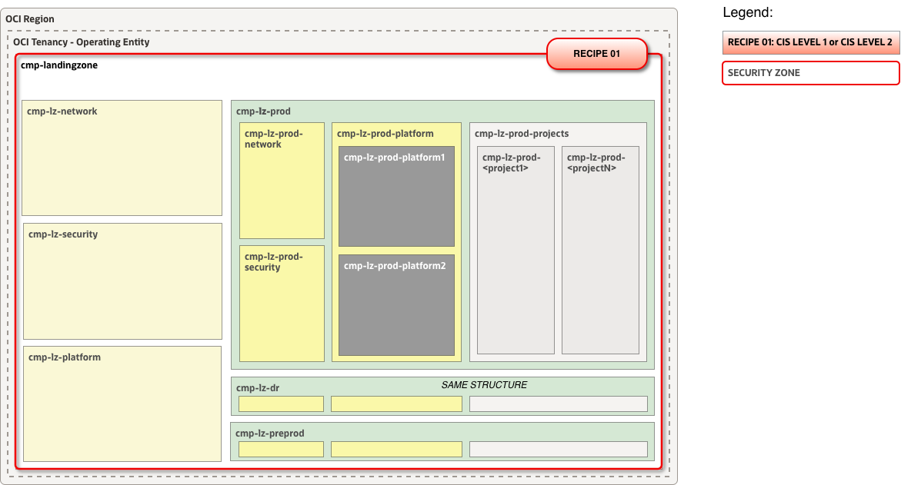

## **[Security Zone Recipes for CIS Level 2](#)**
### Overview

The published One-OE blueprint deploys Recipe 01 only. This reference describes that baseline and the optional Recipe 02 for selected environments available through the [OCI Security Zones add-on](./README.md).

Recipe 01 remains owned by the base landing-zone stack. Deploy selected additional zones in a separate stack after the landing zone is complete. Choose the same CIS level as the baseline.

For deployable files, ownership requirements and plan/apply steps, see the [add-on deployment guide](./README.md).

The base [oneoe_security_cis2.json](../../blueprints/one-oe/runtime/one-stack/oneoe_security_cis2.json) file configures Recipe 01, Cloud Guard, Vulnerability Scanning and the CIS2 Vault and key from the initial deployment onwards. Keep that same security file for subsequent base-stack updates; additional recipes are owned by the add-on stack.

&nbsp;
#### [Security Zone](https://docs.oracle.com/en-us/iaas/Content/security-zone/using/security-zones.htm) and [Recipe](https://docs.oracle.com/en-us/iaas/Content/security-zone/using/managing-recipes.htm) assignment across the [One-OE](https://github.com/oci-landing-zones/oci-landing-zone-operating-entities/tree/master/blueprints/one-oe) Landing Zone compartment hierarchy

&nbsp;

> [!IMPORTANT]
> - These Security Zone recipes provide a minimum baseline of security controls for **CIS Level 2** environments. Additional Security Zone policies and controls should be implemented to align with organizational security requirements, compliance obligations, and risk tolerance.
>
> - Security Zone policies are enforced based on the recipe assigned to the Security Zone associated with a compartment. When a child compartment is assigned a different Security Zone, only the policies defined in that Security Zone's recipe are enforced for resources within the child compartment.

&nbsp;
&nbsp;

#### Reference:
- [Oracle Cloud Infrastructure Documentation - Security Zone Policies](https://docs.oracle.com/en-us/iaas/Content/security-zone/using/security-zone-policies.htm)

&nbsp;

# License 

Copyright (c) 2026 Oracle and/or its affiliates.

Licensed under the Universal Permissive License (UPL), Version 1.0.

See [LICENSE](/LICENSE.txt) for more details.
