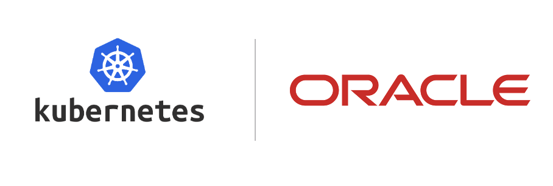

# **[OKE Landing Zone Extension](#)**   <!-- omit from toc -->
## **An OCI Open LZ [Workload Extensions](#) to Reduce Your Time-to-Production** <!-- omit from toc -->

 
&nbsp; 

Welcome to the **OKE Landing Zone Extension**.

The OKE Landing Zone Extension is a secure cloud environment, designed with the best practices to simplify the on-boarding of OKE workloads and enable the continuous operations of their cloud resources. This reference architecture provides an automated landing zone configuration.

Use the [**Simple OKE deployment**](./simple) to deploy one OKE cluster in a production environment from the published configuration, or use config-driven generation to add the environments and OKE platforms required by your design.

The supported contract requires Orchestrator **v2.4.1** with CIS OKE **v0.3.0**. Published and Blueprint Factory packages use one `oke.json`, mapping cluster keys to cluster configuration and managed worker pools. See the [OKE generation guide](simple/oke-blueprint-factory.md#10-generated-output-contract).

> **Migration warning:** Existing deployments require Terraform state and input migration. Do not simply apply the new generated files to existing state.

&nbsp;

## License <!-- omit from toc -->

Copyright (c) 2026 Oracle and/or its affiliates.

Licensed under the Universal Permissive License (UPL), Version 1.0.

See [LICENSE](/LICENSE.txt) for more details.
